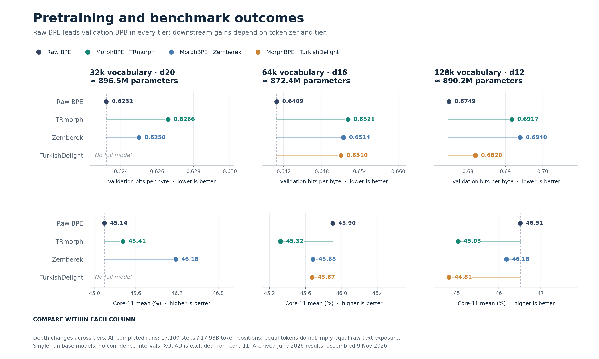

# Tokenizer and language-model study results

Consolidated **9 November 2026** from checked-in GitHub artifacts, recovered UHeM outputs, checkpoint metadata, and evaluation logs. Historical measurements are reported first, followed by recovered results and the newly completed matched intrinsic evaluation. Recovery dates are not new experiment dates for the historical runs. Source paths, source hashes, original scores, and missing-result states accompany the machine-readable exports.

## 1. Previously reported results

The historical evidence is retained before adding the recovered measurements. The June 9, June 12, and June 22 model tables partly describe the same runs; they are not independent repetitions.

| Evidence already available | Coverage | Tables and original evidence |
| --- | --- | --- |
| Intrinsic tokenizer comparison | 12 local tokenizers: raw BPE, TRmorph, Zemberek, TurkishDelight × 32k/64k/128k; 50,000 train documents | [All intrinsic metrics and definitions](tokenizer_results.md); [original comparison](../tokenizer_tests/tokenizer_metrics/tokenizer_metrics_comparison.md) |
| External tokenizer references | Kumru and Cosmos tokenizer diagnostics on the same 50k-document corpus | [External-reference tables](tokenizer_results.md#external-tokenizer-references) |
| Historical normalizing tokenizer references | BERTurk, TURNA and VBART results recovered from Git history, with failed roundtrips clearly labeled | [Historical reference diagnostics](tokenizer_results.md) |
| Additional tokenizer/segmenter diagnostics | Raw-text Zemberek diagnostic, analyzer throughput/coverage, and 500-item blind local judge | [Archived diagnostics](tokenizer_results.md); [segmenter log](../tokenizer_tests/segmenter_benchmark_status.md); [judge table](../tokenizer_tests/codex_local_judge_results.md) |
| Controlled tokenizer-to-model ablation | 11 completed models, 3 vocabulary/depth tiers, 17,100 steps each; 132 common task scores | [BPB, CETVEL, per-task scores, deltas and performance](model_results.md); [June 22 artifact](../../artifacts/cetvel_core12_tokenizer_ablation_2026-06-22/) |
| Earlier model evidence | Raw-BPE-only tasks/submetrics, three-model June 12 comparison, d2 pipeline smoke | [Historical model results](model_results.md); [June 9](../../artifacts/cetvel_base_subset_2026-06-09_job493293/), [June 12](../../artifacts/cetvel_core12_model_comparison_2026-06-12/), [June 7 smoke](../../artifacts/uhem_smoke_2026-06-07_job492393/) |

## 2. Recovered and newly completed results added to GitHub

| Recovered evidence | What the new tables add | Report |
| --- | --- | --- |
| Completed full-corpus tokenizer job `496882` | All 12 tokenizers over 93,211,827 train documents / 299.17 GB; common 500k word caps; compression, morphology, boundary preservation, reversibility, and recorded runtime | [Full-corpus intrinsic results](tokenizer_full_corpus.md) |
| Completed 100k- and 1M-document intrinsic runs; raw-BPE train/validation diagnostics | 26 additional measurement rows with sample sizes, reference availability and runtime | [Additional intrinsic results](tokenizer_additional.md) |
| Original checkpoint metadata and CETVEL results | Full-precision scores, model shapes, stored training time, task metrics and available standard errors, with legacy rounded values retained | [Model results and performance](model_results.md) |
| Longer d20 raw-BPE training | Step 34,200 checkpoint, longer token budget, recorded BPB and training time | [Additional LLM configurations](model_configuration_results.md) |
| Larger d32 raw-BPE model | Step 28,000 checkpoint, model size/configuration, training performance, broader CETVEL task/category scores | [Additional LLM configurations and benchmarks](model_configuration_results.md) |
| d32/raw-BPE32k SFT configuration screens | 27 diagnostic rows across learning rates, checkpoints and curricula; retained/rejected candidates and missing scores explicit | [SFT configuration screens](sft_configuration_screens.md) |
| Corrected generation evaluations | Separate d20/d32 XQuAD results plus other protocol-specific d32 diagnostics | [Protocol-specific results](model_configuration_results.md#generation-protocol-corrected-xquad) |
| New matched intrinsic job `558060`, completed 9 November | 24 measurements: all 12 tokenizers × train/validation; 50k documents per split, matching 500k word caps; intact-morpheme coverage, character-only coverage and boundary P/R/F1 | [Matched train/validation intrinsic results](tokenizer_matched.md) |

The d32 checkpoint's BPB evaluation includes text used in training. It is a **train-overlap diagnostic**, not a held-out score comparable with the original model matrix. Corrected-generation QA results are also kept separate from the legacy tokenizer ablation. A continuation or architecture change is a configuration study, not a controlled tokenizer effect.

## 3. Main tokenizer-ablation outcomes

The table puts every tokenizer beside its trained-model result. Intrinsic columns use the recovered full training corpus (capped morphology analysis); BPB and core-11 use the original 17,100-step model ablation. Training speed is the median of the final 100 printed steps on the recorded four-A100 setup. These columns measure different tasks and do not form a composite score.

Compare tokenizer families within a vocabulary/depth tier. Across tiers, both vocabulary and depth change. `—` means no completed model result. Core-11 excludes XQuAD; the legacy and corrected QA protocols have their own tables.

<!-- BEGIN GENERATED TOKENIZER MODEL OVERVIEW -->

| Vocabulary / depth | Tokenizer | Corpus tokens/word ↓ | Morph consistency F1 ↑ | Val BPB ↓ | Core-11 ↑ | Training k tokens/s |
| --- | --- | ---: | ---: | ---: | ---: | ---: |
| 32k / d20 | Raw BPE | 1.5553 | 0.3241 | 0.6232 | 0.4514 | 235.8 |
| 32k / d20 | MorphBPE / TRmorph | 1.7698 | 0.5129 | 0.6266 | 0.4541 | 236.1 |
| 32k / d20 | MorphBPE / Zemberek | 1.7551 | 0.4357 | 0.6250 | 0.4618 | 235.3 |
| 32k / d20 | MorphBPE / TurkishDelight | 1.6865 | 0.4795 | — | — | — |
| 64k / d16 | Raw BPE | 1.4328 | 0.2863 | 0.6409 | 0.4590 | 329.4 |
| 64k / d16 | MorphBPE / TRmorph | 1.6712 | 0.4421 | 0.6521 | 0.4532 | 329.9 |
| 64k / d16 | MorphBPE / Zemberek | 1.6640 | 0.3743 | 0.6514 | 0.4568 | 329.9 |
| 64k / d16 | MorphBPE / TurkishDelight | 1.5651 | 0.4296 | 0.6510 | 0.4567 | 331.1 |
| 128k / d12 | Raw BPE | 1.3473 | 0.2412 | 0.6749 | 0.4651 | 451.9 |
| 128k / d12 | MorphBPE / TRmorph | 1.5952 | 0.3786 | 0.6917 | 0.4503 | 454.6 |
| 128k / d12 | MorphBPE / Zemberek | 1.5916 | 0.3330 | 0.6940 | 0.4618 | 455.0 |
| 128k / d12 | MorphBPE / TurkishDelight | 1.4715 | 0.3971 | 0.6820 | 0.4481 | 453.7 |

<!-- END GENERATED TOKENIZER MODEL OVERVIEW -->

MorphBPE improves the recorded automatic-reference morphology metrics while using more document tokens per word. Raw BPE leads validation BPB in all three controlled tiers; downstream differences depend on the tokenizer and task. These single-run results do not establish statistical significance. The full tables show every tokenizer, including the missing 32k TurkishDelight model cell.



[Per-task changes figure](figures/cetvel_task_deltas.png) · [Historical 50k-document compression/boundary figure](figures/tokenizer_efficiency_boundary_tradeoff.png). Figures describe the June controlled ablation and historical 50k sample; the separately recovered full-corpus and later-model results are in their tables.

## 4. Downloads and rebuilding

| Dataset | Markdown | CSV | JSON with provenance |
| --- | --- | --- | --- |
| New matched train/validation intrinsic measurements | [Tables](tokenizer_matched.md) | [CSV](tokenizer_matched.csv) | [JSON](tokenizer_matched.json) |
| Historical intrinsic measurements | [Tables](tokenizer_results.md) | [CSV](tokenizer_results.csv) | [JSON](tokenizer_results.json) |
| Full-corpus intrinsic measurements | [Tables](tokenizer_full_corpus.md) | [CSV](tokenizer_full_corpus.csv) | [JSON](tokenizer_full_corpus.json) |
| Additional 100k/1M and raw-BPE train/validation diagnostics | [Tables](tokenizer_additional.md) | [CSV](tokenizer_additional.csv) | [JSON](tokenizer_additional.json) |
| Original model summaries and performance | [Tables](model_results.md) | [CSV](model_results.csv) | [JSON](model_results.json) |
| Additional LLM configurations | [Tables](model_configuration_results.md) | [CSV](model_configuration_results.csv) | [JSON](model_configuration_results.json) |
| All recovered task metrics, including auxiliary scores | [Protocol guide](model_configuration_results.md) | [CSV](model_all_task_metrics.csv) | [Original models](model_results.json), [additional configurations](model_configuration_results.json) |
| d32 CETVEL table-compatible task scores | [Tables](model_configuration_results.md#all-official-protocol-task-scores) | [CSV](model_official_task_metrics.csv) | [JSON](model_configuration_results.json) |
| Model training time, throughput, memory and MFU | [Tables](model_results.md#training-throughput-memory-and-scheduler-time) | [CSV](model_training_performance.csv) | [JSON](model_results.json) |
| SFT learning-rate/checkpoint screens | [Tables](sft_configuration_screens.md) | [CSV](sft_configuration_screens.csv) | [JSON](sft_configuration_screens.json) |
| Historical 132 common task scores | [Tables](model_results.md) | [CSV](model_task_metrics.csv) | [JSON](model_results.json) |

From the repository root:

```bash
python3 -m scripts.build_tokenizer_study_results
python3 -m scripts.build_fresh_tokenizer_results
python3 -m scripts.build_model_study_results
python3 -m scripts.build_sft_configuration_results
python3 -m scripts.build_study_overview
MPLCONFIGDIR=/tmp/nanochat-mpl python3 -m scripts.plot_study_results
```

The table builders use Python's standard library and saved measurements; charts additionally require matplotlib and NumPy. Rebuilding tables does not run training or evaluation. The original source artifacts remain available, and the builders preserve full precision and verify carry-forward consistency.

## 5. Coverage and remaining gaps

- The 32k/d20 TurkishDelight tokenizer exists, but a completed matched language model is absent from the verified inventory.
- Intrinsic morphology uses an automatic TRmorph reference. The historical corpora are training data; the new matched report additionally samples the reserved validation shard. That shard was also included in the later all-shard d32 training. No independent gold morphology test result is available.
- Historical word-level caps differ in the 50k-document evaluation; the recovered full-corpus pass uses equal 500k caps. Full-corpus does not mean every word received the capped morphology analysis.
- Per-morpheme intact-token coverage, character-only coverage and explicit boundary precision/recall/F1 were absent from the June outputs. They are now reported separately for all 24 tokenizer/split measurements in the completed matched evaluation; historical nulls remain null.
- Fixed token budgets do not establish equal raw-text training exposure. Timing tables state the recorded runtime definition and concurrency; they are not hardware-controlled speed rankings.
- Available benchmark standard errors are preserved where supplied. They are not repeated-training-seed uncertainty or paired significance tests.
- SFT custom-screen results use one tokenizer (raw BPE 32k), with their own dataset and probe definitions; they do not add a multi-tokenizer SFT ablation. Pending jobs and unscored checkpoints are not assigned benchmark values.

[Method, paper alignment and research limitations](../../MorphBPE-alignment.md) · [Experimental design](../tokenizer_ablation_plan.md) · [Artifact index](../../artifacts/README.md)
