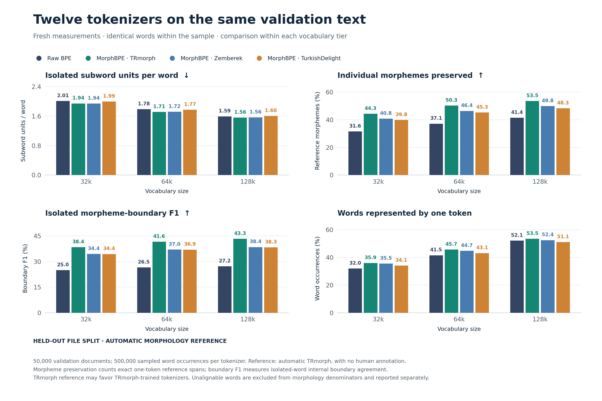
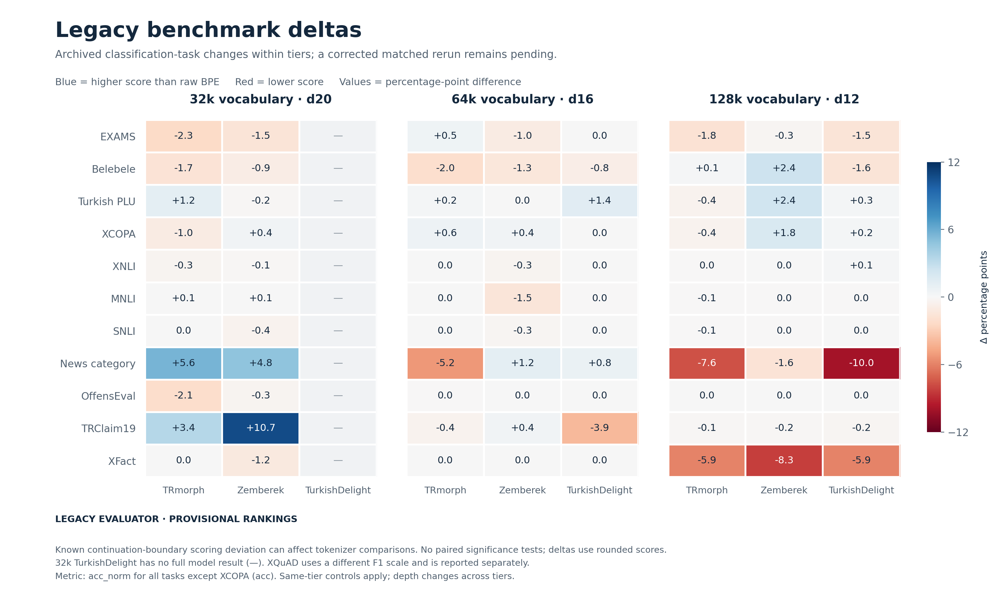
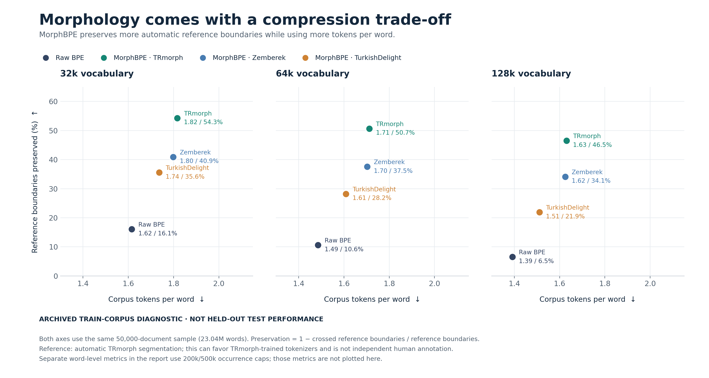
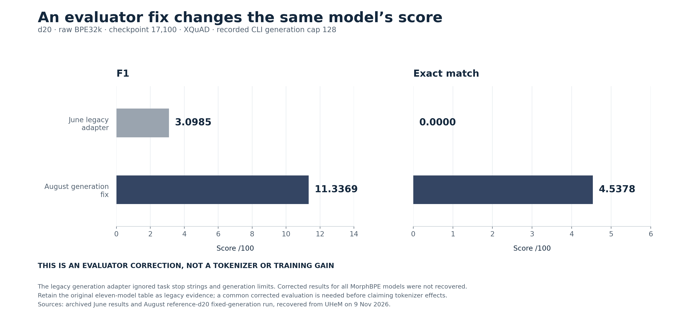

<a id="study-results"></a>

# nanochat-turk — complete study report

**One page for the study, updated 9 November 2026.** The significant intrinsic, extrinsic, later-model and historical results are collected below. Supporting exports are in [`data/`](data/), raw run evidence in [`provenance/`](provenance/), and figures in [`figures/`](figures/). Older file versions remain in Git history.

**Reading the tables:** ↑ higher is better, ↓ lower is better for the stated objective, ↔ descriptive/trade-off. **Bold scores** are the best comparable displayed values, including ties, within vocabulary/sample/protocol groups. They are not significance claims. Legacy benchmark rankings remain provisional.

## On this page

- [Study summary and comparison overview](#overview)
- [Fresh intrinsic tokenizer assessment](#fresh-tokenizers)
- [Original model pretraining and extrinsic benchmarks](#original-models)
- [Later d20/d32 configurations and benchmarks](#model-configurations)
- [Evaluator corrections and model provenance](#evaluator-audit)
- [SFT configuration experiments](#sft-configurations)
- [Recovered full-corpus tokenizer measurements](#full-corpus-tokenizers)
- [Earlier tokenizer measurements and external references](#historical-tokenizers)
- [Additional 100k/1M and diagnostic runs](#additional-tokenizers)
- [Metric definitions and better directions](#metric-guide)
- [Reproduction, evidence and historical source revisions](#reproduction)
- [Presentation figures](#figures)
- [Download data](#downloads)

Historical and supporting sections expand in place: use **Show section** beneath their headings. You do not need to switch report files.

<a id="overview"></a>

## Study summary

This study compares **12 tokenizers**: raw BPE and MorphBPE with TRmorph,
Zemberek and TurkishDelightNLP boundaries at **32,768 / 65,536 / 131,072**
vocabulary sizes. The original model matrix has **11 completed models**;
32k TurkishDelight remains tokenizer-only. Work continues on **main**, and all
historical branch commits and measured evidence are retained.

- **Fresh intrinsic assessment:** all requested metrics are measured on matched
  50,000-document training and validation samples, with 500,000 word occurrences
  per tokenizer/split. The validation shard belongs to the original tokenizer
  split; later all-shard d32 training also used this text.
- **Morphology:** TRmorph leads validation morpheme preservation and boundary F1
  at all three vocabulary sizes. At 32k, preservation is **44.30% versus 31.57%**
  for raw BPE, and boundary F1 is **38.38% versus 24.96%**. The reference is
  automatic TRmorph, not independent human-gold annotation. The older pairwise
  consistency metric has a different winner at 128k on training/full-corpus data:
  TurkishDelight scores **0.3971**, versus TRmorph's **0.3786**.
- **Compression:** raw BPE uses the fewest document tokens per word within every
  vocabulary tier. Isolated-word fertility is a different objective: Zemberek
  is slightly best at 32k validation; TRmorph is best at 64k/128k.
- **Pretraining:** raw BPE has the lowest archived validation BPB in every tier
  (**0.6232 / 0.6409 / 0.6749**). Architecture is held fixed within each tier;
  across tiers depth changes d20/d16/d12. Equal token budgets do not establish
  equal raw-text exposure or identical evaluation spans.
- **Extrinsic results:** the original CETVEL rankings are **provisional** because
  the evaluator had generation and likelihood-boundary bugs. Correcting the
  evaluator changes the same d20 checkpoint's XQuAD F1 from **3.0985 to 11.3369**.
  A complete corrected eleven-model rerun remains outstanding.
- **Later experiments:** the d20 continuation and the **dsai-3b-base** d32 model
  change training budget or architecture. d32's **0.519040 BPB overlaps training
  text** and cannot establish held-out superiority. Its **37.1709/100**
  table-compatible CETVEL receipt has its own scoring protocol. SFT screens use
  only raw BPE 32k and selection probes, so they do not add a multi-tokenizer SFT
  comparison.

The sections below preserve both current and historical measurements, including
full-corpus, 100k/1M, external-tokenizer, analyzer and SFT evidence. There is one
fresh tokenizer report/export for job **558060**; its formerly separate matched
report supplied additional diagnostic columns that are now included here.

<a id="overview-comparison"></a>

### Original model matrix beside tokenizer diagnostics

Intrinsic columns below use the recovered full training corpus with capped morphology analysis. Models use the original step-17,100 matrix. Training speed is the recorded final-100-step median on four A100s. Compare within each tier; these different objectives do not form a composite score.

| Vocabulary / depth ↔ | Tokenizer | Corpus tokens/word ↓ | Morph consistency F1 ↑ | Val BPB ↓ | Legacy core-11 ↑ | Training k tokens/s ↑ |
| --- | --- | ---: | ---: | ---: | ---: | ---: |
| 32k / d20 | Raw BPE | **1.5553** | 0.3241 | **0.6232** | 0.4514 | 235.8 |
| 32k / d20 | MorphBPE / TRmorph | 1.7698 | **0.5129** | 0.6266 | 0.4541 | **236.1** |
| 32k / d20 | MorphBPE / Zemberek | 1.7551 | 0.4357 | 0.6250 | **0.4618** | 235.3 |
| 32k / d20 | MorphBPE / TurkishDelight | 1.6865 | 0.4795 | — | — | — |
| 64k / d16 | Raw BPE | **1.4328** | 0.2863 | **0.6409** | **0.4590** | 329.4 |
| 64k / d16 | MorphBPE / TRmorph | 1.6712 | **0.4421** | 0.6521 | 0.4532 | 329.9 |
| 64k / d16 | MorphBPE / Zemberek | 1.6640 | 0.3743 | 0.6514 | 0.4568 | 329.9 |
| 64k / d16 | MorphBPE / TurkishDelight | 1.5651 | 0.4296 | 0.6510 | 0.4567 | **331.1** |
| 128k / d12 | Raw BPE | **1.3473** | 0.2412 | **0.6749** | **0.4651** | 451.9 |
| 128k / d12 | MorphBPE / TRmorph | 1.5952 | 0.3786 | 0.6917 | 0.4503 | 454.6 |
| 128k / d12 | MorphBPE / Zemberek | 1.5916 | 0.3330 | 0.6940 | 0.4618 | **455.0** |
| 128k / d12 | MorphBPE / TurkishDelight | 1.4715 | **0.3971** | 0.6820 | 0.4481 | 453.7 |

Raw BPE leads document compression and archived BPB in every tier. TRmorph leads this historical pairwise consistency metric at 32k/64k; TurkishDelight leads at 128k. The legacy core-11 leaders are Zemberek at 32k and raw BPE at 64k/128k, pending the corrected common rerun. Within-tier speed differences are under 1% and do not establish a tokenizer speed advantage.

<a id="fresh-tokenizers"></a>

## Fresh intrinsic tokenizer assessment

**Direction legend:** ↑ means higher is better for the stated objective; ↓ means lower is better; ↔ means descriptive or a tradeoff, with no universally better direction. See the [metric guide](#metric-guide) for every definition, denominator and limitation.

**Bold scores** mark the best comparable value for that metric within the same vocabulary and table's split/sample; all ties at displayed precision are bold. They do not identify an overall winner. Descriptive fields, uncontrolled timings, normalizing references and groups with only one measured value stay unbolded. Analyzer fallback is compared only on the common hash-100k screen; judge scores only within the shared scripted rubric.

**Objectives:** lower tokens/word and higher bytes/token mean more compact lossless encoding. Higher one-token coverage helps isolated-word compression only. Higher morphology preservation, boundary agreement and consistency, or lower morphology edit distance, mean closer agreement with the automatic reference; they do not establish better LLM performance. Lower multi-character character-only coverage means less character-level fragmentation.

**Diagnostics:** vocabulary size, vocabulary use, sample counts, inclusive character-only/byte-only coverage and resample SD have no universal optimum. Zero roundtrip failures is ideal for exact text recovery; fewer UNKs and alignment exclusions are better when applicable. Speed ↑ and time ↓ apply only to matched workloads and hardware; recorded timings here do not establish a controlled speed ranking. Normalizing references' apparent compression and boundary figures remain descriptive.

New measurements on UHEM, 9 November 2026. All twelve original tokenizer bundles receive identical raw text within each split; segmentation is reference-only. [Run/sample provenance](provenance/fresh_tokenizer_metrics/manifest.json), [full precision JSON](data/tokenizer_fresh_results.json), [CSV](data/tokenizer_fresh_results.csv), and [complete evaluator outputs](provenance/fresh_tokenizer_metrics) are retained.

The validation file is withheld by the repository's configured file split; training and validation sample hashes differ. This is an automatic TRmorph-reference diagnostic, not independently annotated human morphology. No model was retrained for this evaluation. Reserved validation refers to the original tokenizer-study split; the later d32 all-shard training run includes this source text, so it is not held out from every model in the repository.

<a id="fresh-tokenizers--validation"></a>

### Validation

50,000 documents; 161,056,183 UTF-8 bytes; 19,832,065 regex words. Word-level metrics use 500,000 occurrences per tokenizer. Identical word/reference hashes are required for all twelve rows.

| Vocab ↔ | Tokenizer | Corpus tok/word ↓ | Isolated tok/word ↓ | One-token words % ↑ compression | Character-only words % ↔ | Morphemes intact % ↑ | Isolated boundary P % ↑ | Isolated boundary R % ↑ | Isolated boundary F1 % ↑ |
|---:|---|---:|---:|---:|---:|---:|---:|---:|---:|
| 32,768 | Raw BPE | **1.5728** | 2.0076 | 32.00 | 2.43 | 31.57 | 18.87 | 36.88 | 24.96 |
| 32,768 | TRmorph | 1.7785 | 1.9414 | **35.89** | 2.35 | **44.30** | **29.70** | **54.23** | **38.38** |
| 32,768 | Zemberek | 1.7673 | **1.9400** | 35.48 | 2.36 | 40.79 | 26.63 | 48.56 | 34.40 |
| 32,768 | TurkishDelight | 1.6989 | 1.9949 | 34.11 | 2.37 | 39.81 | 26.09 | 50.34 | 34.37 |
| 65,536 | Raw BPE | **1.4483** | 1.7850 | 41.48 | 2.31 | 37.15 | 21.99 | 33.48 | 26.54 |
| 65,536 | TRmorph | 1.6775 | **1.7121** | **45.67** | 2.25 | **50.27** | **35.88** | **49.55** | **41.62** |
| 65,536 | Zemberek | 1.6733 | 1.7176 | 44.74 | 2.25 | 46.39 | 31.77 | 44.21 | 36.97 |
| 65,536 | TurkishDelight | 1.5760 | 1.7695 | 43.09 | 2.25 | 45.27 | 30.84 | 46.02 | 36.93 |
| 131,072 | Raw BPE | **1.3611** | 1.5902 | 52.07 | 2.24 | 41.39 | 25.48 | 29.16 | 27.20 |
| 131,072 | TRmorph | 1.6001 | **1.5576** | **53.45** | 2.22 | **53.55** | **41.69** | **45.09** | **43.33** |
| 131,072 | Zemberek | 1.5989 | 1.5639 | 52.42 | 2.23 | 49.83 | 36.78 | 40.23 | 38.43 |
| 131,072 | TurkishDelight | 1.4809 | 1.6022 | 51.07 | 2.22 | 48.26 | 35.52 | 41.49 | 38.27 |

**Interpretation:** Lowest corpus fertility: Raw BPE at 32k, 64k and 128k. Lowest isolated fertility: Zemberek at 32k; TRmorph at 64k and 128k. Highest one-token coverage, intact-morpheme preservation and boundary P/R/F1: TRmorph at 32k, 64k and 128k. TurkishDelight at 128k has both higher isolated fertility and lower one-token coverage than same-size raw BPE, despite its morphology improvements. These morphology rankings use the automatic TRmorph reference.

| Vocab ↔ | Tokenizer | Multi-character words split only into characters % ↓ fragmentation | Byte-only words % ↔ | Roundtrip failures ↓ (0 ideal) | UNK count ↓ | Scored / excluded morphology words ↔ / ↓ |
|---:|---|---:|---:|---:|---|---|
| 32,768 | Raw BPE | 0.29 | 2.27 | **0** | N/A (byte-complete) | 500,000 / 0 |
| 32,768 | TRmorph | **0.22** | 2.20 | **0** | N/A (byte-complete) | 500,000 / 0 |
| 32,768 | Zemberek | **0.22** | 2.21 | **0** | N/A (byte-complete) | 500,000 / 0 |
| 32,768 | TurkishDelight | 0.23 | 2.22 | **0** | N/A (byte-complete) | 500,000 / 0 |
| 65,536 | Raw BPE | 0.18 | 2.16 | **0** | N/A (byte-complete) | 500,000 / 0 |
| 65,536 | TRmorph | **0.11** | 2.11 | **0** | N/A (byte-complete) | 500,000 / 0 |
| 65,536 | Zemberek | **0.11** | 2.11 | **0** | N/A (byte-complete) | 500,000 / 0 |
| 65,536 | TurkishDelight | **0.11** | 2.11 | **0** | N/A (byte-complete) | 500,000 / 0 |
| 131,072 | Raw BPE | 0.10 | 2.10 | **0** | N/A (byte-complete) | 500,000 / 0 |
| 131,072 | TRmorph | 0.09 | 2.09 | **0** | N/A (byte-complete) | 500,000 / 0 |
| 131,072 | Zemberek | 0.09 | 2.09 | **0** | N/A (byte-complete) | 500,000 / 0 |
| 131,072 | TurkishDelight | **0.08** | 2.09 | **0** | N/A (byte-complete) | 500,000 / 0 |

**Interpretation:** All twelve tokenizers tie on observed roundtrip success and score all 500,000 morphology words without exclusions; UNK is N/A for every byte-complete tokenizer. Lowest multi-character character-only rate: TRmorph and Zemberek (tied at displayed precision) at 32k; TRmorph, Zemberek and TurkishDelight (tied at displayed precision) at 64k; TurkishDelight at 128k. Character-only and byte-only rates describe fragmentation, not independent evidence of linguistic quality.

<a id="fresh-tokenizers--compression-and-original-morphology-diagnostics"></a>

#### Compression and original morphology diagnostics

| Vocab ↔ | Tokenizer | Bytes/token ↑ | Morph edit ↓ | Normalized edit ↓ | Exact morph sequence % ↑ | Consistency P ↑ | Consistency R ↑ | Consistency F1 ↑ | Document boundaries preserved % ↑ |
|---:|---|---:|---:|---:|---:|---:|---:|---:|---:|
| 32,768 | Raw BPE | **5.1636** | 1.6572 | 1.2010 | 33.54 | 0.9582 | 0.2062 | 0.3393 | 14.52 |
| 32,768 | MorphBPE / TRmorph | 4.5663 | **1.3672** | **0.9903** | **43.42** | **0.9822** | **0.3402** | **0.5054** | **54.25** |
| 32,768 | MorphBPE / Zemberek | 4.5953 | 1.4415 | 1.0396 | 41.07 | 0.9803 | 0.3002 | 0.4596 | 40.48 |
| 32,768 | MorphBPE / TurkishDelight | 4.7801 | 1.4954 | 1.0945 | 39.16 | 0.9788 | 0.3175 | 0.4794 | 34.21 |
| 65,536 | Raw BPE | **5.6074** | 1.3907 | 0.9602 | 42.25 | 0.9759 | 0.1849 | 0.3108 | 9.17 |
| 65,536 | MorphBPE / TRmorph | 4.8410 | **1.0912** | **0.7398** | **53.38** | **0.9888** | **0.2920** | **0.4508** | **50.67** |
| 65,536 | MorphBPE / Zemberek | 4.8534 | 1.1803 | 0.8048 | 50.27 | 0.9883 | 0.2679 | 0.4215 | 37.00 |
| 65,536 | MorphBPE / TurkishDelight | 5.1528 | 1.2288 | 0.8525 | 48.24 | 0.9867 | 0.2774 | 0.4330 | 26.84 |
| 131,072 | Raw BPE | **5.9666** | 1.1853 | 0.7618 | 49.65 | 0.9868 | 0.1668 | 0.2853 | 5.37 |
| 131,072 | MorphBPE / TRmorph | 5.0752 | **0.9283** | **0.5818** | **59.66** | **0.9930** | **0.2569** | **0.4082** | **46.35** |
| 131,072 | MorphBPE / Zemberek | 5.0790 | 1.0144 | 0.6469 | 56.51 | 0.9923 | 0.2361 | 0.3814 | 33.67 |
| 131,072 | MorphBPE / TurkishDelight | 5.4839 | 1.0610 | 0.6900 | 54.15 | 0.9911 | 0.2479 | 0.3965 | 20.43 |

**Interpretation:** Best corpus compression (most bytes/token): Raw BPE at 32k, 64k and 128k. Lowest raw and normalized morphology edit distance: TRmorph at 32k, 64k and 128k. Highest pairwise consistency precision: TRmorph at 32k, 64k and 128k. Highest pairwise consistency recall: TRmorph at 32k, 64k and 128k. Highest original pairwise consistency F1: TRmorph at 32k, 64k and 128k. Highest exact-morpheme agreement: TRmorph at 32k, 64k and 128k. Highest document-boundary preservation: TRmorph at 32k, 64k and 128k. This pairwise consistency metric is distinct from literal boundary F1.

<a id="fresh-tokenizers--coverage-exclusions-and-recorded-runtime"></a>

#### Coverage exclusions and recorded runtime

All use one metric worker and eight tokenizer threads per process, with four tokenizer processes scheduled concurrently. Encoding throughput is tokens divided by accumulated encoding time (↑ only for matched conditions); producing more tokens can raise this rate without processing text faster. Document-pass wall time (↓ time; raw field `metric_wall_seconds`) includes document I/O, roundtrip and boundary accounting but ends before isolated-word, coverage and morphology computation. Parallel preliminary word collection also precedes this timer. These are recorded runtime diagnostics, not a controlled serial speed benchmark. Multi-character character-only coverage excludes one-character words from its denominator.

| Vocab ↔ | Tokenizer | Byte-only words % ↔ | Multi-char character-only % ↓ fragmentation | Coverage unaligned ↓ | Morphology unaligned ↓ | Roundtrip failures ↓ (0 ideal) | Encode M tok/s ↑ speed | Document-pass wall s ↓ time |
|---:|---|---:|---:|---:|---:|---:|---:|---:|
| 32,768 | Raw BPE | 2.27 | 0.29 | **0** | **0** | **0** | 5.804 | 85.43 |
| 32,768 | MorphBPE / TRmorph | 2.20 | **0.22** | **0** | **0** | **0** | 6.118 | 87.61 |
| 32,768 | MorphBPE / Zemberek | 2.21 | **0.22** | **0** | **0** | **0** | 6.180 | 85.68 |
| 32,768 | MorphBPE / TurkishDelight | 2.22 | 0.23 | **0** | **0** | **0** | 5.946 | 85.41 |
| 65,536 | Raw BPE | 2.16 | 0.18 | **0** | **0** | **0** | 5.488 | 83.72 |
| 65,536 | MorphBPE / TRmorph | 2.11 | **0.11** | **0** | **0** | **0** | 5.621 | 87.96 |
| 65,536 | MorphBPE / Zemberek | 2.11 | **0.11** | **0** | **0** | **0** | 5.433 | 88.91 |
| 65,536 | MorphBPE / TurkishDelight | 2.11 | **0.11** | **0** | **0** | **0** | 5.464 | 87.16 |
| 131,072 | Raw BPE | 2.10 | 0.10 | **0** | **0** | **0** | 5.008 | 86.56 |
| 131,072 | MorphBPE / TRmorph | 2.09 | 0.09 | **0** | **0** | **0** | 5.466 | 86.19 |
| 131,072 | MorphBPE / Zemberek | 2.09 | 0.09 | **0** | **0** | **0** | 5.482 | 86.24 |
| 131,072 | MorphBPE / TurkishDelight | 2.09 | **0.08** | **0** | **0** | **0** | 5.216 | 87.30 |

**Interpretation:** All rows tie at zero roundtrip failures and zero alignment exclusions. Lowest multi-character character-only rate: TRmorph and Zemberek (tied at displayed precision) at 32k; TRmorph, Zemberek and TurkishDelight (tied at displayed precision) at 64k; TurkishDelight at 128k. Highest recorded encoding tokens/s: Zemberek at 32k and 128k; TRmorph at 64k. These timings include concurrent-process contention, and more tokens/s can reflect producing more tokens rather than processing raw text faster.

<a id="fresh-tokenizers--training-sample"></a>

### Training sample

50,000 documents; 186,328,421 UTF-8 bytes; 23,042,031 regex words. Word-level metrics use 500,000 occurrences per tokenizer. Identical word/reference hashes are required for all twelve rows.

| Vocab ↔ | Tokenizer | Corpus tok/word ↓ | Isolated tok/word ↓ | One-token words % ↑ compression | Character-only words % ↔ | Morphemes intact % ↑ | Isolated boundary P % ↑ | Isolated boundary R % ↑ | Isolated boundary F1 % ↑ |
|---:|---|---:|---:|---:|---:|---:|---:|---:|---:|
| 32,768 | Raw BPE | **1.6157** | 2.0472 | 31.05 | 2.31 | 30.76 | 19.08 | 37.17 | 25.22 |
| 32,768 | TRmorph | 1.8166 | 1.9890 | **34.09** | 2.23 | **42.90** | **29.36** | **54.02** | **38.05** |
| 32,768 | Zemberek | 1.7986 | **1.9810** | 34.06 | 2.23 | 39.60 | 26.54 | 48.44 | 34.29 |
| 32,768 | TurkishDelight | 1.7366 | 2.0357 | 32.73 | 2.25 | 38.46 | 25.94 | 49.98 | 34.15 |
| 65,536 | Raw BPE | **1.4856** | 1.8322 | 39.44 | 2.21 | 35.59 | 21.85 | 33.83 | 26.55 |
| 65,536 | TRmorph | 1.7121 | 1.7625 | **43.17** | 2.14 | **48.16** | **34.84** | **49.42** | **40.87** |
| 65,536 | Zemberek | 1.7030 | **1.7616** | 42.78 | 2.14 | 44.50 | 31.11 | 44.08 | 36.48 |
| 65,536 | TurkishDelight | 1.6091 | 1.8192 | 40.76 | 2.15 | 43.24 | 30.12 | 45.90 | 36.37 |
| 131,072 | Raw BPE | **1.3915** | 1.6372 | 49.58 | 2.04 | 39.47 | 24.92 | 29.55 | 27.04 |
| 131,072 | TRmorph | 1.6304 | 1.6027 | **50.73** | 2.02 | **51.33** | **40.14** | **45.00** | **42.43** |
| 131,072 | Zemberek | 1.6248 | **1.6026** | 50.17 | 2.02 | 47.77 | 35.67 | 39.99 | 37.71 |
| 131,072 | TurkishDelight | 1.5109 | 1.6481 | 48.56 | 2.02 | 46.27 | 34.58 | 41.69 | 37.80 |

**Interpretation:** Lowest corpus fertility: Raw BPE at 32k, 64k and 128k. Lowest isolated fertility: Zemberek at 32k, 64k and 128k. The lead at 64k and 128k is at most 0.001 token/word at the displayed precision. Highest one-token coverage, intact-morpheme preservation and boundary P/R/F1: TRmorph at 32k, 64k and 128k. TurkishDelight at 128k has both higher isolated fertility and lower one-token coverage than same-size raw BPE, despite its morphology improvements. These morphology rankings use the automatic TRmorph reference.

| Vocab ↔ | Tokenizer | Multi-character words split only into characters % ↓ fragmentation | Byte-only words % ↔ | Roundtrip failures ↓ (0 ideal) | UNK count ↓ | Scored / excluded morphology words ↔ / ↓ |
|---:|---|---:|---:|---:|---|---|
| 32,768 | Raw BPE | 0.39 | 2.21 | **0** | N/A (byte-complete) | 500,000 / 0 |
| 32,768 | TRmorph | **0.31** | 2.14 | **0** | N/A (byte-complete) | 500,000 / 0 |
| 32,768 | Zemberek | **0.31** | 2.14 | **0** | N/A (byte-complete) | 500,000 / 0 |
| 32,768 | TurkishDelight | 0.33 | 2.15 | **0** | N/A (byte-complete) | 500,000 / 0 |
| 65,536 | Raw BPE | 0.28 | 2.10 | **0** | N/A (byte-complete) | 500,000 / 0 |
| 65,536 | TRmorph | **0.21** | 2.03 | **0** | N/A (byte-complete) | 500,000 / 0 |
| 65,536 | Zemberek | **0.21** | 2.04 | **0** | N/A (byte-complete) | 500,000 / 0 |
| 65,536 | TurkishDelight | 0.23 | 2.05 | **0** | N/A (byte-complete) | 500,000 / 0 |
| 131,072 | Raw BPE | 0.11 | 1.93 | **0** | N/A (byte-complete) | 500,000 / 0 |
| 131,072 | TRmorph | **0.08** | 1.91 | **0** | N/A (byte-complete) | 500,000 / 0 |
| 131,072 | Zemberek | 0.09 | 1.91 | **0** | N/A (byte-complete) | 500,000 / 0 |
| 131,072 | TurkishDelight | 0.09 | 1.92 | **0** | N/A (byte-complete) | 500,000 / 0 |

**Interpretation:** All twelve tokenizers tie on observed roundtrip success and score all 500,000 morphology words without exclusions; UNK is N/A for every byte-complete tokenizer. Lowest multi-character character-only rate: TRmorph and Zemberek (tied at displayed precision) at 32k and 64k; TRmorph at 128k. Character-only and byte-only rates describe fragmentation, not independent evidence of linguistic quality.

<a id="fresh-tokenizers--compression-and-original-morphology-diagnostics-1"></a>

#### Compression and original morphology diagnostics

| Vocab ↔ | Tokenizer | Bytes/token ↑ | Morph edit ↓ | Normalized edit ↓ | Exact morph sequence % ↑ | Consistency P ↑ | Consistency R ↑ | Consistency F1 ↑ | Document boundaries preserved % ↑ |
|---:|---|---:|---:|---:|---:|---:|---:|---:|---:|
| 32,768 | Raw BPE | **5.0051** | 1.7096 | 1.2328 | 32.46 | 0.9630 | 0.1949 | 0.3241 | 16.05 |
| 32,768 | MorphBPE / TRmorph | 4.4514 | **1.4319** | **1.0362** | **41.54** | **0.9865** | **0.3466** | **0.5129** | **54.31** |
| 32,768 | MorphBPE / Zemberek | 4.4959 | 1.4986 | 1.0773 | 39.50 | 0.9831 | 0.2799 | 0.4357 | 40.94 |
| 32,768 | MorphBPE / TurkishDelight | 4.6564 | 1.5544 | 1.1335 | 37.54 | 0.9825 | 0.3172 | 0.4795 | 35.57 |
| 65,536 | Raw BPE | **5.4434** | 1.4627 | 1.0124 | 40.04 | 0.9804 | 0.1677 | 0.2863 | 10.61 |
| 65,536 | MorphBPE / TRmorph | 4.7230 | **1.1697** | **0.7982** | **50.56** | **0.9919** | **0.2845** | **0.4421** | **50.69** |
| 65,536 | MorphBPE / Zemberek | 4.7485 | 1.2527 | 0.8560 | 47.82 | 0.9895 | 0.2309 | 0.3743 | 37.55 |
| 65,536 | MorphBPE / TurkishDelight | 5.0254 | 1.3071 | 0.9094 | 45.56 | 0.9880 | 0.2745 | 0.4296 | 28.21 |
| 131,072 | Raw BPE | **5.8114** | 1.2623 | 0.8188 | 47.01 | 0.9913 | 0.1373 | 0.2412 | 6.54 |
| 131,072 | MorphBPE / TRmorph | 4.9597 | **1.0045** | **0.6388** | **56.66** | **0.9955** | 0.2338 | 0.3786 | **46.49** |
| 131,072 | MorphBPE / Zemberek | 4.9770 | 1.0859 | 0.6982 | 53.80 | 0.9933 | 0.2001 | 0.3330 | 34.13 |
| 131,072 | MorphBPE / TurkishDelight | 5.3521 | 1.1345 | 0.7437 | 51.37 | 0.9933 | **0.2482** | **0.3971** | 21.89 |

**Interpretation:** Best corpus compression (most bytes/token): Raw BPE at 32k, 64k and 128k. Lowest raw and normalized morphology edit distance: TRmorph at 32k, 64k and 128k. Highest pairwise consistency precision: TRmorph at 32k, 64k and 128k. Highest pairwise consistency recall: TRmorph at 32k and 64k; TurkishDelight at 128k. Highest original pairwise consistency F1: TRmorph at 32k and 64k; TurkishDelight at 128k. Highest exact-morpheme agreement: TRmorph at 32k, 64k and 128k. Highest document-boundary preservation: TRmorph at 32k, 64k and 128k. This pairwise consistency metric is distinct from literal boundary F1.

<a id="fresh-tokenizers--coverage-exclusions-and-recorded-runtime-1"></a>

#### Coverage exclusions and recorded runtime

All use one metric worker and eight tokenizer threads per process, with four tokenizer processes scheduled concurrently. Encoding throughput is tokens divided by accumulated encoding time (↑ only for matched conditions); producing more tokens can raise this rate without processing text faster. Document-pass wall time (↓ time; raw field `metric_wall_seconds`) includes document I/O, roundtrip and boundary accounting but ends before isolated-word, coverage and morphology computation. Parallel preliminary word collection also precedes this timer. These are recorded runtime diagnostics, not a controlled serial speed benchmark. Multi-character character-only coverage excludes one-character words from its denominator.

| Vocab ↔ | Tokenizer | Byte-only words % ↔ | Multi-char character-only % ↓ fragmentation | Coverage unaligned ↓ | Morphology unaligned ↓ | Roundtrip failures ↓ (0 ideal) | Encode M tok/s ↑ speed | Document-pass wall s ↓ time |
|---:|---|---:|---:|---:|---:|---:|---:|---:|
| 32,768 | Raw BPE | 2.21 | 0.39 | **0** | **0** | **0** | 4.865 | 102.03 |
| 32,768 | MorphBPE / TRmorph | 2.14 | **0.31** | **0** | **0** | **0** | 5.224 | 102.26 |
| 32,768 | MorphBPE / Zemberek | 2.14 | **0.31** | **0** | **0** | **0** | 5.135 | 103.82 |
| 32,768 | MorphBPE / TurkishDelight | 2.15 | 0.33 | **0** | **0** | **0** | 5.084 | 101.75 |
| 65,536 | Raw BPE | 2.10 | 0.28 | **0** | **0** | **0** | 4.566 | 101.43 |
| 65,536 | MorphBPE / TRmorph | 2.03 | **0.21** | **0** | **0** | **0** | 4.981 | 101.61 |
| 65,536 | MorphBPE / Zemberek | 2.04 | **0.21** | **0** | **0** | **0** | 4.965 | 102.52 |
| 65,536 | MorphBPE / TurkishDelight | 2.05 | 0.23 | **0** | **0** | **0** | 4.764 | 102.67 |
| 131,072 | Raw BPE | 1.93 | 0.11 | **0** | **0** | **0** | 4.300 | 104.92 |
| 131,072 | MorphBPE / TRmorph | 1.91 | **0.08** | **0** | **0** | **0** | 4.533 | 106.14 |
| 131,072 | MorphBPE / Zemberek | 1.91 | 0.09 | **0** | **0** | **0** | 4.569 | 106.21 |
| 131,072 | MorphBPE / TurkishDelight | 1.92 | 0.09 | **0** | **0** | **0** | 4.623 | 98.94 |

**Interpretation:** All rows tie at zero roundtrip failures and zero alignment exclusions. Lowest multi-character character-only rate: TRmorph and Zemberek (tied at displayed precision) at 32k and 64k; TRmorph at 128k. Highest recorded encoding tokens/s: TRmorph at 32k and 64k; TurkishDelight at 128k. These timings include concurrent-process contention, and more tokens/s can reflect producing more tokens rather than processing raw text faster.

<a id="fresh-tokenizers--definitions"></a>

### Definitions

- **Vocabulary size (↔)** includes the nine special tokens in each original bundle. Larger vocabularies can shorten sequences while increasing model embedding/output size, so size alone is not a quality score.
- **Corpus fertility (↓ compression)** is total document tokens / regex word count; punctuation and spacing tokens are included. **Isolated fertility (↓ compression)** is sampled subword count / sampled word occurrences. A lower value means fewer units, not necessarily better morphology.
- **Morpheme preservation (↑ reference agreement)** counts reference morpheme spans that coincide exactly with one token span, divided by scored reference morphemes. It is distinct from the earlier whole-word exact-morpheme-sequence rate; both compare with automatic annotations.
- **Original morphology diagnostics:** exact morpheme sequence (↑ reference agreement) requires every token piece in a word to match the reference sequence. Morph edit / normalized edit (↓ reference disagreement) measures sequence edit distance between token pieces and reference pieces, with each normalized distance divided by the reference morpheme count. Pairwise consistency P/R/F1 (↑ reference agreement) measures shared-token/shared-morpheme word-pair agreement over the common 50,000-word-type sample; its resample SD is not across-training-seed uncertainty or a confidence interval. Document boundaries preserved (↑ reference agreement) checks contextual reference boundaries without penalizing extra splits. Bytes/token (↑ compression) divides original UTF-8 bytes by document tokens.
- **Boundary consistency (↑ reference agreement)** reports micro precision, recall and F1 from isolated-word internal token boundaries versus internal reference morpheme boundaries. Precision measures how many predicted boundaries are correct; recall measures how many reference boundaries are found; F1 is their harmonic mean. Extra splits lower precision; merged morphemes lower recall. Byte boundaries inside a Unicode character are extra token boundaries. These isolated-word rates differ from contextual document-boundary preservation. The earlier pairwise morphology-consistency metric is retained separately in the raw outputs.
- **One-token coverage (↑ isolated-word compression only)** counts losslessly represented, non-UNK words encoded as one token in isolation. **Character-only coverage (↔ diagnostic)** counts words represented entirely by one-Unicode-character tokens, including one-character words. The additional **multi-character-only rate (↓ fragmentation)** excludes one-character words from both numerator and denominator; a lower rate means fewer longer words split entirely into characters, not proven linguistic quality.
- **Byte-only coverage (↔ diagnostic)** instead requires each token to represent one UTF-8 byte. Unicode character and byte rates are not interchangeable; short ASCII words can contribute without indicating a tokenizer failure.
- **Roundtrip failures (↓; zero ideal)** count documents for which decoding the encoding does not reproduce the original text exactly. This checks text recovery, separately from whole-word coverage.
- **UNK (↓ when applicable)** is architecture-specific: all twelve local tokenizers contain the full 256-byte alphabet and no UNK mechanism, so counts are N/A. For an UNK-enabled tokenizer, the evaluator measures counts and incidence instead of treating a one-UNK word as whole-word coverage.
- **Scored words (↔ sample size) / excluded words (↓ alignment failures):** unalignable words are excluded from morphology denominators and reported explicitly. Fewer exclusions improve evaluation coverage but do not by themselves improve morphology quality. Undefined denominators produce null/N/A. Rates are occurrence-weighted, not unique-type weighted.

Source sample preparation records ordered raw/annotated document hashes. The same morphology analyzer supplies reference labels and TRmorph tokenizer training supervision; interpretation must retain that bias limitation. Earlier train-corpus diagnostics and the full-corpus archive are included in [the study report](#study-results).

The evaluated runtime is an isolated source snapshot with per-file hashes, based on a prior repository revision. It is not a claim that the current `main` implementation ran this experiment. The source manifest records evaluator, tokenizer and sample-preparation code hashes; environment and sample manifests preserve package versions, selected shards and sample hashes. [Additional recovery receipts](../../artifacts/tokenizer_metrics_matched_2026-11-09) describe the same measurements. Original per-tokenizer outputs remain unchanged.

[Back to contents](#study-results)

<a id="original-models"></a>

## Original model pretraining and extrinsic benchmarks

**How to read the metrics:** ↑ means higher is better for the stated metric; ↓ means lower is better; ↔ marks configuration, budget or diagnostic values with no universal quality direction. Compare scores only under the same dataset and evaluation protocol, and efficiency only with matched workload and hardware. Legacy benchmark rankings remain provisional. See the [metric guide](#metric-guide) for definitions and comparison limits.

**Bold numeric table cells** mark the best displayed comparable score within a vocabulary tier, or across models for the same task row; ties at the displayed precision are all bold. Missing values are excluded. This marks recorded extrema, not statistical significance or established tokenizer gains. Runtime, token loss, model budgets and MFU are not highlighted. The metadata-only 32k BPB subset is also unhighlighted because its raw-BPE baseline is missing.

**The original model benchmark table needs a protocol qualification.** Raw BPE has the lowest archived validation BPB in all three tiers, subject to unmatched raw-text evaluation spans. The saved core-11 table puts Zemberek ahead by 1.04 percentage points at 32k, but recovered evaluator code documents generation and continuation-boundary errors. Treat those benchmark rankings as legacy measurements pending a corrected eleven-model rerun; do not present them as established tokenizer effects.

Report assembled and audited against UHeM on 2026-11-09. All 132 archived task cells match recovered raw results at four decimals. Ten original step-17,100 metadata files remain; the raw-BPE 32k metadata at its original path is absent, so that BPB retains archived provenance. Eleven of twelve model cells have results; 32k TurkishDelight remains tokenizer-only. No new model training or benchmark evaluation was performed for this report.

**Correction evidence:** the same d20/raw-BPE step-17,100 checkpoint scores XQuAD F1 **11.3369** with corrected generation handling, versus the archived **3.0985**. Corrected results for all MorphBPE models were not recovered. See [later model results and evaluator audit](#evaluator-audit) for the separate d20 continuation, d32 training, and protocol-specific benchmarks.

Download [model summary CSV](data/model_results.csv), [training statistics CSV](data/model_training_statistics.csv), [all 132 task scores CSV](data/model_task_metrics.csv), or [full JSON with source paths and hashes](data/model_results.json). Original evidence: [June 22 benchmark artifact](../../artifacts/cetvel_core12_tokenizer_ablation_2026-06-22/metrics_summary.json).

Additional recovery supplies [all available task metrics](data/model_all_task_metrics.csv), [training throughput and memory](data/model_training_performance.csv), [expanded model configurations](#model-configurations), and [SFT configuration screens](#sft-configurations). Those screens vary post-training settings on one raw-BPE model and are not additional controlled tokenizer cells.

<a id="original-models--experiment-controls"></a>

### Experiment controls

Compare tokenizer families **within a vocabulary tier**. The documented design holds the raw FineWeb-2 Turkish source/manifest/order, model shape, optimizer recipe, token-position budget and evaluation harness fixed within that tier. Across tiers, depth changes to keep parameter counts near 0.9B.

| Vocab size ↔ | Transformer depth ↔ | Approx. parameters ↔ | Steps ↔ | Token positions/step ↔ | Total token positions ↔ |
| ---: | ---: | ---: | ---: | ---: | ---: |
| 32,768 | 20 | 896.5M | 17,100 | 1,048,576 | 17,930,649,600 |
| 65,536 | 16 | 872.4M | 17,100 | 1,048,576 | 17,930,649,600 |
| 131,072 | 12 | 890.2M | 17,100 | 1,048,576 | 17,930,649,600 |

**Reading note.** Each vocabulary tier keeps the training horizon and approximate parameter budget fixed, while depth falls from 20 to 16 to 12. This supports comparisons among tokenizers inside a tier. A comparison across tiers changes both vocabulary and model architecture, so it cannot identify the effect of vocabulary size alone.

Recovered original reports/configurations document four A100 GPUs and 2,048-token context. Ten original checkpoint metadata files survive; the raw-BPE32k run is supported by its historical training log and archived metadata values. The ten original report headers record Python 3.12.4 and PyTorch 2.9.1+cu128, but their Git revision is unknown. Source initialization uses seed 42; complete per-run code/environment fingerprints and repeated-seed experiments remain absent. See the [design](../tokenizer_ablation_plan.md) and [launch record](../tokenizer_tests/vocab64_128_uhem_launch.md).

Fixed token positions do **not** mean equal raw bytes, documents, or characters of context. The compact results lack per-run exposure counts. Validation also uses a fixed token budget, so BPB normalization alone does not guarantee the exact same raw-text evaluation spans. Cross-tier results combine vocabulary allocation and model-depth effects.

<a id="original-models--pretraining-results"></a>

### Pretraining results

BPB is bits per UTF-8 byte after excluding special tokens: a lower value means the model assigns higher probability to the observed text per byte. Final BPB equals the recorded minimum in all eleven completed runs. Training loss is the last printed next-token prediction loss; lower is better only for the same tokenizer, data and scoring protocol. It cannot be compared directly across different tokenizations. A negative Δ BPB means lower BPB than raw BPE. All completed models end at step 17,100.

| Tier | Tokenizer | Final/minimum val BPB ↓ | Δ BPB vs raw ↓ | Final token loss ↓* | Status |
| --- | --- | ---: | ---: | ---: | --- |
| 32k/d20 | Raw BPE | **0.6232** | **+0.0000** | 2.4899 | Complete |
| 32k/d20 | MorphBPE · TRmorph | 0.6266 | +0.0034 | 2.0106 | Complete |
| 32k/d20 | MorphBPE · Zemberek | 0.6250 | +0.0018 | 2.3227 | Complete |
| 32k/d20 | MorphBPE · TurkishDelight | — | — | — | No full model in archived inventory |
| 64k/d16 | Raw BPE | **0.6409** | **+0.0000** | 2.5812 | Complete |
| 64k/d16 | MorphBPE · TRmorph | 0.6521 | +0.0112 | 2.2754 | Complete |
| 64k/d16 | MorphBPE · Zemberek | 0.6514 | +0.0105 | 2.3013 | Complete |
| 64k/d16 | MorphBPE · TurkishDelight | 0.6510 | +0.0101 | 2.4869 | Complete |
| 128k/d12 | Raw BPE | **0.6749** | **+0.0000** | 3.0976 | Complete |
| 128k/d12 | MorphBPE · TRmorph | 0.6917 | +0.0168 | 2.5947 | Complete |
| 128k/d12 | MorphBPE · Zemberek | 0.6940 | +0.0191 | 2.6000 | Complete |
| 128k/d12 | MorphBPE · TurkishDelight | 0.6820 | +0.0071 | 2.6477 | Complete |

**Interpretation.** Raw BPE records the lowest validation BPB at every tier: 0.6232, 0.6409 and 0.6749. The closest MorphBPE alternatives are Zemberek at 32k and TurkishDelight at 64k/128k, with BPB gaps of 0.0018, 0.0101 and 0.0071. Lower MorphBPE token-level losses do not reverse that ordering because token losses use different prediction units. BPB comparisons still depend on the unmatched raw-text evaluation-span caveat; the absent 32k TurkishDelight model has no ranking.

<a id="original-models--recovered-training-cost-and-hardware-metrics"></a>

### Recovered training cost and hardware metrics

Training-loop time is separate from Slurm job elapsed time and CETVEL benchmark time. All eleven original jobs were recovered as `COMPLETED`, exit `0:0`; original training used four A100 GPUs. FLOPs and MFU are implementation estimates. Cross-tier speed also changes model depth and cannot isolate tokenizer efficiency.

For matched workload and hardware, lower elapsed time means less waiting, lower peak memory means less GPU-memory demand, and higher throughput means more work completed per second. Parameters count model weights; FLOPs estimate arithmetic work. These describe capacity and compute budget rather than quality. MFU estimates utilization of theoretical hardware compute; a higher percentage alone establishes neither better predictions nor faster training. The * on token loss denotes the same-tokenizer/protocol restriction.

| Tier | Tokenizer | Parameters ↔ | Train minutes ↓ | Slurm elapsed ↓ | Estimated FLOPs ↔ | Peak MiB ↓ | MFU % ↔ |
| --- | --- | ---: | ---: | --- | ---: | ---: | ---: |
| 32k/d20 | Raw BPE | 896,533,746 | 1267.66 | 21:31:38 | 5.809722e+19 | 18499.62 | — |
| 32k/d20 | MorphBPE · TRmorph | 896,533,746 | 1265.77 | 21:30:53 | 5.809722e+19 | 18499.74 | 61.29 |
| 32k/d20 | MorphBPE · Zemberek | 896,533,746 | 1270.43 | 21:35:34 | 5.809722e+19 | 18499.62 | 61.11 |
| 64k/d16 | Raw BPE | 872,416,058 | 907.39 | 15:30:31 | 3.609925e+19 | 14645.31 | 53.14 |
| 64k/d16 | MorphBPE · TRmorph | 872,416,058 | 905.97 | 15:28:04 | 3.609925e+19 | 14645.31 | 53.20 |
| 64k/d16 | MorphBPE · Zemberek | 872,416,058 | 905.82 | 15:27:54 | 3.609925e+19 | 14645.31 | 53.22 |
| 64k/d16 | MorphBPE · TurkishDelight | 872,416,058 | 903.50 | 15:25:56 | 3.609925e+19 | 14645.31 | 53.41 |
| 128k/d12 | Raw BPE | 890,241,506 | 663.68 | 11:26:01 | 2.402855e+19 | 13066.91 | 48.35 |
| 128k/d12 | MorphBPE · TRmorph | 890,241,506 | 658.31 | 11:19:34 | 2.402855e+19 | 13065.79 | 48.81 |
| 128k/d12 | MorphBPE · Zemberek | 890,241,506 | 658.23 | 11:19:37 | 2.402855e+19 | 13068.04 | 48.85 |
| 128k/d12 | MorphBPE · TurkishDelight | 890,241,506 | 659.88 | 11:21:12 | 2.402855e+19 | 13066.91 | 48.69 |

**Interpretation.** The shortest recorded training-loop time within each tier belongs to TRmorph at 32k, TurkishDelight at 64k and Zemberek at 128k. Differences among tokenizers in the same tier are small, whereas the shallower 64k/128k models need much less time, estimated compute and peak memory than d20. Those larger cross-tier savings combine architecture and vocabulary changes; a single timing run does not establish a tokenizer speed advantage.

The raw-BPE32k report directory was overwritten by its later continuation. Its original 1,267.66-minute training time and memory/FLOP values come from job 492421's surviving log, not that overwritten report. The recovered excerpt does not include its final aggregate MFU, so that cell remains unavailable. Source text and job accounting are retained in the [November audit artifact](../../artifacts/uhem_model_audit_2026-11-09).

<a id="original-models--archived-common-cetvel-benchmark--legacy-evaluator"></a>

### Archived common CETVEL benchmark — legacy evaluator

These original values are retained, not silently replaced with results from a different evaluator. The legacy adapter ignored generation kwargs and used a separately tokenized context length without validating the continuation boundary. Both can affect comparisons across tokenizers; the complete matrix needs a corrected rerun. Core-11 is the unweighted mean of eleven classification/log-likelihood task scores on a 0–1 scale. XQuAD F1 uses a 0–100 scale and is excluded from that mean. Core-11 deltas below are **percentage points**; XQuAD deltas are F1 points. Timing divides 39,441 expanded effective examples by the logged core-12 elapsed time.

Accuracy is the fraction of questions answered correctly. Normalized accuracy (`acc_norm`) chooses answers using length-normalized likelihoods before counting correct answers. QA F1 measures overlap with reference-answer words; exact match requires the whole normalized answer to match. Higher values are better within each fixed task/protocol. A positive score delta means a higher recorded score, not a proven improvement under this legacy evaluator. Examples/s and speed/raw measure evaluation throughput, not answer quality; speed/raw above one means faster than that tier's raw-BPE run. Standard errors describe uncertainty, not model quality.

| Tier | Tokenizer | Legacy core-11 ↑ | Δ pp ↑ | Legacy XQuAD F1 ↑ | Δ F1 ↑ | Elapsed ↓ | ex/s ↑ | Speed/raw ↑ | Job |
| --- | --- | ---: | ---: | ---: | ---: | --- | ---: | ---: | --- |
| 32k/d20 | Raw BPE | 0.4514 | +0.00 | 3.0985 | +0.0000 | 50m20s | 13.06 | 1.000× | 493293 |
| 32k/d20 | MorphBPE · TRmorph | 0.4541 | +0.27 | **3.4786** | **+0.3801** | 52m38s | 12.49 | 0.956× | 494056 |
| 32k/d20 | MorphBPE · Zemberek | **0.4618** | **+1.04** | 3.2633 | +0.1648 | 50m30s | 13.02 | 0.997× | 494057 |
| 32k/d20 | MorphBPE · TurkishDelight | — | — | — | — | — | — | — | — |
| 64k/d16 | Raw BPE | **0.4590** | **+0.00** | 2.8576 | +0.0000 | 43m27s | 15.13 | 1.000× | 496898 |
| 64k/d16 | MorphBPE · TRmorph | 0.4532 | -0.58 | 3.2778 | +0.4202 | 43m09s | 15.23 | 1.007× | 496899 |
| 64k/d16 | MorphBPE · Zemberek | 0.4568 | -0.22 | 2.8956 | +0.0380 | 42m45s | 15.38 | 1.016× | 496900 |
| 64k/d16 | MorphBPE · TurkishDelight | 0.4567 | -0.23 | **3.3280** | **+0.4704** | 40m52s | 16.09 | 1.063× | 496901 |
| 128k/d12 | Raw BPE | **0.4651** | **+0.00** | 2.2674 | +0.0000 | 35m13s | 18.67 | 1.000× | 496902 |
| 128k/d12 | MorphBPE · TRmorph | 0.4503 | -1.48 | 2.3517 | +0.0843 | 35m09s | 18.70 | 1.002× | 496903 |
| 128k/d12 | MorphBPE · Zemberek | 0.4618 | -0.33 | **2.9685** | **+0.7011** | 35m19s | 18.61 | 0.997× | 496904 |
| 128k/d12 | MorphBPE · TurkishDelight | 0.4481 | -1.70 | 2.2498 | -0.0176 | 33m25s | 19.67 | 1.054× | 496905 |

**Interpretation.** The recorded core-11 leader is Zemberek at 32k (0.4618), then raw BPE at 64k (0.4590) and 128k (0.4651). Thus the legacy aggregate contains no consistent MorphBPE winner. The likelihood-boundary error requires a corrected rerun before treating those leads as model-quality or tokenizer effects, and the generation bug prevents interpreting the XQuAD leads as tokenizer gains. CETVEL throughput describes the entire legacy harness, with depth also changing across tiers.

The low legacy XQuAD scores are affected by the generation bug and should not be used to judge absolute QA ability or tokenizer gains. Recovered raw task standard errors do not provide paired confidence intervals for model differences. The 128k TurkishDelight result file was complete at import time while Slurm was still finishing uploads; that archived job-state qualification is retained in JSON.

<a id="original-models--per-task-legacy-results-32k"></a>

### Per-task legacy results: 32k

Legacy adapter values; all displayed task metrics are higher-is-better (↑), with provisional rankings. Classification metrics use 0–1; the final XQuAD row uses 0–100. `acc_norm` counts correct choices selected with length-normalized likelihoods; it is not F1. Interpretation requires the evaluator caveat above.

| Task | Metric ↑ | Raw BPE | MorphBPE · TRmorph | MorphBPE · Zemberek |
| --- | --- | ---: | ---: | ---: |
| `exams_tr` | `acc_norm` | **0.3104** | 0.2875 | 0.2952 |
| `belebele_tr` | `acc_norm` | **0.2522** | 0.2356 | 0.2433 |
| `turkish_plu` | `acc_norm` | 0.5027 | **0.5146** | 0.5011 |
| `cetvel_xcopa_tr` | `acc` | 0.6180 | 0.6080 | **0.6220** |
| `cetvel_xnli_tr` | `acc_norm` | **0.3335** | 0.3301 | 0.3325 |
| `mnli_tr` | `acc_norm` | 0.3210 | 0.3215 | **0.3216** |
| `snli_tr` | `acc_norm` | 0.3234 | **0.3235** | 0.3195 |
| `news_cat` | `acc_norm` | 0.6760 | **0.7320** | 0.7240 |
| `offenseval_tr` | `acc_norm` | **0.7971** | 0.7764 | 0.7937 |
| `trclaim19` | `acc_norm` | 0.4938 | 0.5283 | **0.6010** |
| `xfact_tr` | `acc_norm` | **0.3373** | **0.3373** | 0.3254 |
| `xquad_tr` | `f1` | 3.0985 | **3.4786** | 3.2633 |

**Interpretation.** Across the eleven classification tasks, outright first-place counts at the displayed precision are raw BPE 4, TRmorph 3, Zemberek 3; the tied first places are `xfact_tr` (raw BPE and TRmorph). These counts describe the recorded table, while the macro weights score magnitudes rather than task wins. The legacy continuation-boundary error makes every ranking provisional pending a corrected common rerun. XQuAD is excluded from these counts because its legacy generation bug prevents a tokenizer-benefit conclusion.

<a id="original-models--per-task-legacy-results-64k"></a>

### Per-task legacy results: 64k

Legacy adapter values; all displayed task metrics are higher-is-better (↑), with provisional rankings. Classification metrics use 0–1; the final XQuAD row uses 0–100. `acc_norm` counts correct choices selected with length-normalized likelihoods; it is not F1. Interpretation requires the evaluator caveat above.

| Task | Metric ↑ | Raw BPE | MorphBPE · TRmorph | MorphBPE · Zemberek | MorphBPE · TurkishDelight |
| --- | --- | ---: | ---: | ---: | ---: |
| `exams_tr` | `acc_norm` | 0.3028 | **0.3079** | 0.2926 | 0.3028 |
| `belebele_tr` | `acc_norm` | **0.2433** | 0.2233 | 0.2300 | 0.2356 |
| `turkish_plu` | `acc_norm` | 0.4906 | 0.4928 | 0.4909 | **0.5046** |
| `cetvel_xcopa_tr` | `acc` | 0.6100 | **0.6160** | 0.6140 | 0.6100 |
| `cetvel_xnli_tr` | `acc_norm` | 0.3333 | 0.3333 | 0.3299 | **0.3335** |
| `mnli_tr` | `acc_norm` | **0.3213** | **0.3213** | 0.3064 | 0.3211 |
| `snli_tr` | `acc_norm` | 0.3237 | 0.3237 | 0.3209 | **0.3240** |
| `news_cat` | `acc_norm` | 0.6920 | 0.6400 | **0.7040** | 0.7000 |
| `offenseval_tr` | `acc_norm` | **0.7971** | 0.7968 | **0.7971** | **0.7971** |
| `trclaim19` | `acc_norm` | 0.5976 | 0.5932 | **0.6017** | 0.5583 |
| `xfact_tr` | `acc_norm` | **0.3373** | **0.3373** | **0.3373** | **0.3373** |
| `xquad_tr` | `f1` | 2.8576 | 3.2778 | 2.8956 | **3.3280** |

**Interpretation.** Across the eleven classification tasks, outright first-place counts at the displayed precision are raw BPE 1, TRmorph 2, Zemberek 2, TurkishDelight 3; the tied first places are `mnli_tr` (raw BPE and TRmorph); `offenseval_tr` (raw BPE and Zemberek and TurkishDelight); `xfact_tr` (all four tokenizers). These counts describe the recorded table, while the macro weights score magnitudes rather than task wins. The legacy continuation-boundary error makes every ranking provisional pending a corrected common rerun. XQuAD is excluded from these counts because its legacy generation bug prevents a tokenizer-benefit conclusion.

<a id="original-models--per-task-legacy-results-128k"></a>

### Per-task legacy results: 128k

Legacy adapter values; all displayed task metrics are higher-is-better (↑), with provisional rankings. Classification metrics use 0–1; the final XQuAD row uses 0–100. `acc_norm` counts correct choices selected with length-normalized likelihoods; it is not F1. Interpretation requires the evaluator caveat above.

| Task | Metric ↑ | Raw BPE | MorphBPE · TRmorph | MorphBPE · Zemberek | MorphBPE · TurkishDelight |
| --- | --- | ---: | ---: | ---: | ---: |
| `exams_tr` | `acc_norm` | **0.3104** | 0.2926 | 0.3079 | 0.2952 |
| `belebele_tr` | `acc_norm` | 0.2389 | 0.2400 | **0.2633** | 0.2233 |
| `turkish_plu` | `acc_norm` | 0.4653 | 0.4611 | **0.4893** | 0.4678 |
| `cetvel_xcopa_tr` | `acc` | 0.6000 | 0.5960 | **0.6180** | 0.6020 |
| `cetvel_xnli_tr` | `acc_norm` | 0.3325 | 0.3323 | 0.3329 | **0.3339** |
| `mnli_tr` | `acc_norm` | **0.3214** | 0.3209 | 0.3212 | 0.3210 |
| `snli_tr` | `acc_norm` | 0.3241 | 0.3234 | 0.3237 | **0.3243** |
| `news_cat` | `acc_norm` | **0.7280** | 0.6520 | 0.7120 | 0.6280 |
| `offenseval_tr` | `acc_norm` | **0.7971** | **0.7971** | **0.7971** | **0.7971** |
| `trclaim19` | `acc_norm` | **0.6021** | 0.6010 | 0.6003 | 0.5996 |
| `xfact_tr` | `acc_norm` | **0.3964** | 0.3373 | 0.3136 | 0.3373 |
| `xquad_tr` | `f1` | 2.2674 | 2.3517 | **2.9685** | 2.2498 |

**Interpretation.** Across the eleven classification tasks, outright first-place counts at the displayed precision are raw BPE 5, TRmorph 0, Zemberek 3, TurkishDelight 2; the tied first places are `offenseval_tr` (all four tokenizers). These counts describe the recorded table, while the macro weights score magnitudes rather than task wins. The legacy continuation-boundary error makes every ranking provisional pending a corrected common rerun. XQuAD is excluded from these counts because its legacy generation bug prevents a tokenizer-benefit conclusion.

<a id="original-models--historical-evidence-retained"></a>

### Historical evidence retained

The [June 12 comparison](../../artifacts/cetvel_core12_model_comparison_2026-06-12) contains the same three 32k models. Shared summaries match the June 22 artifact at four decimal places, and all 36 task cells match exactly; these are not additional independent runs. Its higher-precision 32k BPB and train-loss values are preserved separately in JSON (raw-BPE BPB 0.6232126545832695, TRmorph 0.6265726039416546, Zemberek 0.6249791391940578).

The earlier [raw-BPE-only archive](../../artifacts/cetvel_base_subset_2026-06-09_job493293/metrics_summary.json) preserves additional metrics and subtasks. The following are baseline-only and must not be used as a tokenizer-family comparison:

| Baseline-only task | Metric | Value ↑ |
| --- | --- | ---: |
| `check_worthiness` | `acc` | 0.376143 |
| `check_worthiness` | `acc_norm` | 0.428702 |
| `relevance_judgment` | `acc` | 0.421389 |
| `relevance_judgment` | `acc_norm` | 0.558958 |
| `tquad` | `exact` | 0.000000 |
| `tquad` | `f1` | 5.260303 |

**Reading note.** This historical table contains only the raw-BPE baseline, so it cannot by itself rank tokenizers. Additional check-worthiness and relevance-judgment submetrics for the other models are preserved in the all-metric CSV. Accuracy and normalized accuracy are different scoring rules; the TQuAD exact/F1 values also retain the legacy generation limitation.

The [June 7 pipeline smoke test](../../artifacts/uhem_smoke_2026-06-07_job492393/metrics.json) is also retained: depth 2, 12,976,182 parameters, 259,522,560 training token positions, final/minimum validation BPB 1.239557, separate base-eval validation BPB 1.239951. It validates the training pipeline and is excluded from the controlled model comparison.

The repository has Atlas SFT preparation/launcher documentation, but no matched multi-tokenizer SFT result table in this evidence bundle. The d32 production work is a separate experiment and is excluded from the d20/d16/d12 ablation.

<a id="original-models--reproduce-and-interpret"></a>

### Reproduce and interpret

Run `python -m scripts.build_model_study_results` from the repository root. The builder checks all 132 task cells, historical carry-forward consistency, final/minimum BPB equality, throughput arithmetic, and macro compatibility with four-decimal source rounding. It records SHA-256 hashes and preserves UHeM source paths in JSON.

Reported macros are preserved rather than recomputed as new measurements. In particular, the 64k TurkishDelight reported macro is 0.4567; the mean of its already-rounded task cells is 0.4567545. The difference is compatible with independent rounding of the source macro and task scores. The recovered full-precision mean confirms the archived macro when rounded to four decimals.

For a presentation: report the tokenizer diagnostics and archived BPB, label the CETVEL matrix as legacy, show the evaluator correction and missing 32k TurkishDelight model, and separate later model-scale/budget experiments. Tokenizer-effect claims require a corrected common evaluator, matched raw-text exposure/evaluation spans, replicated seeds, and paired statistical analysis.

<a id="original-models--recovered-checkpoint-configuration-and-training-performance"></a>

### Recovered checkpoint configuration and training performance

The compact [UHeM evidence bundle](../../artifacts/model_evidence_2026-11-09) was recovered on 9 November 2026. It supplies ten of the eleven final checkpoint metadata records and full-precision evaluation results for all eleven models. All **132 primary task cells** reproduce the archived four-decimal values; all recovered core-11 means reproduce their archived macros. The additional [all-metric CSV](data/model_all_task_metrics.csv) includes available auxiliary metrics and per-task standard errors, not just the original selected metric.

The table reports `loop_state.total_training_time`, an accumulated training-loop counter that excludes initial compile/warmup steps, evaluation, checkpoint and setup overhead. It is not scheduler wall-clock time. Throughput below uses logged step measurements; the full position budget is not divided by this partial-time counter. [CSV](data/model_training_performance.csv) and [JSON](data/model_results.json) retain exact values, model and optimizer settings, source paths and hashes.

| Tokenizer | Layers ↔ | Width ↔ | Heads ↔ | Recovered BPB ↓ | Training-loop h ↓ |
| --- | --- | --- | --- | --- | --- |
| bpe_32768 | 20 | — | — | — | — |
| morphbpe_trmorph_32768 | 20 | 1280 | 10 | 0.62657260 | 21.096 |
| morphbpe_zemberek_32768 | 20 | 1280 | 10 | 0.62497914 | 21.174 |
| bpe_65536 | 16 | 1024 | 8 | **0.64087624** | 15.123 |
| morphbpe_trmorph_65536 | 16 | 1024 | 8 | 0.65211758 | 15.100 |
| morphbpe_zemberek_65536 | 16 | 1024 | 8 | 0.65140315 | 15.097 |
| morphbpe_tdelight_65536 | 16 | 1024 | 8 | 0.65101966 | 15.058 |
| bpe_131072 | 12 | 768 | 6 | **0.67487410** | 11.061 |
| morphbpe_trmorph_131072 | 12 | 768 | 6 | 0.69171386 | 10.972 |
| morphbpe_zemberek_131072 | 12 | 768 | 6 | 0.69403741 | 10.970 |
| morphbpe_tdelight_131072 | 12 | 768 | 6 | 0.68201767 | 10.998 |

**Interpretation.** The higher-precision metadata preserves the same BPB ordering: Zemberek is the better of the two recovered 32k MorphBPE models, and raw BPE leads the recovered 64k/128k rows. The missing raw-BPE32k metadata cells do not erase its archived 0.6232 result. Shorter training counters at larger vocabularies coincide with fewer layers and narrower hidden states, so this table is not an isolated vocabulary ablation.

All ten recovered configurations use context 2,048, full attention (`L`), matching query/KV heads, global batch 1,048,576 token positions, per-device batch 4, and FP8 disabled. The original raw-BPE d20 final metadata path was absent at recovery; its archived BPB and existing benchmark remain valid historical evidence. A dash means the value is unavailable from this metadata source.

The [additional model-configuration report](#model-configurations) contains the d20 continuation, completed d32 FineWeb-2 model, fixed-generation comparisons and full EACL table-compatible benchmark. It explicitly separates protocols and the d32 training-overlap BPB diagnostic from the controlled tokenizer ablation.


<a id="original-models--training-throughput-memory-and-scheduler-time"></a>

#### Training throughput, memory and scheduler time

Fresh log recovery preserves all eleven completed runs. Tokens/s, step time and BF16 MFU are medians of printed steps 17,000–17,099 (100 steps per run); MFU follows the logger’s hardware/FLOP convention. Peak MiB is the logged training-process memory figure, not total cluster RAM. Scheduler wall time includes other job work and is distinct from the training-loop counter.

Direction labels assume matched workload and hardware: tokens/s ↑ is throughput, step time and elapsed time ↓ are latency/cost, and peak memory ↓ is resource demand. MFU ↔ is estimated hardware-compute utilization, not a model-quality score. Parameters ↔ describe model size. See the [metric guide](#metric-guide).

| Tokenizer | Parameters ↔ | Training min ↓ | Slurm wall time ↓ | Median tok/s ↑ | Median step ms ↓ | BF16 MFU % ↔ | Peak MiB ↓ |
| --- | --- | --- | --- | --- | --- | --- | --- |
| bpe_32768 | 896,533,746 | 1267.66 | 21:31:38 | 235775.0 | 4447.35 | 61.21 | 18499.62 |
| morphbpe_trmorph_32768 | 896,533,746 | 1265.77 | 21:30:53 | 236079.5 | 4441.61 | 61.29 | 18499.74 |
| morphbpe_zemberek_32768 | 896,533,746 | 1270.43 | 21:35:34 | 235298.0 | 4456.36 | 61.09 | 18499.62 |
| bpe_65536 | 872,416,058 | 907.39 | 15:30:31 | 329363.5 | 3183.64 | 53.13 | 14645.31 |
| morphbpe_trmorph_65536 | 872,416,058 | 905.97 | 15:28:04 | 329908.5 | 3178.38 | 53.22 | 14645.31 |
| morphbpe_zemberek_65536 | 872,416,058 | 905.82 | 15:27:54 | 329899.0 | 3178.47 | 53.22 | 14645.31 |
| morphbpe_tdelight_65536 | 872,416,058 | 903.50 | 15:25:56 | 331144.5 | 3166.52 | 53.42 | 14645.31 |
| bpe_131072 | 890,241,506 | 663.68 | 11:26:01 | 451859.5 | 2320.57 | 48.52 | 13066.91 |
| morphbpe_trmorph_131072 | 890,241,506 | 658.31 | 11:19:34 | 454632.5 | 2306.42 | 48.82 | 13065.79 |
| morphbpe_zemberek_131072 | 890,241,506 | 658.23 | 11:19:37 | 455047.0 | 2304.32 | 48.86 | 13068.04 |
| morphbpe_tdelight_131072 | 890,241,506 | 659.88 | 11:21:12 | 453685.0 | 2311.24 | 48.72 | 13066.91 |

**Interpretation.** The fastest final-100-step median is TRmorph within 32k, TurkishDelight within 64k and Zemberek within 128k. Each lead over its raw-BPE baseline is under 1%, and memory use is nearly unchanged within a tier. The large speed increase from d20 to d12 comes with a different architecture; higher d20 MFU does not imply higher tokens/s or shorter training.

<a id="original-models--standalone-base-evaluation-bpb-from-training-logs"></a>

#### Standalone base-evaluation BPB from training logs

These logged train/validation evaluations run after the final checkpoint. They are a separate evaluation call and are preserved separately from checkpoint validation BPB; they must not silently replace the earlier measurement.

| Tokenizer | Checkpoint val BPB (log) ↓ | Base-eval train BPB ↓ | Base-eval val BPB ↓ |
| --- | --- | --- | --- |
| bpe_32768 | **0.623213** | **0.749119** | **0.623278** |
| morphbpe_trmorph_32768 | 0.626573 | 0.750972 | 0.626622 |
| morphbpe_zemberek_32768 | 0.624979 | 0.750180 | 0.625030 |
| bpe_65536 | **0.640876** | 0.779835 | **0.640925** |
| morphbpe_trmorph_65536 | 0.652118 | 0.778736 | 0.652161 |
| morphbpe_zemberek_65536 | 0.651403 | 0.778257 | 0.651429 |
| morphbpe_tdelight_65536 | 0.651020 | **0.776459** | 0.651062 |
| bpe_131072 | **0.674874** | **0.817503** | **0.674923** |
| morphbpe_trmorph_131072 | 0.691714 | 0.820881 | 0.691756 |
| morphbpe_zemberek_131072 | 0.694037 | 0.820229 | 0.694084 |
| morphbpe_tdelight_131072 | 0.682018 | 0.818073 | 0.682060 |

**Interpretation.** Raw BPE also has the lowest standalone validation BPB within all three tiers, so the separate evaluation call agrees with the checkpoint BPB ordering. Small last-decimal changes between the two validation calls are evaluation differences, not evidence of another training improvement. Training-set BPB and token-level loss should not substitute for the validation comparison.

<a id="original-models--archived-d2-pipeline-smoke-performance"></a>

#### Archived d2 pipeline smoke performance

This separate June 7 job validates the pipeline, not the controlled tokenizer comparison. Its tokenizer was trained on a 50-million-character cap and is named `bpe_32768_uhem_smoke`.

| Depth / width / heads ↔ | Context ↔ | Parameters ↔ | Steps ↔ | Training positions ↔ | Training min ↓ | Slurm wall time ↓ | MFU % ↔ | Peak MiB ↓ |
| --- | --- | --- | --- | --- | --- | --- | --- | --- |
| 2 / 128 / 2 | 256 | 12,976,182 | 1980 | 259,522,560 | 11.60 | 00:17:38 | 2.51 | 1,420.94 |

**Reading note.** This single d2 run demonstrates that tokenization, training, checkpointing and evaluation completed on the cluster. Its short context, small model and separate tokenizer-training cap make its time, MFU and BPB unsuitable for ranking the d20/d16/d12 treatments.
The smoke artifact also records tokenizer-training time 6.3158 s, 7.347524e15 training FLOPs, 19.79 GB job memory utilized, and standalone train BPB 1.295173 / validation BPB 1.239951. Its checkpoint validation BPB is 1.239557.

[Back to contents](#study-results)

<a id="model-configurations"></a>

## Later d20/d32 configurations and benchmarks

**Direction legend:** ↑ higher is better for the named metric; ↓ lower is better; ↔ identifies configuration, budget or diagnostic values without a universal quality direction. Scores require the same task/protocol, and speed, elapsed time and memory require matched workload/hardware. Legacy scores remain provisional. Read the [metric guide](#metric-guide) for definitions and limits.

**Bold numeric table cells** mark the best displayed score across the models on the same legacy task row, or within the corrected XQuAD group sharing protocol, generation cap and sample count. Displayed ties are all bold; legacy rankings remain provisional. Different task/category scores, unmatched runtime workloads, budgets and training-overlap BPB receive no winner highlighting.

These existing checkpoints and experiment outputs were recovered from UHeM on 9 November 2026. They extend the original [eleven-model tokenizer comparison](#original-models) with continuation, model scaling, generation-protocol corrections and broader benchmarks. No new training or evaluation is claimed. Download [configuration CSV](data/model_configuration_results.csv), [complete JSON](data/model_configuration_results.json), [all available task metrics](data/model_all_task_metrics.csv), and [table-compatible protocol task scores](data/model_official_task_metrics.csv).

<a id="model-configurations--model-configuration-and-training-results"></a>

### Model configuration and training results

**The d32 BPB is a training-overlap diagnostic.** Its launch manifest makes all 30 source shards eligible for optimization and reuses one source shard for validation. It must not be presented as a held-out BPB improvement over d20 or MorphBPE. The completed FineWeb-2 d32 experiment is distinct from the separate general-corpus d32/WSD production plan.

BPB ↓ is the prediction cost in bits per text byte. Layers, width, heads, parameters, context and token/step counts ↔ describe architecture and budget, not outcome quality; larger values are not automatically better.

| Experiment | Layers / width / heads ↔ | Parameters ↔ | Checkpoint ↔ | Batch positions ↔ | Cumulative positions ↔ | BPB ↓ | Training-loop h ↓ |
| --- | --- | --- | --- | --- | --- | --- | --- |
| d20 raw-BPE continuation | 20 / 1280 / 10 | 896,533,746 | 34,200 | 1,048,576 | 35,861,299,200 | 0.59145082 | 33.203 |
| d32 raw-BPE FineWeb-2 | 32 / 2048 / 16 | 2,818,575,450 | 28,000 | 2,097,152 | 58,720,256,000 | 0.51903967 | 120.750 |

**Interpretation.** Continuing d20 lowers its recorded BPB from 0.62321265 to 0.59145082 with twice the scheduled token budget and a changed learning-rate policy. There is no paired continuation benchmark to show whether that translates into downstream improvement. The larger d32 records 0.51903967 on training-overlap text, so that value cannot demonstrate a held-out advantage over d20 or any tokenizer treatment.

Both use raw BPE with 32,768 entries, 2,048-token context and full attention. d20 continues the 17,100-step baseline to 34,200 cumulative steps with an explicitly changed continuation learning-rate schedule (start fraction 0.05, peak 0.25, 1,000-step warmup). Its BPB changes from archived 0.62321265 to 0.59145082; there is no recovered continuation CETVEL result. The checkpoint time counter is cumulative state and is not attributed solely to the continuation phase.

d32 uses 2,818,575,450 parameters, BF16, eight A100 GPUs, SDPA and 58,720,256,000 scheduled positions. Its 28,000 steps are a coverage-oriented budget; the legacy loader/resume behavior does not establish exactly-once exposure. Training-loop hours exclude initial compile/warmup steps, evaluation, checkpointing and launch overhead. Exact metadata and the original launch manifest are preserved in JSON.

<a id="model-configurations--measured-performance-and-scheduler-outcomes"></a>

#### Measured performance and scheduler outcomes

**The d20 continuation saved its final step-34,200 checkpoint, but Slurm job 512018 ended FAILED (exit code 1).** Its final model measurements are available; it is not described as a cleanly completed job. The d32 job 512605 completed with exit code 0.

Throughput ↑ counts processed work per second; step time ↓ measures time per update; wall time ↓ measures the whole job; peak MiB ↓ measures maximum logged GPU-memory demand. MFU ↔ estimates the fraction of theoretical compute used and does not measure prediction quality. These efficiency directions apply only to matched workloads, units and hardware.

| Experiment | Job / state | Slurm wall time ↓ | Median throughput ↑ | Unit | Median step ms ↓ | BF16 MFU % ↔ | Peak MiB ↓ |
| --- | --- | --- | --- | --- | --- | --- | --- |
| d20 raw-BPE continuation | 512018 / FAILED (exit code 1) | 12:11:58 | 416325.5 | token positions/s | 2518.64 | 54.05 | 17847.49 |
| d32 raw-BPE FineWeb-2 | 512605 / COMPLETED (exit code 0) | 5-01:19:15 | 135456.5 | valid targets/s | 15482.08 | 63.37 | 51900.56 |

**Interpretation.** On eight A100s, d32 has a much longer measured step and substantially larger peak memory than the d20 continuation; its higher MFU does not make it the cheaper configuration. The throughput columns use different units, so their ratio is not a precise speedup. Job duration also includes different training phases: d20 retains a usable final checkpoint despite a failed scheduler exit, while d32 finished cleanly.

The medians use the final 100 printed iterations: d20 steps 34,100–34,199 and d32 updates 27,901–28,000. Both use eight A100s. The d20 logger measures token positions/s, whereas d32 measures valid prediction targets/s; preserve this distinction. The d20 job wall time is 12:11:58, while its inherited cumulative training-time counter is 33.203 hours. These durations cover different phases and must not be divided into the same token budget. Whole-log hashes and selected line numbers are retained in the evidence bundle.

<a id="model-configurations--legacy-core-11-d20-and-d32"></a>

### Legacy core-11: d20 and d32

The following preserves the original eleven classification/log-likelihood metrics. The legacy adapter did not validate the tokenized context/continuation boundary, so these values may be affected by likelihood-scoring errors. Their differences are provisional descriptive measurements, not established model-scale or tokenizer effects; a corrected common rerun is needed. The models also differ in scale, data eligibility and training budget despite sharing raw BPE.

Accuracy ↑ counts correct answers; `acc_norm` ↑ first selects answers by length-normalized likelihood. Core-11 ↑ averages the eleven task scores. Positive deltas mean a higher recorded score; this does not resolve the legacy scoring caveat.

| Task | Metric ↑ | d20 / step 17,100 ↑ | d32 / step 28,000 ↑ | Δ percentage points ↑ |
| --- | --- | --- | --- | --- |
| `exams_tr` | acc_norm | 0.3104 | **0.3410** | +3.05 |
| `belebele_tr` | acc_norm | **0.2522** | 0.2389 | -1.33 |
| `turkish_plu` | acc_norm | 0.5027 | **0.5504** | +4.77 |
| `cetvel_xcopa_tr` | acc | 0.6180 | **0.6900** | +7.20 |
| `cetvel_xnli_tr` | acc_norm | **0.3335** | 0.3329 | -0.06 |
| `mnli_tr` | acc_norm | 0.3210 | **0.3235** | +0.25 |
| `snli_tr` | acc_norm | **0.3234** | 0.3186 | -0.48 |
| `news_cat` | acc_norm | 0.6760 | **0.7040** | +2.80 |
| `offenseval_tr` | acc_norm | **0.7971** | 0.3370 | -46.00 |
| `trclaim19` | acc_norm | **0.4938** | 0.4835 | -1.03 |
| `xfact_tr` | acc_norm | **0.3373** | 0.2781 | -5.92 |
| **Core-11 mean** | mean | **0.4514** | 0.4180 | -3.34 |

**Interpretation.** The larger d32 has a lower recorded legacy core-11 mean (0.4180 versus 0.4514), so these observations do not show a universal gain from scaling. It has higher recorded scores on 5 of the eleven tasks and lower scores on 6, with Offenseval contributing the largest drop. This contrast remains provisional because the legacy likelihood scorer is flawed, and size, data eligibility and training budget all change together.

<a id="model-configurations--generation-protocol-corrected-xquad"></a>

### Generation protocol: corrected XQuAD

The legacy adapter misread generation kwargs, ignoring actual stop strings and task generation limits; its XQuAD values cannot support absolute QA or tokenizer-effect conclusions. The original scores are retained as historical evidence. Only the raw-BPE d20 reference and d32 have recovered corrected-generation runs in this bundle. They do not establish corrected scores for the other ten tokenizer-trained models.

Exact match ↑ requires the whole normalized answer to match a reference. QA F1 ↑ balances precision and recall of overlapping answer words. Example counts and generation limits ↔ describe the evaluation setup, not quality.

| Model / protocol | Max generation tokens ↔ | Examples ↔ | Exact match % ↑ | F1 / 100 ↑ |
| --- | --- | --- | --- | --- |
| d20 baseline · legacy | 128 | 1190 | 0.0000 | 3.0985 |
| d20 baseline · corrected | 128 | 1190 | 4.5378 | 11.3369 |
| d32 · corrected | 128 | 1190 | **8.2353** | **15.8833** |
| d32 · Kumru comparison protocol | 256 | 1190 | 8.2353 | 15.1717 |

**Interpretation.** Correcting the evaluator raises the unchanged d20 checkpoint from 3.0985 to 11.3369 XQuAD F1, so that increase comes from decoding/scoring behavior, not training or tokenization. With the corrected 128-token setup, d32 scores higher than d20 (15.8833 versus 11.3369), but both use raw BPE and also differ in model size and training exposure. The separate 256-token d32 result is lower (15.1717) under different recorded runner/protocol settings; this is not an isolated generation-cap experiment. None of these comparisons establishes a MorphBPE benefit.

The corrected 128-token d20/d32 comparison gives F1 11.3369 versus 15.8833. The later 256-token d32 QA run gives 15.1717; both are retained with their own source paths and settings. Generation limits and the recorded protocol must accompany any score. The same-checkpoint d20 change is an evaluator correction, not a training gain; the d20/d32 contrast also changes model scale and training exposure. See [the evaluator audit](#evaluator-audit) for the recovered bug mechanisms.

<a id="model-configurations--complete-d32-cetvel-eacl-table-compatible-scoring"></a>

### Complete d32 CETVEL EACL table-compatible scoring

The saved receipt reports **37.1709/100**, the unweighted mean of seven category scores. The verification receipt covers **97,844 effective samples**, 24 top-level tasks and 38 verified leaves, with no sample limit. It records all eight source-shard hashes. This is the repository's `cetvel-eacl2026-table4-compatible-v1` protocol, not the legacy core-11 macro or an independent verification against an official public leaderboard.

Classification uses raw accuracy ↑, QA normalized exact match ↑, summarization TabiBERT BERTScore F1 ↑, translation COMET-22 ↑, and GEC stripped exact match ↑. BERTScore compares contextual word representations; COMET estimates translation quality with a learned evaluator. The category and overall scores are higher-is-better only within this fixed protocol, not interchangeable measures across tasks. Do not substitute legacy `acc_norm`, ROUGE, BLEU or QA F1 into this aggregate. The receipt documents table-compatibility assumptions, model revisions and metric settings.

| Category | Score / 100 ↑ |
| --- | --- |
| QA | 8.3129 |
| MCQA | 39.9344 |
| TC | 38.3574 |
| NLI | 32.9338 |
| SUM | 81.0680 |
| MT | 58.6223 |
| GEC | 0.9678 |
| **Overall** | 37.1709 |

**Interpretation.** The d32 receipt has its highest category score in summarization (81.0680) and its lowest in grammatical correction (0.9678), with QA also low at 8.3129. The categories use different metrics and task difficulties, so their numerical order is a profile of this protocol rather than a common measure of capability. The 37.1709 overall score has no same-protocol competing model here and cannot establish a tokenizer or model-size winner.

<a id="model-configurations--all-table-compatible-protocol-task-scores"></a>

#### All table-compatible protocol task scores

| Task | Metric ↑ | Examples ↔ | Score / 100 ↑ |
| --- | --- | --- | --- |
| `belebele_tr` | accuracy | 900 | 23.8889 |
| `bilmecebench` | accuracy | 442 | 21.7195 |
| `check_worthiness` | accuracy | 2188 | 37.6143 |
| `circumflex_tr` | accuracy | 70 | 48.5714 |
| `exams_tr` | accuracy | 393 | 31.2977 |
| `gecturk_generation` | stripped exact match | 20769 | 0.9678 |
| `ironytr` | accuracy | 600 | 50.0000 |
| `mkqa_tr` | SQuAD normalized exact match | 6758 | 4.4836 |
| `mlsum_tr` | BERTScore F1 | 12775 | 83.4049 |
| `mnli_tr` | accuracy | 10000 | 32.8700 |
| `news_cat` | accuracy | 250 | 70.0000 |
| `offenseval_tr` | accuracy | 3528 | 20.5215 |
| `relevance_judgment` | accuracy | 2188 | 59.5064 |
| `snli_tr` | accuracy | 10000 | 31.6600 |
| `sts_tr` | accuracy | 1379 | 12.9079 |
| `tquad` | SQuAD normalized exact match | 892 | 12.2197 |
| `tr-wikihow-summ` | BERTScore F1 | 5984 | 80.7533 |
| `turkce_atasozleri` | accuracy | 1730 | 0.0000 |
| `turkish_plu` | accuracy | aggregate | 51.2000 |
| `turkish_plu_goal_inference` | accuracy | 837 | 44.4444 |
| `turkish_plu_next_event_prediction` | accuracy | 655 | 49.0076 |
| `turkish_plu_step_inference` | accuracy | 612 | 39.3791 |
| `turkish_plu_step_ordering` | accuracy | 1021 | 65.2302 |
| `turkishmmlu` | accuracy | aggregate | 18.2222 |
| `wiki_lingua_tr` | BERTScore F1 | 874 | 79.7509 |
| `wmt-en-tr-prompt` | COMET-22 | 1001 | 62.1575 |
| `wmt-tr-en-prompt` | COMET-22 | 1001 | 55.0871 |
| `xcopa_tr` | accuracy | 500 | 69.0000 |
| `xlsum_tr` | BERTScore F1 | 3397 | 80.3629 |
| `xnli_tr` | accuracy | 5010 | 34.2715 |
| `xquad_tr` | SQuAD normalized exact match | 1190 | 8.2353 |

**Interpretation.** This table describes one d32 model, so it has no cross-model winner. Among its raw-accuracy tasks, news classification (70.0) and XCOPA (69.0) have higher recorded accuracy than TurkishMMLU (18.22) and proverbs (0.0), although these tasks differ in difficulty and chance level. The high summarization BERTScores and low QA exact-match/GEC scores use different definitions; they must not be ranked together as if they measured the same thing. A same-protocol baseline is needed to turn this task profile into a configuration comparison.

The MCQA definition includes both the Turkish-PLU aggregate and its listed component tasks, as specified by the archived table-compatible receipt. The translation task identifiers have counterintuitive direction names; use the receipt’s explicit source/target-language fields. The seven-category macro deliberately weights categories equally.

<a id="model-configurations--other-recovered-d32-metrics"></a>

### Other recovered d32 metrics

The earlier Kumru-comparison output files also contain auxiliary metrics. These are separate measurements/aggregations from the table-compatible receipt above. Values retain their original scale. All auxiliary scores and available standard errors—including NLU subtasks—are included in the all-metric CSV and JSON. Standard errors describe uncertainty rather than model quality.

BLEU ↑ measures matching word sequences in translation, ROUGE ↑ measures overlap with reference summaries, and WER ↓ measures word insertions, deletions and substitutions relative to reference length. QA F1 ↑ measures answer-word overlap; EM/exact/exact_match ↑ require a matching answer after the recorded normalization. The metric column marks the preferred direction for each row; compare only the same metric, task, normalization and protocol.

| Task | Metric / direction | Examples ↔ | Value | Scale |
| --- | --- | --- | --- | --- |
| `mkqa_tr` | em ↑ | 6758 | 0.044836 | native output |
| `mkqa_tr` | f1 ↑ | 6758 | 0.081235 | native output |
| `tquad` | exact ↑ | 892 | 12.219731 | 0–100 |
| `tquad` | f1 ↑ | 892 | 30.671475 | 0–100 |
| `xquad_tr` | exact ↑ | 1190 | 8.235294 | 0–100 |
| `xquad_tr` | f1 ↑ | 1190 | 15.171744 | 0–100 |
| `gecturk_generation` | exact_match ↑ | 20769 | 0.010641 | native output |
| `wmt-tr-en-prompt` | wer ↓ | 1001 | 12.494500 | native output |
| `wmt-tr-en-prompt` | bleu ↑ | 1001 | 0.015787 | native output |
| `mlsum_tr` | rouge1 ↑ | 12775 | 0.179007 | native output |
| `mlsum_tr` | rouge2 ↑ | 12775 | 0.108186 | native output |
| `mlsum_tr` | rougeL ↑ | 12775 | 0.153631 | native output |
| `mlsum_tr` | rougeLsum ↑ | 12775 | 0.147354 | native output |
| `tr-wikihow-summ` | rouge1 ↑ | 5984 | 0.151297 | native output |
| `tr-wikihow-summ` | rouge2 ↑ | 5984 | 0.048790 | native output |
| `tr-wikihow-summ` | rougeL ↑ | 5984 | 0.112428 | native output |
| `tr-wikihow-summ` | rougeLsum ↑ | 5984 | 0.112428 | native output |

**Interpretation.** These are alternative metrics for the same d32 model, not competing tokenizer/configuration rows. Its recorded TQuAD overlap F1 is higher than XQuAD F1, but the tasks differ; translation WER and BLEU likewise measure different aspects of output. ROUGE, QA F1, exact match and the later BERTScore/COMET receipt must retain their native scales and protocols rather than being combined into a new ranking.

The `kumru20_sum_fixed` file is a partial suite result containing complete outputs for the two listed summarization tasks; it is not a completed full-suite evaluation. The later table-compatible receipt includes four summarization tasks under BERTScore.

<a id="model-configurations--evidence-coverage-and-unavailable-results"></a>

### Evidence coverage and unavailable results

| Evidence | Disposition |
| --- | --- |
| 11 original tokenizer-trained models | Archived scores retained; 132 primary cells checked against recovered full-precision outputs. |
| 32k TurkishDelight full d20 model | No completed result in the archived/recovered inventory. |
| d20 continuation step 34,200 | Checkpoint metadata present; no continuation benchmark found in this bundle. |
| d32 step 28,000 | Checkpoint, launch manifest, full table-compatible receipt, corrected QA and legacy/auxiliary evaluations present. |
| d32 smoke_job515374 / kumru20_comparison_smoke_job515380 | Two examples per task; retained in JSON/CSV with is_smoke=true; excluded from capability tables. |
| Raw d20 cetvel_out/full/cetvel_full_results.json | Recovery reports malformed JSON; not used. The valid archived partial/core comparison is retained. |
| Original raw d20 meta_017100.json | Absent at recovery; archived checkpoint statistics retained. |
| Later d32 SFT configuration screens | Reported in the separate [SFT screen report](#sft-configurations); these vary post-training settings on one raw-BPE model. |
| General-corpus d32 WSD | Separate production-plan documents; not the completed FineWeb-2 d32 model reported here. |
| June 7 d2 pipeline smoke | Separate archived infrastructure result; see model report. |

**Reading note.** The inventory distinguishes saved results, missing checkpoints, malformed files and smoke checks. Missing entries are not zero scores, and a two-example smoke result is not a capability estimate. The available continuation/d32/SFT evidence broadens the configuration record without filling the missing matched 32k TurkishDelight cell.

Rebuild all tables with `python -m scripts.build_model_study_results`. The builder verifies recovered primary task values, full-precision macros, checkpoint identity and receipt category/overall arithmetic. Source artifacts retain retrieval timestamps, UHeM paths, original source-file hashes, settings and reported errors.

[Back to contents](#study-results)

<a id="evaluator-audit"></a>

## Evaluator corrections and model provenance

<details>
<summary>Show section</summary>

**Recovered on 2026-11-09; measured in August 2026.** These results supplement the original tokenizer-ablation table. They change model depth, training budget and/or evaluation protocol, so they are not additional controlled tokenizer cells.

Sources: [compact UHeM audit](../../artifacts/uhem_model_audit_2026-11-09), [derived JSON](data/later_model_results.json), and [runtime/reproduction notes](#reproduction). Per-source paths, byte counts, timestamps and SHA-256 hashes are preserved. No model training or benchmark inference was rerun during recovery.


<a id="evaluator-audit--a-corrected-evaluator-changes-the-interpretation"></a>

### A corrected evaluator changes the interpretation

For the unchanged d20 step-17,100 checkpoint, the archived generation correction changes XQuAD F1 from **3.0985 to 11.3369** and exact match from **0.0000 to 4.5378**. These are evaluator changes, not training gains. The complete corrected-model tables appear in [model configurations](#model-configurations).

The recovered [generation runner](../../artifacts/uhem_model_audit_2026-11-09/evaluator_evidence/cetvel_generation_fixed_runner.py) documents that the June adapter treated lm-eval's generation-kwargs mapping as a list of stop strings, ignoring actual `until` strings and task generation limits. The later [comparison runner](../../artifacts/uhem_model_audit_2026-11-09/evaluator_evidence/cetvel_comparison_runner.py) also moves trailing context whitespace to the continuation and checks that joint tokenization preserves an exact continuation boundary. Its code is archived as evidence; these files are not installed by the report builder.

The old eleven-model benchmark values remain visible as **legacy evaluator measurements**. The generation bug invalidates the previous absolute-XQuAD interpretation; the likelihood-boundary deviation can be tokenizer-dependent, so classification rankings also need a corrected common rerun. A single corrected raw-BPE row cannot repair the complete matrix.


**Interpretation.** Correcting the evaluator raises the unchanged d20 checkpoint from 3.0985 to 11.3369 XQuAD F1, so that increase comes from decoding/scoring behavior, not training or tokenization. With the corrected 128-token setup, d32 scores higher than d20 (15.8833 versus 11.3369), but both use raw BPE and also differ in model size and training exposure. The separate 256-token d32 result is lower (15.1717) under different recorded runner/protocol settings; this is not an isolated generation-cap experiment. None of these comparisons establishes a MorphBPE benefit.

The two d32 F1 values use distinct recorded runner/generation settings and must not be mixed. The d20-versus-d32 rows also differ in scale and training exposure; they do not isolate a tokenizer effect. The fixed d20 run records the original `tr_d20_bpe_32768_chinchilla20` step-17,100 model in its evaluator arguments; its original checkpoint metadata path is now absent from UHeM, while the evaluation record remains.

<a id="evaluator-audit--additional-pretraining"></a>

### Additional pretraining


**Interpretation.** Continuing d20 lowers its recorded BPB from 0.62321265 to 0.59145082 with twice the scheduled token budget and a changed learning-rate policy. There is no paired continuation benchmark to show whether that translates into downstream improvement. The larger d32 records 0.51903967 on training-overlap text, so that value cannot demonstrate a held-out advantage over d20 or any tokenizer treatment.

The d20 continuation uses a distinct learning-rate continuation policy and step 34,200; it must not replace the step-17,100 baseline in the original matrix. Its final checkpoint was saved, but the later recovered Slurm record reports job 512018 FAILED (exit 1); checkpoint availability does not establish a cleanly completed job. Its training-time counter is cumulative and must not be attributed only to the continuation phase.

The completed d32 model has 2,818,575,450 parameters, 2,048-token context, raw BPE32k and 58,720,256,000 scheduled positions. Its launch manifest explicitly trains on **all 30** FineWeb-2 Turkish source shards and also reuses the final source shard as validation. Consequently BPB **0.519040 is a train-overlap diagnostic**, not a held-out generalization result and not comparable as a held-out improvement over the original ablation. The launch describes the exposure schedule as a coverage-oriented heuristic, not a proof of exactly-once document/token consumption.

This completed run is `tr_d32_bpe_32768_fineweb2_all_v1`, deployed from a content-addressed source snapshot based on `955c3809c94c04731bf35a9695cc0a04c28e35e9` (snapshot SHA-256 `37503db09be2617d53d3f201d2fc776f7eb96844c7115818f02f38a3e0f83a97`). It records `strict_mode=false` and `lr_schedule=nanochat_linear`. It is **not** the frozen Turkish-general WSD v4 family whose source was subsequently consolidated into main.

The d32 legacy core-11 mean is **0.4180**, calculated from the same eleven selected metrics, but retains the legacy continuation-scoring caveat. It is not pooled into the tokenizer-ablation matrix.

<a id="evaluator-audit--d32-cetvel-eacl-table-compatible-receipt"></a>

### d32 CETVEL EACL table-compatible receipt

The recovered scoring receipt reports **37.1709/100**, the unweighted mean of seven category scores, and marks the result complete. This is the archived `cetvel-eacl2026-table4-compatible-v1` protocol result for d32 step 28,000; it is not the core-11 macro and is not an independent verification against a public leaderboard.


**Interpretation.** The d32 receipt has its highest category score in summarization (81.0680) and its lowest in grammatical correction (0.9678), with QA also low at 8.3129. The categories use different metrics and task difficulties, so their numerical order is a profile of this protocol rather than a common measure of capability. The 37.1709 overall score has no same-protocol competing model here and cannot establish a tokenizer or model-size winner.

The receipt pins CETVEL `6119c517e06cce23aaeac103ce3504c9380655e3`, lm-eval `6e49b1f6910931882a4b3b105794c6faf96b74e5`, and the metric provenance. Its compatibility warnings are retained: GECTurk uses stripped exact match; MCQA includes check-worthiness and relevance-judgment; summarization BERTScore uses pinned TabiBERT F1/final layer 22 with no baseline rescaling. These metrics differ from the legacy table's normalized accuracy, XQuAD F1 and ROUGE; do not compare their numerical scales directly.

Every task/category score in this receipt is higher-is-better under its own definition: accuracy counts correct answers; exact match requires a matching answer; BERTScore measures similarity of contextual word representations; COMET predicts translation quality with a learned evaluator. The overall score averages category scores equally. These definitions and scales differ, so a higher score in one category does not establish stronger capability than a lower score in another.


**Interpretation.** The [configuration task table](#model-configurations) describes one d32 model, so it has no cross-model winner. Among its raw-accuracy tasks, news classification (70.0) and XCOPA (69.0) have higher recorded accuracy than TurkishMMLU (18.22) and proverbs (0.0), although these tasks differ in difficulty and chance level. The high summarization BERTScores and low QA exact-match/GEC scores use different definitions; they must not be ranked together as if they measured the same thing. A same-protocol baseline is needed to turn this task profile into a configuration comparison.

Intermediate `kumru20_*` directories describe evaluation task suites, not a recovered Kumru model run: their model arguments identify the nanochat d32 checkpoint. Their full extracted metrics, including QA F1, GEC exact match, translation WER/BLEU and partial summarization ROUGE, remain in the source JSON; the table-compatible receipt uses its own documented aggregations.

For those auxiliary metrics, BLEU ↑ measures matching word sequences in translation, ROUGE ↑ measures reference-summary overlap, and WER ↓ counts word substitutions, insertions and deletions relative to reference length. They measure different properties and retain their native scales; they cannot be pooled with F1, BERTScore or COMET without an explicitly defined protocol.

<a id="evaluator-audit--excluded-or-incomplete-evidence"></a>

### Excluded or incomplete evidence

Two-example smoke outputs are retained only as operations evidence. Their 50% XQuAD and 100% Belebele scores are not full benchmarks. The raw d20 `cetvel_out/full/cetvel_full_results.json` failed JSON parsing during recovery and is not accepted as a completed result. A `kumru20_sum_fixed` file is explicitly partial; it does not establish a completed suite by itself. The later complete table-compatible receipt is reported separately.

The original ten surviving step-17,100 metadata files contain effective user/model configuration but no complete training-code/environment fingerprint. All eleven original raw CETVEL result files survive and match the archived table at published precision. Their task standard errors are retained; they do not replace seed replication or paired uncertainty estimates for tokenizer differences.

</details>

[Back to contents](#study-results)

<a id="sft-configurations"></a>

## SFT configuration experiments

<details>
<summary>Show section</summary>

**Direction legend:** ↑ higher is better for the stated check; ↓ lower is better; ↔ describes setup or a diagnostic with no universal quality direction. Compare the same dataset, probe suite and scoring rules. The [metric guide](#metric-guide) explains the measures and their comparison limits.

**Bold numeric table cells** mark the best displayed BPB or probe result within the same curriculum table; final-polish checks are compared separately within each suite. All ties at displayed precision are bold and missing results are excluded. A bold score does not establish a qualified release, independent held-out performance or a tokenizer effect. Learning rates, steps and termination counts are not highlighted.

These recovered posttraining results hold the tokenizer at **raw BPE, 32,768 tokens** and vary the training curriculum, learning rates and checkpoint. They supplement the [base-model tokenizer ablation](#original-models); they are not additional tokenizer-family comparisons. All are descendants of the d32 FineWeb-2 model. The 41-case probe and 512-case production behavior suite are custom selection diagnostics, not CETVEL. Because these checks inform candidate selection, their pass rates are not independent held-out estimates of general capability.

Read-only UHeM recovery: `2026-11-09T12:47:17.506694+00:00`. [Source manifest](../../artifacts/uhem_sft_screens_2026-11-09/manifest.json), [flat CSV](data/sft_configuration_screens.csv), [full derived JSON](data/sft_configuration_screens.json). Original receipt bytes, source paths, SHA-256 hashes, code identities and checkpoint hashes are preserved. These summaries establish recorded results; this import does not re-execute their evaluators or verify current weight-file availability.

The common retained SFT source is `tr_d32_bpe32k_smoltalk2_turk_full_v9_then_fast_stage_b_v1`, checkpoint **84**. Its custom probe score is **9/41**. Low validation BPB on these small SFT corpora does not establish better general language modeling or downstream capability. Compare BPB only within a dataset and scoring protocol; it is not comparable to pretraining BPB or across the different curricula below.

Validation BPB ↓ measures prediction cost in bits per byte on the specified SFT validation text. Probe passes and pass rate ↑ count satisfied behavior checks and their fraction of the same suite; failed checks ↓ are preferred under those same criteria. A higher total does not guarantee qualification because category-specific selection gates also apply. Checkpoint/step numbers, learning rates and dataset row counts ↔ describe budget and configuration, not quality. Artifact verification confirms the saved checkpoint and recorded identities, not task performance.

<a id="sft-configurations--dataset-and-protocol-inventory"></a>

### Dataset and protocol inventory

| Study | Training rows ↔ | Validation rows ↔ | Evaluation | Status |
| --- | ---: | ---: | --- | --- |
| Targeted repair v3 | 7,860 | 1,557 | 41-case selection probe | Nine verified checkpoints; retain source |
| Capability calibration v1 | 7,600 | 400 | Checkpoint validation BPB | Five verified checkpoints; incomplete screen |
| Final polish v1 | 21,414 | 1,557 | 41-case probe + 512-case production suite | Checkpoint complete; rejected by selection gates |
| Combined SmolTalk2-Turk SFT | 55,873 | 1,557 | Completion receipt only | Checkpoint 139 complete; no score inferred |

**Reading note.** These curricula have different training sizes and, for calibration, a different validation set. The inventory identifies what each screen measured; larger datasets and later checkpoint numbers are not evidence of better behavior. Repair/calibration/polish start from the retained SFT source, while the combined SmolTalk2 checkpoint is a separate run from the base model.

Targeted repair and final polish share the exact 1,557-row validation file (SHA-256 `2cae224e5cbfa297c8b6e8ebd3226bd99ed426e876a936053bdc1f670b8cfb6d`). Capability calibration uses a different 400-row set. Both curriculum manifests specify a 2,048-token maximum. Bounded-recovery data-row counts are not present in the selected receipts and are left unspecified.

<a id="sft-configurations--bounded-recovery-nine-learning-ratecheckpoint-candidates"></a>

### Bounded recovery: nine learning-rate/checkpoint candidates

The recovered selection reuses completed training and probe outputs after the initial selection step failed. The repaired decision is **retain source**: none of the nine candidates passes its selection gates. The arm names below are the recorded low/mid/high labels; exact checkpoint identities are retained in JSON.

| Arm | Checkpoint ↔ | SFT validation BPB ↓ | Probe passes / 41 ↑ | Qualified (desired: Yes) |
| --- | ---: | ---: | ---: | --- |
| low | 8 | 0.454580 | **8/41** | No |
| low | 16 | 0.450470 | **8/41** | No |
| low | 24 | 0.449236 | 6/41 | No |
| mid | 8 | 0.450021 | 6/41 | No |
| mid | 16 | 0.445096 | 6/41 | No |
| mid | 24 | 0.444001 | 6/41 | No |
| high | 8 | 0.444666 | 5/41 | No |
| high | 16 | 0.441746 | 6/41 | No |
| high | 24 | **0.441730** | 6/41 | No |

**Interpretation.** The high-rate arm at step 24 gives the lowest BPB (0.441730), but its probe score is only 6/41. The low-rate steps 8 and 16 lead the candidates at 8/41, still below the retained source at 9/41, and none passes the full selection gates. Here a lower validation loss does not identify the behaviorally better checkpoint.

Evidence: [probe scores](../../artifacts/uhem_sft_screens_2026-11-09/sources/bounded-recovery-v1r2__probe-selection-summary.json), [checkpoint BPB and hashes](../../artifacts/uhem_sft_screens_2026-11-09/sources/bounded-recovery-v1r2__recovery-admission-summary.json), [final decision](../../artifacts/uhem_sft_screens_2026-11-09/sources/bounded-recovery-v1r2__recovery-decision.json).

<a id="sft-configurations--targeted-repair-learning-rates-and-checkpoint-horizon"></a>

### Targeted repair: learning rates and checkpoint horizon

The table reports the declared matrix learning rate and the receipt’s effective initial smear learning rate. Other optimizer-group rates and the initial multiplier are preserved in the source receipts. All nine rows are diagnostic selection candidates; the recorded decision is **retain source**, with no probe-qualified candidate.

| Arm | Step ↔ | Matrix LR ↔ | Initial smear LR ↔ | SFT validation BPB ↓ | Probe passes / 41 ↑ | Qualified (desired: Yes) |
| --- | ---: | ---: | ---: | ---: | ---: | --- |
| eff005 | 4 | 0.0010 | 0.0020 | 0.460415 | 8/41 | No |
| eff005 | 8 | 0.0010 | 0.0020 | 0.459071 | 8/41 | No |
| eff005 | 12 | 0.0010 | 0.0020 | 0.458667 | 8/41 | No |
| eff010 | 4 | 0.0020 | 0.0040 | 0.458865 | 8/41 | No |
| eff010 | 8 | 0.0020 | 0.0040 | 0.457161 | 8/41 | No |
| eff010 | 12 | 0.0020 | 0.0040 | 0.456851 | 8/41 | No |
| eff020 | 4 | 0.0040 | 0.0080 | 0.457116 | 8/41 | No |
| eff020 | 8 | 0.0040 | 0.0080 | **0.456307** | 9/41 | No |
| eff020 | 12 | 0.0040 | 0.0080 | 0.456318 | **10/41** | No |

**Interpretation.** The strongest-rate arm gives the lowest BPB at step 8 (0.456307) and the highest probe count at step 12 (10/41). Although 10/41 exceeds the source’s 9/41 overall count, the candidate fails the required category/selection gates, so the decision remains retain source. Extra steps and a higher rate therefore do not establish an acceptable improvement on this screen.

Evidence: [probe selection](../../artifacts/uhem_sft_screens_2026-11-09/sources/targeted-repair-screen-v3-probe-recovery-v1__probe-selection.json), [decision](../../artifacts/uhem_sft_screens_2026-11-09/sources/targeted-repair-screen-v3-probe-recovery-v1__screen-decision-summary.json). Each checkpoint verifier is linked through the source manifest.

<a id="sft-configurations--capability-calibration-completed-checkpoints"></a>

### Capability calibration: completed checkpoints

This is a separate 7,600-training/400-validation-row curriculum. These rows establish checkpoint verification and its recorded validation BPB. They do not establish passing behavior probes or a selected release. The `eff040-16` summary is empty; no value is inferred for it or other unreported arms.

| Arm | Step ↔ | Matrix LR ↔ | Initial smear LR ↔ | SFT validation BPB ↓ | Artifact verification |
| --- | ---: | ---: | ---: | ---: | --- |
| eff020 | 8 | 0.0040 | 0.0080 | 0.575542 | Pass |
| eff020 | 16 | 0.0040 | 0.0080 | 0.379709 | Pass |
| eff020 | 24 | 0.0040 | 0.0080 | 0.189516 | Pass |
| eff020 | 32 | 0.0040 | 0.0080 | **0.105042** | Pass |
| eff040 | 8 | 0.0080 | 0.0160 | 0.398625 | Pass |

**Interpretation.** Within eff020, additional updates reduce validation BPB from 0.575542 at step 8 to 0.105042 at step 32. At step 8, eff040 has lower BPB than eff020. These are loss-only observations: the imported receipts do not show a passing behavior probe, and the incomplete eff040 trajectory prevents a full rate-by-horizon comparison. The lowest BPB row is not a selected best model.

<a id="sft-configurations--final-polish-source-versus-candidate"></a>

### Final polish: source versus candidate

The candidate is `tr_d32_bpe32k_final_instruct_polish_v1`, checkpoint **64**. Both checkpoints use raw BPE 32k. The saved selection rejects the candidate and retains source checkpoint 84. Pass counts below are custom behavior checks. Empty ↓ counts missing answers, echo ↓ counts prompt copying, and repetition ↓ counts detected repetitive output; fewer are preferred under the same suite and detector. Assistant-end termination ↔ counts outputs ending with the expected control token: correct stopping is useful, but a larger count alone does not show a correct or complete answer. These diagnostics are independent counts and need not sum to the suite size.

| Model | Suite | Passes ↑ | Pass rate ↑ | Empty ↓ | Echo ↓ | Repetition ↓ | Assistant-end termination ↔ |
| --- | --- | ---: | ---: | ---: | ---: | ---: | ---: |
| Source | probe | **9/41** | **21.95%** | 2 | **2** | **2** | 40 |
| Source | production | **68/512** | **13.28%** | **0** | 179 | **15** | 490 |
| Candidate | probe | 5/41 | 12.20% | **0** | 3 | 4 | 37 |
| Candidate | production | 36/512 | 7.03% | **0** | **163** | 34 | 474 |

**Interpretation.** The retained source wins both behavior suites: 9 versus 5 passes on the probe and 68 versus 36 on the production suite. The candidate reduces prompt-echo counts in the production suite but increases repetition and loses overall passes, so its selection rejection follows the measured behavior. This is a post-training configuration result on one tokenizer, not a tokenizer-family comparison.

Evidence: [selection receipt](../../artifacts/uhem_sft_screens_2026-11-09/sources/final-polish-v1__selection-summary.json) and [checkpoint/data receipt](../../artifacts/uhem_sft_screens_2026-11-09/sources/final-polish-v1__checkpoint-summary.json).

<a id="sft-configurations--completed-checkpoint-without-an-imported-benchmark"></a>

### Completed checkpoint without an imported benchmark

`tr_d32_bpe32k_final_combined_smoltalk2_turk_v1` checkpoint **139** has a completed receipt, one-rank optimizer inventory, and training/validation manifest hashes. This establishes the saved SFT checkpoint, not a measured improvement. No benchmark value is inferred from completion. Evidence: [completion receipt](../../artifacts/uhem_sft_screens_2026-11-09/sources/final-combined-smoltalk2-turk-sft-v1__checkpoint-summary.json).

<a id="sft-configurations--coverage-and-limitations"></a>

### Coverage and limitations

- These are selected recoverable configuration screens from UHeM, not a claim that every operational pilot or intermediate checkpoint has been exhaustively audited.
- Repeated checks of the same checkpoint and selection recovery do not count as independent training runs or seed repetitions.
- The initial bounded-recovery selection summary and capability `eff040-16` summary were empty at recovery; both are recorded as unavailable in the manifest. Their missing values are not zero.
- No matched multi-tokenizer SFT comparison was recovered. These d32/raw-BPE32k screens stay separate from the eleven-model tokenizer comparison and the separate CETVEL protocol results.
- Rebuild with `python -m scripts.build_sft_configuration_results`. The builder verifies all original-file SHA-256 values, checkpoint steps, probe denominators and verification statuses before emitting the tables.

</details>

[Back to contents](#study-results)

<a id="full-corpus-tokenizers"></a>

## Recovered full-corpus tokenizer measurements

<details>
<summary>Show section</summary>

**Direction legend:** ↑ means higher is better for the stated objective; ↓ means lower is better; ↔ means descriptive or a tradeoff, with no universally better direction. See the [metric guide](#metric-guide) for every definition, denominator and limitation.

**Bold scores** mark the best comparable value for that metric within the same vocabulary and table's split/sample; all ties at displayed precision are bold. They do not identify an overall winner. Descriptive fields, uncontrolled timings, normalizing references and groups with only one measured value stay unbolded. Analyzer fallback is compared only on the common hash-100k screen; judge scores only within the shared scripted rubric.

**Objectives:** lower tokens/word and higher bytes/token mean more compact lossless encoding. Higher one-token coverage helps isolated-word compression only. Higher morphology preservation, boundary agreement and consistency, or lower morphology edit distance, mean closer agreement with the automatic reference; they do not establish better LLM performance. Lower multi-character character-only coverage means less character-level fragmentation.

**Diagnostics:** vocabulary size, vocabulary use, sample counts, inclusive character-only/byte-only coverage and resample SD have no universal optimum. Zero roundtrip failures is ideal for exact text recovery; fewer UNKs and alignment exclusions are better when applicable. Speed ↑ and time ↓ apply only to matched workloads and hardware; recorded timings here do not establish a controlled speed ranking. Normalizing references' apparent compression and boundary figures remain descriptive.

UHEM job **496882** completed on 23 June 2026 (exit 0:0; 29h 20m 05s). Results were recovered on 9 November. [Original files and scheduler evidence](../../artifacts/tokenizer_metrics_full_2026-06-23) are preserved unchanged; [JSON](data/tokenizer_full_corpus.json) and [CSV](data/tokenizer_full_corpus.csv) contain full precision and source hashes.

All twelve rows cover the same **93,211,827 training documents**, **36,699,889,764 regex words**, and **299,173,651,770 UTF-8 bytes**. Full-corpus totals apply to compression, boundary crossing and roundtrip. Word-level metrics use **500,000 occurrences** for all rows, and consistency uses **50,000 unique words**. This is not a held-out test.

| Vocab ↔ | Tokenizer | Corpus tokens/word ↓ | Isolated tokens/word ↓ | One-token words % ↑ compression | Bytes/token ↑ | Exact morph sequence % ↑ | Boundaries preserved % ↑ | Morph edit ↓ | Morph consistency F1 ↑ |
|---:|---|---:|---:|---:|---:|---:|---:|---:|---:|
| 32,768 | Raw BPE | **1.5553** | 2.0472 | 31.05 | **5.2415** | 32.46 | 14.66 | 1.7096 | 0.3241 |
| 32,768 | MorphBPE / TRmorph | 1.7698 | 1.9890 | **34.09** | 4.6061 | **41.54** | **54.18** | **1.4319** | **0.5129** |
| 32,768 | MorphBPE / Zemberek | 1.7551 | **1.9810** | 34.06 | 4.6446 | 39.50 | 40.44 | 1.4986 | 0.4357 |
| 32,768 | MorphBPE / TurkishDelight | 1.6865 | 2.0357 | 32.73 | 4.8335 | 37.54 | 34.43 | 1.5544 | 0.4795 |
| 65,536 | Raw BPE | **1.4328** | 1.8322 | 39.44 | **5.6894** | 40.04 | 9.34 | 1.4627 | 0.2863 |
| 65,536 | MorphBPE / TRmorph | 1.6712 | 1.7625 | **43.17** | 4.8780 | **50.56** | **50.59** | **1.1697** | **0.4421** |
| 65,536 | MorphBPE / Zemberek | 1.6640 | **1.7616** | 42.78 | 4.8989 | 47.82 | 36.97 | 1.2527 | 0.3743 |
| 65,536 | MorphBPE / TurkishDelight | 1.5651 | 1.8192 | 40.76 | 5.2084 | 45.56 | 27.03 | 1.3071 | 0.4296 |
| 131,072 | Raw BPE | **1.3473** | 1.6372 | 49.58 | **6.0506** | 47.01 | 5.51 | 1.2623 | 0.2412 |
| 131,072 | MorphBPE / TRmorph | 1.5952 | 1.6027 | **50.73** | 5.1101 | **56.66** | **46.32** | **1.0045** | 0.3786 |
| 131,072 | MorphBPE / Zemberek | 1.5916 | **1.6026** | 50.17 | 5.1219 | 53.80 | 33.63 | 1.0859 | 0.3330 |
| 131,072 | MorphBPE / TurkishDelight | 1.4715 | 1.6481 | 48.56 | 5.5399 | 51.37 | 20.64 | 1.1345 | **0.3971** |

**Interpretation:** Lowest corpus fertility: Raw BPE at 32k, 64k and 128k. Lowest isolated fertility: Zemberek at 32k, 64k and 128k. The lead at 64k and 128k is at most 0.001 token/word at the displayed precision. Lowest morphology edit distance: TRmorph at 32k, 64k and 128k. Highest one-token coverage, exact-morpheme agreement and boundary preservation: TRmorph at 32k, 64k and 128k. Highest original pairwise consistency F1: TRmorph at 32k and 64k; TurkishDelight at 128k. TurkishDelight at 128k has both higher isolated fertility and lower one-token coverage than same-size raw BPE, despite its morphology improvements.

All twelve rows record zero roundtrip failures. Per-morpheme intact-token preservation, character-only coverage and explicit boundary P/R/F1 were absent from these June outputs; they are now separately measured in the [completed matched train/validation evaluation](#fresh-tokenizers), while the historical missing fields remain null. The full-corpus word caps resolve the earlier 32k 200k/500k cap mismatch, while retaining the automatic TRmorph-reference limitation. The repeated consistency values are expected because this metric remains capped at the same 50,000 word types; they are not independent replications.

<a id="full-corpus-tokenizers--additional-morphology-diagnostics"></a>

### Additional morphology diagnostics

Morph consistency is shared-token/shared-morpheme pair precision/recall/F1. `F1 resample SD` is variability over the ten sampled pair sets, not a confidence interval or across-training-seed uncertainty. Boundary preservation is 1 minus crossed-boundary rate and does not penalize extra splits.

| Vocab ↔ | Tokenizer | Normalized morph edit ↓ | Consistency P ↑ | Consistency R ↑ | F1 resample SD ↔ | Crossed boundaries % ↓ |
|---:|---|---:|---:|---:|---:|---:|
| 32,768 | Raw BPE | 1.2328 | 0.9630 | 0.1949 | 0.0079 | 85.34 |
| 32,768 | MorphBPE / TRmorph | **1.0362** | **0.9865** | **0.3466** | 0.0046 | **45.82** |
| 32,768 | MorphBPE / Zemberek | 1.0773 | 0.9831 | 0.2799 | 0.0089 | 59.56 |
| 32,768 | MorphBPE / TurkishDelight | 1.1335 | 0.9825 | 0.3172 | 0.0072 | 65.57 |
| 65,536 | Raw BPE | 1.0124 | 0.9804 | 0.1677 | 0.0085 | 90.66 |
| 65,536 | MorphBPE / TRmorph | **0.7982** | **0.9919** | **0.2845** | 0.0043 | **49.41** |
| 65,536 | MorphBPE / Zemberek | 0.8560 | 0.9895 | 0.2309 | 0.0089 | 63.03 |
| 65,536 | MorphBPE / TurkishDelight | 0.9094 | 0.9880 | 0.2745 | 0.0060 | 72.97 |
| 131,072 | Raw BPE | 0.8188 | 0.9913 | 0.1373 | 0.0079 | 94.49 |
| 131,072 | MorphBPE / TRmorph | **0.6388** | **0.9955** | 0.2338 | 0.0036 | **53.68** |
| 131,072 | MorphBPE / Zemberek | 0.6982 | 0.9933 | 0.2001 | 0.0091 | 66.37 |
| 131,072 | MorphBPE / TurkishDelight | 0.7437 | 0.9933 | **0.2482** | 0.0062 | 79.36 |

**Interpretation:** Lowest normalized morphology edit distance: TRmorph at 32k, 64k and 128k. Highest pairwise consistency precision: TRmorph at 32k, 64k and 128k. Highest pairwise consistency recall: TRmorph at 32k and 64k; TurkishDelight at 128k. Lowest crossed-boundary rate: TRmorph at 32k, 64k and 128k. Lower resample SD is not a quality win or a confidence interval; it measures variability of the sampled consistency calculation.

<a id="full-corpus-tokenizers--archived-encoding-and-evaluator-performance"></a>

### Archived encoding and evaluator performance

These are recorded timings, not a controlled tokenizer speed benchmark. `Encode M tok/s` divides token count by accumulated encoding time across workers (↑ token throughput under matched conditions). `Document-pass wall s` is elapsed time for the document pass (↓ time), including document I/O, roundtrip and boundary accounting but excluding the later isolated-word, coverage and morphology computations; parallel word-sample collection also precedes this timer. The raw field remains `metric_wall_seconds`. The two time measures have different denominators. Worker/thread settings and vocabulary usage are descriptive; different work allocations prevent like-for-like speed rankings.

| Vocab ↔ | Tokenizer | Encode M tok/s ↑ speed | Encoding s (summed) ↓ time | Document-pass wall s ↓ time | Workers × threads ↔ | Used vocab % ↔ | Roundtrip failures ↓ (0 ideal) |
|---:|---|---:|---:|---:|---|---:|---:|
| 32,768 | Raw BPE | 1.217 | 46885.67 | 9061.83 | 32 × 1 | 99.84 | **0** |
| 32,768 | MorphBPE / TRmorph | 1.230 | 52806.76 | 8930.92 | 32 × 1 | 99.84 | **0** |
| 32,768 | MorphBPE / Zemberek | 1.253 | 51422.19 | 8796.46 | 32 × 1 | 99.84 | **0** |
| 32,768 | MorphBPE / TurkishDelight | 1.244 | 49774.39 | 8662.04 | 32 × 1 | 99.83 | **0** |
| 65,536 | Raw BPE | 1.159 | 45360.90 | 8532.99 | 32 × 1 | 99.92 | **0** |
| 65,536 | MorphBPE / TRmorph | 1.213 | 50546.32 | 8711.07 | 32 × 1 | 99.92 | **0** |
| 65,536 | MorphBPE / Zemberek | 1.198 | 50992.53 | 8767.68 | 32 × 1 | 99.92 | **0** |
| 65,536 | MorphBPE / TurkishDelight | 1.169 | 49152.42 | 8672.63 | 32 × 1 | 99.91 | **0** |
| 131,072 | Raw BPE | 1.063 | 46517.39 | 8564.54 | 32 × 1 | 99.96 | **0** |
| 131,072 | MorphBPE / TRmorph | 1.152 | 50814.85 | 8751.28 | 32 × 1 | 99.96 | **0** |
| 131,072 | MorphBPE / Zemberek | 1.105 | 52872.38 | 8795.26 | 32 × 1 | 99.96 | **0** |
| 131,072 | MorphBPE / TurkishDelight | 1.049 | 51477.29 | 8953.76 | 32 × 1 | 99.95 | **0** |

**Interpretation:** Among the local tokenizer rows, highest recorded encoding tokens/s: Zemberek at 32k; TRmorph at 64k and 128k. All rows tie at zero observed roundtrip failures. These timings use tokenizer-dependent token counts, so they do not establish a controlled raw-text-speed ranking. High vocabulary usage alone is not evidence of better morphology.

<a id="full-corpus-tokenizers--row-level-source-files"></a>

### Row-level source files

Every file below is copied in full into the report JSON with its SHA-256 hash; the CSV carries the same path and hash. Original result files are preserved unchanged.

| Vocabulary ↔ | Tokenizer | Original JSON |
|---:|---|---|
| 32,768 | Raw BPE | [bpe_32768_metrics.json](../../artifacts/tokenizer_metrics_full_2026-06-23/bpe_32768_metrics.json) |
| 32,768 | MorphBPE / TRmorph | [morphbpe_trmorph_32768_metrics.json](../../artifacts/tokenizer_metrics_full_2026-06-23/morphbpe_trmorph_32768_metrics.json) |
| 32,768 | MorphBPE / Zemberek | [morphbpe_zemberek_32768_metrics.json](../../artifacts/tokenizer_metrics_full_2026-06-23/morphbpe_zemberek_32768_metrics.json) |
| 32,768 | MorphBPE / TurkishDelight | [morphbpe_tdelight_32768_metrics.json](../../artifacts/tokenizer_metrics_full_2026-06-23/morphbpe_tdelight_32768_metrics.json) |
| 65,536 | Raw BPE | [bpe_65536_metrics.json](../../artifacts/tokenizer_metrics_full_2026-06-23/bpe_65536_metrics.json) |
| 65,536 | MorphBPE / TRmorph | [morphbpe_trmorph_65536_metrics.json](../../artifacts/tokenizer_metrics_full_2026-06-23/morphbpe_trmorph_65536_metrics.json) |
| 65,536 | MorphBPE / Zemberek | [morphbpe_zemberek_65536_metrics.json](../../artifacts/tokenizer_metrics_full_2026-06-23/morphbpe_zemberek_65536_metrics.json) |
| 65,536 | MorphBPE / TurkishDelight | [morphbpe_tdelight_65536_metrics.json](../../artifacts/tokenizer_metrics_full_2026-06-23/morphbpe_tdelight_65536_metrics.json) |
| 131,072 | Raw BPE | [bpe_131072_metrics.json](../../artifacts/tokenizer_metrics_full_2026-06-23/bpe_131072_metrics.json) |
| 131,072 | MorphBPE / TRmorph | [morphbpe_trmorph_131072_metrics.json](../../artifacts/tokenizer_metrics_full_2026-06-23/morphbpe_trmorph_131072_metrics.json) |
| 131,072 | MorphBPE / Zemberek | [morphbpe_zemberek_131072_metrics.json](../../artifacts/tokenizer_metrics_full_2026-06-23/morphbpe_zemberek_131072_metrics.json) |
| 131,072 | MorphBPE / TurkishDelight | [morphbpe_tdelight_131072_metrics.json](../../artifacts/tokenizer_metrics_full_2026-06-23/morphbpe_tdelight_131072_metrics.json) |

**Reading note:** These links identify the original evidence for each row; their order is not a performance ranking.

<a id="full-corpus-tokenizers--interpretation-and-reproduction"></a>

### Interpretation and reproduction

The recovered generated comparison uses a diagnostic sorting order, not an official paper ranking. Compare each treatment with raw BPE of the same vocabulary size; avoid a single synthetic overall winner. All nine MorphBPE variants preserve more automatic reference boundaries and improve recorded morphology edit/consistency diagnostics while using more corpus tokens per word than same-size raw BPE. These training-corpus diagnostics do not establish a downstream model advantage.

The report JSON retains original distributions, unique-word metrics, vocabulary shape, elapsed times and actual consistency clusters/pairs. Rebuild with `python -m scripts.build_tokenizer_study_results`; the builder verifies all recovered source hashes, sample counts and derived ratios before producing tables.

</details>

[Back to contents](#study-results)

<a id="historical-tokenizers"></a>

## Earlier tokenizer measurements and external references

<details>
<summary>Show section</summary>

**Direction legend:** ↑ means higher is better for the stated objective; ↓ means lower is better; ↔ means descriptive or a tradeoff, with no universally better direction. See the [metric guide](#metric-guide) for every definition, denominator and limitation.

**Bold scores** mark the best comparable value for that metric within the same vocabulary and table's split/sample; all ties at displayed precision are bold. They do not identify an overall winner. Descriptive fields, uncontrolled timings, normalizing references and groups with only one measured value stay unbolded. Analyzer fallback is compared only on the common hash-100k screen; judge scores only within the shared scripted rubric.

**Historical sample groups:** at 32k, isolated-word and morphology-edit/exact-sequence bolding compares only the three 200,000-word rows; TurkishDelight's 500,000-word row has no matched peer and stays unbolded for those metrics. Corpus metrics compare all four rows. Pairwise consistency also compares all four because each uses the same 50,000-word-type prefix and clustering settings.

**Objectives:** lower tokens/word and higher bytes/token mean more compact lossless encoding. Higher one-token coverage helps isolated-word compression only. Higher morphology preservation, boundary agreement and consistency, or lower morphology edit distance, mean closer agreement with the automatic reference; they do not establish better LLM performance. Lower multi-character character-only coverage means less character-level fragmentation.

**Diagnostics:** vocabulary size, vocabulary use, sample counts, inclusive character-only/byte-only coverage and resample SD have no universal optimum. Zero roundtrip failures is ideal for exact text recovery; fewer UNKs and alignment exclusions are better when applicable. Speed ↑ and time ↓ apply only to matched workloads and hardware; recorded timings here do not establish a controlled speed ranking. Normalizing references' apparent compression and boundary figures remain descriptive.

Archived measurements, consolidated 9 November 2026. This report retains the earlier twelve-tokenizer sample, two lossless external references, three historical normalizing references, a separate raw-text diagnostic and upstream analyzer screening. Full precision, original metrics and SHA-256 source hashes are in [JSON](data/tokenizer_results.json); flat tokenizer values are in [CSV](data/tokenizer_results.csv). For the subsequently recovered complete training-corpus pass, use the [full-corpus report](#full-corpus-tokenizers).

<a id="historical-tokenizers--historical-50000-document-intrinsic-comparison"></a>

### Historical 50,000-document intrinsic comparison

**Scope:** 50,000 FineWeb-2 Turkish **training** documents, 186,328,421 bytes and 23,042,031 regex-defined words. These are corpus diagnostics, not held-out generalization results. Values below are percentages where marked `%`.

| Vocabulary ↔ | Tokenizer | Tokens/word ↓ | Isolated tokens/word ↓ | Whole word: one token % ↑ compression | Exact morpheme sequence % ↑ | Preserved boundaries % ↑ | Morph consistency F1 ↑ | Word sample ↔ |
|---:|---|---:|---:|---:|---:|---:|---:|---:|
| 32,768 | Raw BPE | **1.6157** | 2.0312 | 31.89 | 33.42 | 16.05 | 0.3241 | 200,000 |
| 32,768 | MorphBPE / TRmorph | 1.8166 | 1.9821 | **34.95** | **42.58** | **54.31** | **0.5129** | 200,000 |
| 32,768 | MorphBPE / Zemberek | 1.7986 | **1.9748** | 34.79 | 40.40 | 40.94 | 0.4357 | 200,000 |
| 32,768 | MorphBPE / TurkishDelight | 1.7366 | 2.0357 | 32.73 | 37.54 | 35.57 | 0.4795 | 500,000 |
| 65,536 | Raw BPE | **1.4856** | 1.8322 | 39.44 | 40.04 | 10.61 | 0.2863 | 500,000 |
| 65,536 | MorphBPE / TRmorph | 1.7121 | 1.7625 | **43.17** | **50.56** | **50.69** | **0.4421** | 500,000 |
| 65,536 | MorphBPE / Zemberek | 1.7030 | **1.7616** | 42.78 | 47.82 | 37.55 | 0.3743 | 500,000 |
| 65,536 | MorphBPE / TurkishDelight | 1.6091 | 1.8192 | 40.76 | 45.56 | 28.21 | 0.4296 | 500,000 |
| 131,072 | Raw BPE | **1.3915** | 1.6372 | 49.58 | 47.01 | 6.54 | 0.2412 | 500,000 |
| 131,072 | MorphBPE / TRmorph | 1.6304 | 1.6027 | **50.73** | **56.66** | **46.49** | 0.3786 | 500,000 |
| 131,072 | MorphBPE / Zemberek | 1.6248 | **1.6026** | 50.17 | 53.80 | 34.13 | 0.3330 | 500,000 |
| 131,072 | MorphBPE / TurkishDelight | 1.5109 | 1.6481 | 48.56 | 51.37 | 21.89 | **0.3971** | 500,000 |

**Interpretation:** Lowest corpus fertility: Raw BPE at 32k, 64k and 128k. Lowest isolated fertility: Zemberek at 32k, 64k and 128k. The lead at 64k and 128k is at most 0.001 token/word at the displayed precision. Highest one-token coverage, exact-morpheme agreement and boundary preservation: TRmorph at 32k, 64k and 128k. Highest original pairwise consistency F1: TRmorph at 32k and 64k; TurkishDelight at 128k. TurkishDelight at 128k has both higher isolated fertility and lower one-token coverage than same-size raw BPE, despite its morphology improvements. The mixed 32k word caps make its word-level rankings descriptive rather than fully matched.

<a id="historical-tokenizers--definitions-and-coverage"></a>

#### Definitions and coverage

- **Vocabulary size (↔):** actual vocabulary including nine special tokens for every local tokenizer. Larger vocabularies can shorten sequences but increase embedding/output table size; vocabulary use is the fraction of IDs seen in the sample (↔ scope-dependent diagnostic).
- **Subword efficiency (↓ compression):** total encoded document tokens divided by regex word count (`\w+`). This includes punctuation/spacing tokens in the numerator. Isolated fertility encodes each sampled word separately and is reported alongside it. **Bytes/token (↑ compression)** is original UTF-8 bytes divided by encoded document tokens.
- **Whole-word coverage (↑ isolated-word compression only):** fraction of sampled word occurrences represented by exactly one token when encoded in isolation. It is sensitive to whitespace conventions and differs from context-aware word coverage; it is not a morphology-quality score.
- **Morpheme preservation (↑ automatic-reference agreement):** the archived **exact morpheme-sequence rate** counts words whose token pieces exactly match the automatic morpheme sequence. It is a strict word-level proxy. Individual-morpheme intact-token preservation was absent from these June measurements and is now separately measured in the [matched evaluation](#fresh-tokenizers).
- **Boundary preservation (↑ reference agreement):** `(reference boundaries - crossed boundaries) / reference boundaries`, using all 12,706,795 reference boundaries. The complementary crossed-boundary rate is better when lower. Neither penalizes extra token splits, so neither is boundary precision or F1.
- **Morphological consistency (↑ reference agreement):** retain the original MorphBPE shared-token/shared-morpheme pair precision, recall and F1 (`k=100`, `C=50`, `N=10`). It must not be relabelled as boundary F1. **Morph edit / normalized edit (↓ reference disagreement)** is token-piece versus reference-piece sequence edit distance, averaged over word occurrences; the normalized version first divides each distance by its reference morpheme count. Explicit boundary precision and F1 were not measured here.
- **Character-only coverage (↔ diagnostic):** fraction of words split entirely into single Unicode-character tokens, including single-character words; it was not measured in the archived outputs. A UTF-8 byte fragment is not a character token.
- **UNK (↓ when applicable):** N/A for the twelve local byte-complete BPE/MorphBPE tokenizers, which have no UNK mechanism. Historical UNK counts were not recorded for the external references and remain unmeasured.
- **Roundtrip failures (↓; zero ideal):** documents whose decoded encoding differs from the original. All twelve local tokenizers had zero failures in 50,000 documents (100% exact decode/encode success). This establishes observed representability, not whole-word compression or morphology quality.

<a id="historical-tokenizers--previously-reported-metrics"></a>

### Previously reported metrics

| Vocabulary ↔ | Tokenizer | Bytes/token ↑ | Morph edit distance ↓ | Normalized edit ↓ | Consistency P ↑ | Consistency R ↑ | Boundary crossed % ↓ | Used vocab % ↔ | Encode M tokens/s ↑ speed |
|---:|---|---:|---:|---:|---:|---:|---:|---:|---:|
| 32,768 | Raw BPE | **5.0051** | 1.6836 | 1.2083 | 0.9630 | 0.1949 | 83.95 | 99.70 | 4.923 |
| 32,768 | MorphBPE / TRmorph | 4.4514 | **1.4126** | **1.0166** | **0.9865** | **0.3466** | **45.69** | 99.62 | 5.112 |
| 32,768 | MorphBPE / Zemberek | 4.4959 | 1.4817 | 1.0605 | 0.9831 | 0.2799 | 59.06 | 99.50 | 5.076 |
| 32,768 | MorphBPE / TurkishDelight | 4.6564 | 1.5544 | 1.1335 | 0.9825 | 0.3172 | 64.43 | 99.21 | 3.759 |
| 65,536 | Raw BPE | **5.4434** | 1.4627 | 1.0124 | 0.9804 | 0.1677 | 89.39 | 99.71 | 3.239 |
| 65,536 | MorphBPE / TRmorph | 4.7230 | **1.1697** | **0.7982** | **0.9919** | **0.2845** | **49.31** | 99.25 | 3.659 |
| 65,536 | MorphBPE / Zemberek | 4.7485 | 1.2527 | 0.8560 | 0.9895 | 0.2309 | 62.45 | 99.01 | 3.611 |
| 65,536 | MorphBPE / TurkishDelight | 5.0254 | 1.3071 | 0.9094 | 0.9880 | 0.2745 | 71.79 | 98.36 | 3.409 |
| 131,072 | Raw BPE | **5.8114** | 1.2623 | 0.8188 | 0.9913 | 0.1373 | 93.46 | 99.35 | 3.133 |
| 131,072 | MorphBPE / TRmorph | 4.9597 | **1.0045** | **0.6388** | **0.9955** | 0.2338 | **53.51** | 97.83 | 3.284 |
| 131,072 | MorphBPE / Zemberek | 4.9770 | 1.0859 | 0.6982 | 0.9933 | 0.2001 | 65.87 | 97.53 | 3.351 |
| 131,072 | MorphBPE / TurkishDelight | 5.3521 | 1.1345 | 0.7437 | 0.9933 | **0.2482** | 78.11 | 96.34 | 3.271 |

**Interpretation:** Best corpus compression (most bytes/token): Raw BPE at 32k, 64k and 128k. Lowest raw and normalized morphology edit distance: TRmorph at 32k, 64k and 128k. Highest pairwise consistency precision: TRmorph at 32k, 64k and 128k. Highest pairwise consistency recall: TRmorph at 32k and 64k; TurkishDelight at 128k. Lowest crossed-boundary rate: TRmorph at 32k, 64k and 128k. Recorded encoding rates are not controlled raw-text speed comparisons.

The JSON also preserves all original distributions, unique-word measurements, resampling standard deviations, vocabulary shape, worker/thread counts and timing. The original [comparison](../tokenizer_tests/tokenizer_metrics/tokenizer_metrics_comparison.md) remains available.

<a id="historical-tokenizers--external-tokenizer-references"></a>

### External tokenizer references

These are tokenizer-only diagnostics; their pretrained models are **not** part of the controlled LLM ablation. Kumru (`vngrs-ai/Kumru-2B`) and Cosmos (`ytu-ce-cosmos/turkish-gpt2`) use the same 50,000 documents, 200,000 isolated/alignment word occurrences and 50,000 consistency word types. The archived external-reference job is 494176. Their vocabularies and runtime settings differ from the local tokenizers.

| Tokenizer | Vocabulary ↔ | Tokens/word ↓ | Isolated tokens/word ↓ | Whole word: one token % ↑ compression | Exact morph sequence % ↑ | Boundaries preserved % ↑ | Morph consistency F1 ↑ |
|---|---:|---:|---:|---:|---:|---:|---:|
| kumru_2b | 50,176 | 1.6677 | 1.6648 | 50.86 | 45.15 | 22.55 | 0.3436 |
| cosmos_turkish_gpt2 | 50,257 | 1.5570 | 1.8678 | 38.47 | 39.65 | 13.06 | 0.3001 |

**Interpretation:** Cosmos uses fewer corpus tokens per word; Kumru has lower isolated fertility and higher one-token coverage, exact-morpheme agreement, boundary preservation and pairwise consistency F1. The preferred reference depends on the metric; their different vocabularies prevent treating this as a controlled tokenizer-family ablation.

| Tokenizer | Bytes/token ↑ | Morph edit ↓ | Normalized edit ↓ | Consistency P ↑ | Consistency R ↑ | Crossed boundaries % ↓ |
|---|---:|---:|---:|---:|---:|---:|
| kumru_2b | 4.8488 | 1.3500 | 0.9195 | 0.9893 | 0.2079 | 77.45 |
| cosmos_turkish_gpt2 | 5.1938 | 1.4839 | 1.0309 | 0.9768 | 0.1773 | 86.94 |

**Interpretation:** Cosmos compresses the corpus into more bytes per token. Kumru has lower morphology edit distance and stronger consistency precision/recall, with fewer crossed reference boundaries. This repeats the compression-versus-morphology trade-off rather than identifying one universal winner.

<a id="historical-tokenizers--archived-encoding-and-evaluator-performance"></a>

### Archived encoding and evaluator performance

These are recorded timings, not a controlled tokenizer speed benchmark. `Encode M tok/s` divides token count by accumulated encoding time across workers (↑ token throughput under matched conditions). `Document-pass wall s` is elapsed time for the document pass (↓ time), including document I/O, roundtrip and boundary accounting but excluding the later isolated-word, coverage and morphology computations; parallel word-sample collection also precedes this timer. The raw field remains `metric_wall_seconds`. The two time measures have different denominators. Worker/thread settings and vocabulary usage are descriptive; different work allocations prevent like-for-like speed rankings.

| Vocab ↔ | Tokenizer | Encode M tok/s ↑ speed | Encoding s (summed) ↓ time | Document-pass wall s ↓ time | Workers × threads ↔ | Used vocab % ↔ | Roundtrip failures ↓ (0 ideal) |
|---:|---|---:|---:|---:|---|---:|---:|
| 32,768 | Raw BPE | 4.923 | 7.56 | 107.78 | 1 × 8 | 99.70 | **0** |
| 32,768 | MorphBPE / TRmorph | 5.112 | 8.19 | 112.06 | 1 × 8 | 99.62 | **0** |
| 32,768 | MorphBPE / Zemberek | 5.076 | 8.16 | 108.35 | 1 × 8 | 99.50 | **0** |
| 32,768 | MorphBPE / TurkishDelight | 3.759 | 10.65 | 109.30 | 1 × 32 | 99.21 | **0** |
| 65,536 | Raw BPE | 3.239 | 10.57 | 109.00 | 1 × 32 | 99.71 | **0** |
| 65,536 | MorphBPE / TRmorph | 3.659 | 10.78 | 111.74 | 1 × 32 | 99.25 | **0** |
| 65,536 | MorphBPE / Zemberek | 3.611 | 10.87 | 110.05 | 1 × 32 | 99.01 | **0** |
| 65,536 | MorphBPE / TurkishDelight | 3.409 | 10.88 | 110.83 | 1 × 32 | 98.36 | **0** |
| 131,072 | Raw BPE | 3.133 | 10.23 | 109.81 | 1 × 32 | 99.35 | **0** |
| 131,072 | MorphBPE / TRmorph | 3.284 | 11.44 | 111.51 | 1 × 32 | 97.83 | **0** |
| 131,072 | MorphBPE / Zemberek | 3.351 | 11.17 | 110.93 | 1 × 32 | 97.53 | **0** |
| 131,072 | MorphBPE / TurkishDelight | 3.271 | 10.64 | 110.40 | 1 × 32 | 96.34 | **0** |
| 50,176 | kumru_2b | 0.414 | 92.71 | 14.96 | 32 × 1 | 98.81 | 0 |
| 50,257 | cosmos_turkish_gpt2 | 0.364 | 98.55 | 11.84 | 32 × 1 | 99.13 | 0 |

**Interpretation:** Among the local tokenizer rows, highest recorded encoding tokens/s: TRmorph at 32k and 64k; Zemberek at 128k. All rows tie at zero observed roundtrip failures. These timings use tokenizer-dependent token counts, so they do not establish a controlled raw-text-speed ranking. High vocabulary usage alone is not evidence of better morphology.

<a id="historical-tokenizers--earlier-normalizing-tokenizer-references-from-git-history"></a>

### Earlier normalizing-tokenizer references from Git history

BERTurk, TURNA and VBART were published in [commit 2ff5305](https://github.com/nurcunal/nanochat-turk/commit/2ff53058540b5d2d00a9e832e7f02a19582faed4), then removed when the primary comparison narrowed to lossless raw-text BPE. The [three original files and immutable source links](../../artifacts/tokenizer_metrics_historical_normalizing_references) are restored separately for completeness. All use the same 50,000 training documents and 500,000 isolated word occurrences.

**These are not lossless-tokenizer comparators.** Their observed roundtrip failures reflect normalization/decoding behavior; UNK counts were not recorded. A word producing one token need not preserve that word. Thus the recorded token counts below do not establish equivalent compression, coverage or morphology quality. No model-weight evaluation was performed for these references.

| Tokenizer | Vocab ↔ | Recorded tokens/word ↔ | Isolated tokens/word ↔ | Recorded one-token words % ↔ | Bytes/token ↔ | Roundtrip failures ↓ (0 ideal) | Failure % ↓ (0 ideal) |
|---|---:|---:|---:|---:|---:|---:|---:|
| berturk_cased | 32,000 | 1.5888 | 1.4201 | 70.03 | 5.0897 | 49,646 | 99.292 |
| turna | 32,100 | 1.5603 | 1.3966 | 71.81 | 5.1827 | 47,607 | 95.214 |
| vbart_large_base | 32,001 | 1.5603 | 1.3966 | 71.81 | 5.1827 | 47,607 | 95.214 |

**Interpretation:** TURNA and VBART have similar recorded token counts and one-token rates, but lose exact roundtrip on 95.214% of documents; BERTurk fails on 99.292%. These values cannot establish a lossless compression or whole-word-coverage winner.

| Tokenizer | Recorded boundary crossed % ↔ | Encode M tok/s ↑ speed | Used vocab % ↔ |
|---|---:|---:|---:|
| berturk_cased | 80.45 | 0.863 | 95.54 |
| turna | 80.15 | 0.541 | 99.55 |
| vbart_large_base | 80.15 | 0.580 | 99.87 |

**Interpretation:** BERTurk has the highest recorded encoding rate, while the boundary figures belong to tokenizers that normalize or alter text. Neither column supports a fair morphology or speed ranking against the lossless BPE tokenizers.

Boundary-crossing fields are preserved as historical diagnostics, not used in the lossless morphology ranking. Morphological edit/consistency measurements and worker/thread settings were absent. Original IDs: `dbmdz/bert-base-turkish-cased`, `boun-tabi-LMG/TURNA`, `vngrs-ai/VBART-Large-Base`.

<a id="historical-tokenizers--separate-raw-text-diagnostic"></a>

### Separate raw-text diagnostic

The earlier Zemberek 32k diagnostic uses **10,000 raw training documents**, 48,975,401 bytes and 6,077,942 words. It has no morphology reference; zero boundary counts in its original file mean **not applicable**, not perfect boundary preservation. Its 200,000-word isolated sample is distinct from the corpus denominator. Runtime worker/thread settings were not recorded.

| Tokenizer | Tokens/word ↓ | Isolated tokens/word ↓ | One-token words % ↑ compression | Bytes/token ↑ | Encode M tok/s ↑ speed | Roundtrip failures ↓ (0 ideal) |
|---|---:|---:|---:|---:|---:|---:|
| MorphBPE / Zemberek 32k | 1.8268 | 1.9748 | 34.79 | 4.4109 | 9.687 | 0 |

**Interpretation:** This single Zemberek diagnostic demonstrates lossless roundtrip on its 10,000-document sample. Without other tokenizers on this same diagnostic scope, it cannot identify the best tokenizer, and its absent morphology reference cannot establish boundary quality.

<a id="historical-tokenizers--earlier-morphology-analyzer-screening"></a>

### Earlier morphology analyzer screening

These measurements evaluate the upstream analyzers that supplied training boundaries. They are separate from the finished tokenizer and LLM evaluations above. Rounded screening values come from the [archived benchmark log](../tokenizer_tests/segmenter_benchmark_status.md); its large original JSON outputs are not included in this repository bundle. Unique forms is the number of distinct inputs (↔ sample size); forms/s (↑ speed) and runtime (↓ time) describe processing cost only for matched scopes. Pieces/word and split rate describe how often/how much an analyzer segments (↔, no universal optimum). Lower fallback means the analyzer handles more inputs through its analysis path; it does not prove those analyses are correct. Weighted rates count occurrences, while type rates count distinct forms.

| Analyzer | Sample | Unique forms ↔ | Runtime s ↓ time | Forms/s ↑ speed | Pieces/word (weighted) ↔ | Split % (weighted) ↔ | Fallback % (weighted) ↓ fallback | Fallback % (types) ↓ fallback |
|---|---|---:|---:|---:|---:|---:|---:|---:|
| identity | full first shard | 10,829,544 | 35.03 | 309,135 | 1.000 | 0.0 | 0.0 | not reported |
| TRmorph | full first shard, pre-repair | 10,829,544 | 1286.69 | 8,417 | 1.474 | 29.2 | 39.0 | 87.4 |
| TRmorph | hash-100k, corrected wrapper | 100,000 | 10.84 | 9,223 | 1.542 | 33.8 | 14.5 | 81.7 |
| Zemberek | hash-1k smoke | 1,000 | 2.00 | 500 | 1.468 | 24.7 | 42.6 | 25.0 |
| Zemberek | hash-100k, corrected wrapper | 100,000 | 29.99 | 3,335 | 1.447 | 31.6 | 42.5 | 23.3 |
| TurkishDelight | hash-100k | 100,000 | 65.29 | 1,532 | 1.503 | 36.2 | **0.0** | **0.0** |

**Interpretation:** On the common hash-100k screen, TRmorph has the highest measured processing rate (9,223 forms/s), while TurkishDelight has the lowest fallback rate (0%). Identity is a no-segmentation control. These analyzer readiness results do not rank the finished tokenizers or their LLMs.

The common hash-100k screen represents 12,095,210 weighted word occurrences; the full first shard represents 1,282,426,655 and the 1k smoke sample 76,484. The full TRmorph row predates case-only surface repair and analysis-tag filtering; its fallback rate is not a current-wrapper result. Different wrappers and scopes prevent a single speed ranking.

<a id="historical-tokenizers--archived-500-item-blind-segmentation-judge"></a>

#### Archived 500-item blind segmentation judge

The [judge report](../tokenizer_tests/codex_local_judge_results.md) used a disagreement-focused sample, blind candidate labels and a local scripted rubric. Best counts/rates measure selections as the preferred candidate; acceptable counts/rates measure candidates passing the rubric. Higher is better within that rubric only. It is not a human-gold or corpus-representative score. Original [scores](../tokenizer_tests/judge_results/codex_local_hash_100k_judge_500.scores.json) and [item judgments](../tokenizer_tests/judge_results/codex_local_hash_100k_judge_500.judgments.jsonl) remain available.

| Analyzer | Best count ↑ rubric | Best % ↑ rubric | Acceptable count ↑ rubric | Acceptable % ↑ rubric |
|---|---:|---:|---:|---:|
| TRmorph | **241** | **48.2** | **255** | **51.0** |
| TurkishDelight | 173 | 34.6 | 219 | 43.8 |
| Zemberek | 86 | 17.2 | 200 | 40.0 |
| Identity | 0 | 0.0 | 4 | 0.8 |

**Interpretation:** TRmorph leads both best selections (48.2%) and acceptability (51.0%); TurkishDelight is second on both. This supports TRmorph under this disagreement-focused scripted rubric, not a universal linguistic-quality or downstream-model win.

Confidence counts: high 148, medium 287, low 65; invalid judgments: 0. Screening source hashes and the full judge summary are retained in the consolidated JSON.

<a id="historical-tokenizers--row-level-source-files"></a>

### Row-level source files

Every file below is copied in full into the report JSON with its SHA-256 hash; the CSV carries the same path and hash. Original result files are preserved unchanged.

| Vocabulary ↔ | Tokenizer | Original JSON |
|---:|---|---|
| 32,768 | Raw BPE | [bpe_32768_metrics.json](../tokenizer_tests/tokenizer_metrics/bpe_32768_metrics.json) |
| 32,768 | MorphBPE / TRmorph | [morphbpe_trmorph_32768_metrics.json](../tokenizer_tests/tokenizer_metrics/morphbpe_trmorph_32768_metrics.json) |
| 32,768 | MorphBPE / Zemberek | [morphbpe_zemberek_32768_metrics.json](../tokenizer_tests/tokenizer_metrics/morphbpe_zemberek_32768_metrics.json) |
| 32,768 | MorphBPE / TurkishDelight | [morphbpe_tdelight_32768_metrics.json](../tokenizer_tests/tokenizer_metrics/morphbpe_tdelight_32768_metrics.json) |
| 65,536 | Raw BPE | [bpe_65536_metrics.json](../tokenizer_tests/tokenizer_metrics/bpe_65536_metrics.json) |
| 65,536 | MorphBPE / TRmorph | [morphbpe_trmorph_65536_metrics.json](../tokenizer_tests/tokenizer_metrics/morphbpe_trmorph_65536_metrics.json) |
| 65,536 | MorphBPE / Zemberek | [morphbpe_zemberek_65536_metrics.json](../tokenizer_tests/tokenizer_metrics/morphbpe_zemberek_65536_metrics.json) |
| 65,536 | MorphBPE / TurkishDelight | [morphbpe_tdelight_65536_metrics.json](../tokenizer_tests/tokenizer_metrics/morphbpe_tdelight_65536_metrics.json) |
| 131,072 | Raw BPE | [bpe_131072_metrics.json](../tokenizer_tests/tokenizer_metrics/bpe_131072_metrics.json) |
| 131,072 | MorphBPE / TRmorph | [morphbpe_trmorph_131072_metrics.json](../tokenizer_tests/tokenizer_metrics/morphbpe_trmorph_131072_metrics.json) |
| 131,072 | MorphBPE / Zemberek | [morphbpe_zemberek_131072_metrics.json](../tokenizer_tests/tokenizer_metrics/morphbpe_zemberek_131072_metrics.json) |
| 131,072 | MorphBPE / TurkishDelight | [morphbpe_tdelight_131072_metrics.json](../tokenizer_tests/tokenizer_metrics/morphbpe_tdelight_131072_metrics.json) |
| 50,176 | kumru_2b | [kumru_2b_metrics.json](../tokenizer_tests/tokenizer_metrics/kumru_2b_metrics.json) |
| 50,257 | cosmos_turkish_gpt2 | [cosmos_turkish_gpt2_metrics.json](../tokenizer_tests/tokenizer_metrics/cosmos_turkish_gpt2_metrics.json) |
| 32,768 | MorphBPE / Zemberek | [morphbpe_zemberek_32768_raw_metrics.json](../tokenizer_tests/tokenizer_metrics/morphbpe_zemberek_32768_raw_metrics.json) |
| 32,000 | berturk_cased | [berturk_cased_metrics.json](../../artifacts/tokenizer_metrics_historical_normalizing_references/berturk_cased_metrics.json) |
| 32,100 | turna | [turna_metrics.json](../../artifacts/tokenizer_metrics_historical_normalizing_references/turna_metrics.json) |
| 32,001 | vbart_large_base | [vbart_large_base_metrics.json](../../artifacts/tokenizer_metrics_historical_normalizing_references/vbart_large_base_metrics.json) |

**Reading note:** These links identify the original evidence for each row; their order is not a performance ranking.

<a id="historical-tokenizers--interpretation-and-limits"></a>

### Interpretation and limits

At every vocabulary size, MorphBPE preserves more TRmorph reference boundaries and has better recorded morphology edit distance and consistency than raw BPE, while requiring more document tokens per word. TRmorph training and evaluation share an analyzer, so these are automatic-reference results. The 32k morphology and isolated-word caps differ across treatments, preventing a fully matched word-level estimate. Corpus-level fertility and boundary counts use the common 50,000 documents.

Isolated-word fertility often improves with MorphBPE even though document tokens/word rises; the two measures capture different contexts. Job 496882 has now been verified COMPLETED and recovered separately in the [full-corpus report](#full-corpus-tokenizers). The [completed matched evaluation](#fresh-tokenizers) adds separate training/validation results and the previously absent coverage/boundary metrics for all twelve local tokenizers; no historical null is overwritten. No significance or causal advantage is claimed from these single-run diagnostics.

</details>

[Back to contents](#study-results)

<a id="additional-tokenizers"></a>

## Additional 100k/1M and diagnostic runs

<details>
<summary>Show section</summary>

**Direction legend:** ↑ means higher is better for the stated objective; ↓ means lower is better; ↔ means descriptive or a tradeoff, with no universally better direction. See the [metric guide](#metric-guide) for every definition, denominator and limitation.

**Bold scores** mark the best comparable value for that metric within the same vocabulary and table's split/sample; all ties at displayed precision are bold. They do not identify an overall winner. Descriptive fields, uncontrolled timings, normalizing references and groups with only one measured value stay unbolded. Analyzer fallback is compared only on the common hash-100k screen; judge scores only within the shared scripted rubric.

**Objectives:** lower tokens/word and higher bytes/token mean more compact lossless encoding. Higher one-token coverage helps isolated-word compression only. Higher morphology preservation, boundary agreement and consistency, or lower morphology edit distance, mean closer agreement with the automatic reference; they do not establish better LLM performance. Lower multi-character character-only coverage means less character-level fragmentation.

**Diagnostics:** vocabulary size, vocabulary use, sample counts, inclusive character-only/byte-only coverage and resample SD have no universal optimum. Zero roundtrip failures is ideal for exact text recovery; fewer UNKs and alignment exclusions are better when applicable. Speed ↑ and time ↓ apply only to matched workloads and hardware; recorded timings here do not establish a controlled speed ranking. Normalizing references' apparent compression and boundary figures remain descriptive.

This supplement adds previously uncollected UHeM results: two complete twelve-tokenizer training-prefix comparisons and raw-BPE-only train/validation diagnostics used by d32 preflight. They are archived measurements recovered on 9 November 2026, not new model training or evaluation. [Original JSONs and scheduler evidence](../../artifacts/tokenizer_metrics_additional_2026-11-09) are preserved byte-for-byte. Download [JSON](data/tokenizer_additional.json) or [CSV](data/tokenizer_additional.csv).

The 100k, 1m and [full-corpus](#full-corpus-tokenizers) passes overlap. Their isolated-word/alignment metrics remain capped at 500,000 occurrences and consistency at 50,000 word types; repeated word-level results are not independent replications. Every comparison uses the automatic TRmorph reference, with its associated analyzer bias.

<a id="additional-tokenizers--100000-document-training-prefix"></a>

### 100,000-document training prefix

Job **496924**: COMPLETED, exit 0:0, elapsed 00:06:46. Every row covers 100,000 training documents, 339,412,790 UTF-8 bytes and 41,919,065 regex words. All use 32 metric workers and one tokenizer thread per worker.

| Vocab ↔ | Tokenizer | Tokens/word ↓ | Isolated tokens/word ↓ | One-token words % ↑ compression | Bytes/token ↑ | Exact morph sequence % ↑ | Boundaries preserved % ↑ | Morph edit ↓ | Consistency F1 ↑ |
|---:|---|---:|---:|---:|---:|---:|---:|---:|---:|
| 32,768 | Raw BPE | **1.5976** | 2.0472 | 31.05 | **5.0681** | 32.46 | 15.75 | 1.7096 | 0.3241 |
| 32,768 | MorphBPE / TRmorph | 1.8021 | 1.9890 | **34.09** | 4.4930 | **41.54** | **54.23** | **1.4319** | **0.5129** |
| 32,768 | MorphBPE / Zemberek | 1.7845 | **1.9810** | 34.06 | 4.5373 | 39.50 | 40.89 | 1.4986 | 0.4357 |
| 32,768 | MorphBPE / TurkishDelight | 1.7217 | 2.0357 | 32.73 | 4.7029 | 37.54 | 35.52 | 1.5544 | 0.4795 |
| 65,536 | Raw BPE | **1.4689** | 1.8322 | 39.44 | **5.5123** | 40.04 | 10.33 | 1.4627 | 0.2863 |
| 65,536 | MorphBPE / TRmorph | 1.6992 | 1.7625 | **43.17** | 4.7651 | **50.56** | **50.59** | **1.1697** | **0.4421** |
| 65,536 | MorphBPE / Zemberek | 1.6899 | **1.7616** | 42.78 | 4.7915 | 47.82 | 37.47 | 1.2527 | 0.3743 |
| 65,536 | MorphBPE / TurkishDelight | 1.5953 | 1.8192 | 40.76 | 5.0755 | 45.56 | 28.13 | 1.3071 | 0.4296 |
| 131,072 | Raw BPE | **1.3770** | 1.6372 | 49.58 | **5.8801** | 47.01 | 6.32 | 1.2623 | 0.2412 |
| 131,072 | MorphBPE / TRmorph | 1.6191 | 1.6027 | **50.73** | 5.0010 | **56.66** | **46.37** | **1.0045** | 0.3786 |
| 131,072 | MorphBPE / Zemberek | 1.6133 | **1.6026** | 50.17 | 5.0188 | 53.80 | 34.03 | 1.0859 | 0.3330 |
| 131,072 | MorphBPE / TurkishDelight | 1.4985 | 1.6481 | 48.56 | 5.4035 | 51.37 | 21.75 | 1.1345 | **0.3971** |

**Interpretation:** Lowest corpus fertility: Raw BPE at 32k, 64k and 128k. Lowest isolated fertility: Zemberek at 32k, 64k and 128k. The lead at 64k and 128k is at most 0.001 token/word at the displayed precision. Lowest morphology edit distance: TRmorph at 32k, 64k and 128k. Highest one-token coverage, exact-morpheme agreement and boundary preservation: TRmorph at 32k, 64k and 128k. Highest original pairwise consistency F1: TRmorph at 32k and 64k; TurkishDelight at 128k. TurkishDelight at 128k has both higher isolated fertility and lower one-token coverage than same-size raw BPE, despite its morphology improvements.

| Vocab ↔ | Tokenizer | Normalized morph edit ↓ | Consistency P ↑ | Consistency R ↑ | F1 resample SD ↔ |
|---:|---|---:|---:|---:|---:|
| 32,768 | Raw BPE | 1.2328 | 0.9630 | 0.1949 | 0.0079 |
| 32,768 | MorphBPE / TRmorph | **1.0362** | **0.9865** | **0.3466** | 0.0046 |
| 32,768 | MorphBPE / Zemberek | 1.0773 | 0.9831 | 0.2799 | 0.0089 |
| 32,768 | MorphBPE / TurkishDelight | 1.1335 | 0.9825 | 0.3172 | 0.0072 |
| 65,536 | Raw BPE | 1.0124 | 0.9804 | 0.1677 | 0.0085 |
| 65,536 | MorphBPE / TRmorph | **0.7982** | **0.9919** | **0.2845** | 0.0043 |
| 65,536 | MorphBPE / Zemberek | 0.8560 | 0.9895 | 0.2309 | 0.0089 |
| 65,536 | MorphBPE / TurkishDelight | 0.9094 | 0.9880 | 0.2745 | 0.0060 |
| 131,072 | Raw BPE | 0.8188 | 0.9913 | 0.1373 | 0.0079 |
| 131,072 | MorphBPE / TRmorph | **0.6388** | **0.9955** | 0.2338 | 0.0036 |
| 131,072 | MorphBPE / Zemberek | 0.6982 | 0.9933 | 0.2001 | 0.0091 |
| 131,072 | MorphBPE / TurkishDelight | 0.7437 | 0.9933 | **0.2482** | 0.0062 |

**Interpretation:** Lowest normalized morphology edit distance: TRmorph at 32k, 64k and 128k. Highest pairwise consistency precision: TRmorph at 32k, 64k and 128k. Highest pairwise consistency recall: TRmorph at 32k and 64k; TurkishDelight at 128k. Lower resample SD is not a quality win or a confidence interval; it measures variability of the sampled consistency calculation.

<a id="additional-tokenizers--archived-encoding-and-evaluator-performance"></a>

#### Archived encoding and evaluator performance

These are recorded timings, not a controlled tokenizer speed benchmark. `Encode M tok/s` divides token count by accumulated encoding time across workers (↑ token throughput under matched conditions). `Document-pass wall s` is elapsed time for the document pass (↓ time), including document I/O, roundtrip and boundary accounting but excluding the later isolated-word, coverage and morphology computations; parallel word-sample collection also precedes this timer. The raw field remains `metric_wall_seconds`. The two time measures have different denominators. Worker/thread settings and vocabulary usage are descriptive; different work allocations prevent like-for-like speed rankings.

| Vocab ↔ | Tokenizer | Encode M tok/s ↑ speed | Encoding s (summed) ↓ time | Document-pass wall s ↓ time | Workers × threads ↔ | Used vocab % ↔ | Roundtrip failures ↓ (0 ideal) |
|---:|---|---:|---:|---:|---|---:|---:|
| 32,768 | Raw BPE | 1.293 | 51.79 | 11.22 | 32 × 1 | 99.74 | **0** |
| 32,768 | MorphBPE / TRmorph | 1.351 | 55.92 | 11.31 | 32 × 1 | 99.68 | **0** |
| 32,768 | MorphBPE / Zemberek | 1.323 | 56.54 | 11.33 | 32 × 1 | 99.60 | **0** |
| 32,768 | MorphBPE / TurkishDelight | 1.313 | 54.97 | 11.34 | 32 × 1 | 99.39 | **0** |
| 65,536 | Raw BPE | 1.236 | 49.82 | 11.17 | 32 × 1 | 99.79 | **0** |
| 65,536 | MorphBPE / TRmorph | 1.287 | 55.35 | 11.40 | 32 × 1 | 99.53 | **0** |
| 65,536 | MorphBPE / Zemberek | 1.283 | 55.21 | 11.53 | 32 × 1 | 99.36 | **0** |
| 65,536 | MorphBPE / TurkishDelight | 1.237 | 54.06 | 11.43 | 32 × 1 | 98.83 | **0** |
| 131,072 | Raw BPE | 1.176 | 49.10 | 11.26 | 32 × 1 | 99.61 | **0** |
| 131,072 | MorphBPE / TRmorph | 1.216 | 55.79 | 11.47 | 32 × 1 | 98.82 | **0** |
| 131,072 | MorphBPE / Zemberek | 1.195 | 56.59 | 11.64 | 32 × 1 | 98.54 | **0** |
| 131,072 | MorphBPE / TurkishDelight | 1.156 | 54.34 | 11.45 | 32 × 1 | 97.45 | **0** |

**Interpretation:** Among the local tokenizer rows, highest recorded encoding tokens/s: TRmorph at 32k, 64k and 128k. All rows tie at zero observed roundtrip failures. These timings use tokenizer-dependent token counts, so they do not establish a controlled raw-text-speed ranking. High vocabulary usage alone is not evidence of better morphology.

<a id="additional-tokenizers--1000000-document-training-prefix"></a>

### 1,000,000-document training prefix

Job **496925**: COMPLETED, exit 0:0, elapsed 00:24:03. Every row covers 1,000,000 training documents, 3,309,498,345 UTF-8 bytes and 405,115,789 regex words. All use 32 metric workers and one tokenizer thread per worker.

| Vocab ↔ | Tokenizer | Tokens/word ↓ | Isolated tokens/word ↓ | One-token words % ↑ compression | Bytes/token ↑ | Exact morph sequence % ↑ | Boundaries preserved % ↑ | Morph edit ↓ | Consistency F1 ↑ |
|---:|---|---:|---:|---:|---:|---:|---:|---:|---:|
| 32,768 | Raw BPE | **1.5519** | 2.0472 | 31.05 | **5.2641** | 32.46 | 15.04 | 1.7096 | 0.3241 |
| 32,768 | MorphBPE / TRmorph | 1.7711 | 1.9890 | **34.09** | 4.6126 | **41.54** | **54.12** | **1.4319** | **0.5129** |
| 32,768 | MorphBPE / Zemberek | 1.7531 | **1.9810** | 34.06 | 4.6600 | 39.50 | 40.49 | 1.4986 | 0.4357 |
| 32,768 | MorphBPE / TurkishDelight | 1.6854 | 2.0357 | 32.73 | 4.8470 | 37.54 | 34.84 | 1.5544 | 0.4795 |
| 65,536 | Raw BPE | **1.4293** | 1.8322 | 39.44 | **5.7154** | 40.04 | 9.69 | 1.4627 | 0.2863 |
| 65,536 | MorphBPE / TRmorph | 1.6729 | 1.7625 | **43.17** | 4.8832 | **50.56** | **50.49** | **1.1697** | **0.4421** |
| 65,536 | MorphBPE / Zemberek | 1.6631 | **1.7616** | 42.78 | 4.9121 | 47.82 | 37.04 | 1.2527 | 0.3743 |
| 65,536 | MorphBPE / TurkishDelight | 1.5641 | 1.8192 | 40.76 | 5.2230 | 45.56 | 27.45 | 1.3071 | 0.4296 |
| 131,072 | Raw BPE | **1.3432** | 1.6372 | 49.58 | **6.0818** | 47.01 | 5.80 | 1.2623 | 0.2412 |
| 131,072 | MorphBPE / TRmorph | 1.5968 | 1.6027 | **50.73** | 5.1159 | **56.66** | **46.26** | **1.0045** | 0.3786 |
| 131,072 | MorphBPE / Zemberek | 1.5909 | **1.6026** | 50.17 | 5.1351 | 53.80 | 33.67 | 1.0859 | 0.3330 |
| 131,072 | MorphBPE / TurkishDelight | 1.4705 | 1.6481 | 48.56 | 5.5552 | 51.37 | 21.07 | 1.1345 | **0.3971** |

**Interpretation:** Lowest corpus fertility: Raw BPE at 32k, 64k and 128k. Lowest isolated fertility: Zemberek at 32k, 64k and 128k. The lead at 64k and 128k is at most 0.001 token/word at the displayed precision. Lowest morphology edit distance: TRmorph at 32k, 64k and 128k. Highest one-token coverage, exact-morpheme agreement and boundary preservation: TRmorph at 32k, 64k and 128k. Highest original pairwise consistency F1: TRmorph at 32k and 64k; TurkishDelight at 128k. TurkishDelight at 128k has both higher isolated fertility and lower one-token coverage than same-size raw BPE, despite its morphology improvements.

| Vocab ↔ | Tokenizer | Normalized morph edit ↓ | Consistency P ↑ | Consistency R ↑ | F1 resample SD ↔ |
|---:|---|---:|---:|---:|---:|
| 32,768 | Raw BPE | 1.2328 | 0.9630 | 0.1949 | 0.0079 |
| 32,768 | MorphBPE / TRmorph | **1.0362** | **0.9865** | **0.3466** | 0.0046 |
| 32,768 | MorphBPE / Zemberek | 1.0773 | 0.9831 | 0.2799 | 0.0089 |
| 32,768 | MorphBPE / TurkishDelight | 1.1335 | 0.9825 | 0.3172 | 0.0072 |
| 65,536 | Raw BPE | 1.0124 | 0.9804 | 0.1677 | 0.0085 |
| 65,536 | MorphBPE / TRmorph | **0.7982** | **0.9919** | **0.2845** | 0.0043 |
| 65,536 | MorphBPE / Zemberek | 0.8560 | 0.9895 | 0.2309 | 0.0089 |
| 65,536 | MorphBPE / TurkishDelight | 0.9094 | 0.9880 | 0.2745 | 0.0060 |
| 131,072 | Raw BPE | 0.8188 | 0.9913 | 0.1373 | 0.0079 |
| 131,072 | MorphBPE / TRmorph | **0.6388** | **0.9955** | 0.2338 | 0.0036 |
| 131,072 | MorphBPE / Zemberek | 0.6982 | 0.9933 | 0.2001 | 0.0091 |
| 131,072 | MorphBPE / TurkishDelight | 0.7437 | 0.9933 | **0.2482** | 0.0062 |

**Interpretation:** Lowest normalized morphology edit distance: TRmorph at 32k, 64k and 128k. Highest pairwise consistency precision: TRmorph at 32k, 64k and 128k. Highest pairwise consistency recall: TRmorph at 32k and 64k; TurkishDelight at 128k. Lower resample SD is not a quality win or a confidence interval; it measures variability of the sampled consistency calculation.

<a id="additional-tokenizers--archived-encoding-and-evaluator-performance-1"></a>

#### Archived encoding and evaluator performance

These are recorded timings, not a controlled tokenizer speed benchmark. `Encode M tok/s` divides token count by accumulated encoding time across workers (↑ token throughput under matched conditions). `Document-pass wall s` is elapsed time for the document pass (↓ time), including document I/O, roundtrip and boundary accounting but excluding the later isolated-word, coverage and morphology computations; parallel word-sample collection also precedes this timer. The raw field remains `metric_wall_seconds`. The two time measures have different denominators. Worker/thread settings and vocabulary usage are descriptive; different work allocations prevent like-for-like speed rankings.

| Vocab ↔ | Tokenizer | Encode M tok/s ↑ speed | Encoding s (summed) ↓ time | Document-pass wall s ↓ time | Workers × threads ↔ | Used vocab % ↔ | Roundtrip failures ↓ (0 ideal) |
|---:|---|---:|---:|---:|---|---:|---:|
| 32,768 | Raw BPE | 1.358 | 462.96 | 96.37 | 32 × 1 | 99.82 | **0** |
| 32,768 | MorphBPE / TRmorph | 1.415 | 507.05 | 98.95 | 32 × 1 | 99.82 | **0** |
| 32,768 | MorphBPE / Zemberek | 1.420 | 500.25 | 97.79 | 32 × 1 | 99.82 | **0** |
| 32,768 | MorphBPE / TurkishDelight | 1.377 | 495.90 | 98.22 | 32 × 1 | 99.78 | **0** |
| 65,536 | Raw BPE | 1.319 | 438.93 | 95.19 | 32 × 1 | 99.91 | **0** |
| 65,536 | MorphBPE / TRmorph | 1.315 | 515.43 | 98.79 | 32 × 1 | 99.90 | **0** |
| 65,536 | MorphBPE / Zemberek | 1.354 | 497.63 | 97.64 | 32 × 1 | 99.87 | **0** |
| 65,536 | MorphBPE / TurkishDelight | 1.304 | 486.02 | 98.63 | 32 × 1 | 99.73 | **0** |
| 131,072 | Raw BPE | 1.251 | 434.92 | 95.23 | 32 × 1 | 99.95 | **0** |
| 131,072 | MorphBPE / TRmorph | 1.243 | 520.24 | 99.85 | 32 × 1 | 99.92 | **0** |
| 131,072 | MorphBPE / Zemberek | 1.265 | 509.44 | 99.11 | 32 × 1 | 99.83 | **0** |
| 131,072 | MorphBPE / TurkishDelight | 1.259 | 473.28 | 96.70 | 32 × 1 | 99.44 | **0** |

**Interpretation:** Among the local tokenizer rows, highest recorded encoding tokens/s: Zemberek at 32k, 64k and 128k. All rows tie at zero observed roundtrip failures. These timings use tokenizer-dependent token counts, so they do not establish a controlled raw-text-speed ranking. High vocabulary usage alone is not evidence of better morphology.

<a id="additional-tokenizers--raw-bpe32k-baseline-trainvalidation-diagnostics"></a>

### Raw BPE32k baseline train/validation diagnostics

The d32 preflight records name the original `nanochat-turk-d20-bpe32k/tokenizers/bpe_32768` tokenizer path. They evaluate raw text with no morphology reference; boundary and morphology fields are not applicable. These are tokenizer-only diagnostics and do not add a new model cell or matched multi-tokenizer validation comparison. The full-train token/byte counts match the recovered full-corpus BPE32k row exactly.

| Split | Documents ↔ | UTF-8 bytes ↔ | Regex words ↔ | Tokens/word ↓ | Isolated tokens/word ↓ | One-token words % ↑ compression | Bytes/token ↑ | Roundtrip failures ↓ (0 ideal) |
|---|---:|---:|---:|---:|---:|---:|---:|---:|
| train | 93,211,827 | 299,173,651,770 | 36,699,889,764 | 1.5553 | 2.0472 | 31.05 | 5.2415 | 0 |
| val | 1,917,302 | 6,323,778,000 | 778,613,710 | 1.5741 | 2.0076 | 32.00 | 5.1596 | 0 |

**Interpretation:** Raw BPE uses slightly more corpus tokens per word on validation than training, despite better isolated-word one-token coverage there. Both splits have zero roundtrip failures. This is one tokenizer on different text distributions, so there is no tokenizer-family winner in this table.

Both use 500,000 isolated word occurrences. Training uses 112 workers × 1 thread; validation uses 56 × 1. Their timing is separate from the twelve-tokenizer prefix comparisons.

| Split | Encode M tok/s ↑ speed | Encoding s (summed) ↓ time | Document-pass wall s ↓ time | Used vocab % ↔ |
|---|---:|---:|---:|---:|
| train | 1.107 | 51559.81 | 1535.21 | 99.84 |
| val | 1.386 | 884.34 | 31.70 | 99.83 |

**Interpretation:** These timings describe different corpus sizes and worker counts for the same tokenizer. Neither the shorter validation runtime nor its recorded tokens/s establishes a faster tokenizer; vocabulary-use rates are scope-dependent diagnostics.

<a id="additional-tokenizers--source-index"></a>

### Source index

| Scope | Tokenizer | Original JSON |
|---|---|---|
| sample_100k | bpe_32768 | [bpe_32768_metrics.json](../../artifacts/tokenizer_metrics_additional_2026-11-09/sample_100k/bpe_32768_metrics.json) |
| sample_100k | morphbpe_trmorph_32768 | [morphbpe_trmorph_32768_metrics.json](../../artifacts/tokenizer_metrics_additional_2026-11-09/sample_100k/morphbpe_trmorph_32768_metrics.json) |
| sample_100k | morphbpe_zemberek_32768 | [morphbpe_zemberek_32768_metrics.json](../../artifacts/tokenizer_metrics_additional_2026-11-09/sample_100k/morphbpe_zemberek_32768_metrics.json) |
| sample_100k | morphbpe_tdelight_32768 | [morphbpe_tdelight_32768_metrics.json](../../artifacts/tokenizer_metrics_additional_2026-11-09/sample_100k/morphbpe_tdelight_32768_metrics.json) |
| sample_100k | bpe_65536 | [bpe_65536_metrics.json](../../artifacts/tokenizer_metrics_additional_2026-11-09/sample_100k/bpe_65536_metrics.json) |
| sample_100k | morphbpe_trmorph_65536 | [morphbpe_trmorph_65536_metrics.json](../../artifacts/tokenizer_metrics_additional_2026-11-09/sample_100k/morphbpe_trmorph_65536_metrics.json) |
| sample_100k | morphbpe_zemberek_65536 | [morphbpe_zemberek_65536_metrics.json](../../artifacts/tokenizer_metrics_additional_2026-11-09/sample_100k/morphbpe_zemberek_65536_metrics.json) |
| sample_100k | morphbpe_tdelight_65536 | [morphbpe_tdelight_65536_metrics.json](../../artifacts/tokenizer_metrics_additional_2026-11-09/sample_100k/morphbpe_tdelight_65536_metrics.json) |
| sample_100k | bpe_131072 | [bpe_131072_metrics.json](../../artifacts/tokenizer_metrics_additional_2026-11-09/sample_100k/bpe_131072_metrics.json) |
| sample_100k | morphbpe_trmorph_131072 | [morphbpe_trmorph_131072_metrics.json](../../artifacts/tokenizer_metrics_additional_2026-11-09/sample_100k/morphbpe_trmorph_131072_metrics.json) |
| sample_100k | morphbpe_zemberek_131072 | [morphbpe_zemberek_131072_metrics.json](../../artifacts/tokenizer_metrics_additional_2026-11-09/sample_100k/morphbpe_zemberek_131072_metrics.json) |
| sample_100k | morphbpe_tdelight_131072 | [morphbpe_tdelight_131072_metrics.json](../../artifacts/tokenizer_metrics_additional_2026-11-09/sample_100k/morphbpe_tdelight_131072_metrics.json) |
| sample_1m | bpe_32768 | [bpe_32768_metrics.json](../../artifacts/tokenizer_metrics_additional_2026-11-09/sample_1m/bpe_32768_metrics.json) |
| sample_1m | morphbpe_trmorph_32768 | [morphbpe_trmorph_32768_metrics.json](../../artifacts/tokenizer_metrics_additional_2026-11-09/sample_1m/morphbpe_trmorph_32768_metrics.json) |
| sample_1m | morphbpe_zemberek_32768 | [morphbpe_zemberek_32768_metrics.json](../../artifacts/tokenizer_metrics_additional_2026-11-09/sample_1m/morphbpe_zemberek_32768_metrics.json) |
| sample_1m | morphbpe_tdelight_32768 | [morphbpe_tdelight_32768_metrics.json](../../artifacts/tokenizer_metrics_additional_2026-11-09/sample_1m/morphbpe_tdelight_32768_metrics.json) |
| sample_1m | bpe_65536 | [bpe_65536_metrics.json](../../artifacts/tokenizer_metrics_additional_2026-11-09/sample_1m/bpe_65536_metrics.json) |
| sample_1m | morphbpe_trmorph_65536 | [morphbpe_trmorph_65536_metrics.json](../../artifacts/tokenizer_metrics_additional_2026-11-09/sample_1m/morphbpe_trmorph_65536_metrics.json) |
| sample_1m | morphbpe_zemberek_65536 | [morphbpe_zemberek_65536_metrics.json](../../artifacts/tokenizer_metrics_additional_2026-11-09/sample_1m/morphbpe_zemberek_65536_metrics.json) |
| sample_1m | morphbpe_tdelight_65536 | [morphbpe_tdelight_65536_metrics.json](../../artifacts/tokenizer_metrics_additional_2026-11-09/sample_1m/morphbpe_tdelight_65536_metrics.json) |
| sample_1m | bpe_131072 | [bpe_131072_metrics.json](../../artifacts/tokenizer_metrics_additional_2026-11-09/sample_1m/bpe_131072_metrics.json) |
| sample_1m | morphbpe_trmorph_131072 | [morphbpe_trmorph_131072_metrics.json](../../artifacts/tokenizer_metrics_additional_2026-11-09/sample_1m/morphbpe_trmorph_131072_metrics.json) |
| sample_1m | morphbpe_zemberek_131072 | [morphbpe_zemberek_131072_metrics.json](../../artifacts/tokenizer_metrics_additional_2026-11-09/sample_1m/morphbpe_zemberek_131072_metrics.json) |
| sample_1m | morphbpe_tdelight_131072 | [morphbpe_tdelight_131072_metrics.json](../../artifacts/tokenizer_metrics_additional_2026-11-09/sample_1m/morphbpe_tdelight_131072_metrics.json) |
| d32_preflight / train | bpe_32768 | [bpe_32768_train_raw_metrics.json](../../artifacts/tokenizer_metrics_additional_2026-11-09/d32_preflight/bpe_32768_train_raw_metrics.json) |
| d32_preflight / val | bpe_32768 | [bpe_32768_val_metrics.json](../../artifacts/tokenizer_metrics_additional_2026-11-09/d32_preflight/bpe_32768_val_metrics.json) |

**Reading note:** These links identify the original evidence for each row; their order is not a performance ranking.

Intact-morpheme-token preservation, character-only coverage and literal boundary P/R/F1 were absent from these archives. They are now measured separately for all twelve local tokenizers in the [completed matched train/validation evaluation](#fresh-tokenizers); historical missing values remain null. All original distributions, vocabulary shape, source paths, timing fields and hashes are preserved in JSON. Rebuild with `python -m scripts.build_tokenizer_study_results`.

</details>

[Back to contents](#study-results)

<a id="metric-guide"></a>

## Metric definitions and better directions

<details>
<summary>Show section</summary>

This guide explains the columns in the [results index](#study-results), including
the [fresh tokenizer tables](#fresh-tokenizers), [historical tokenizer
metrics](#historical-tokenizers), [model benchmarks](#original-models),
[later configurations](#model-configurations) and
[SFT screens](#sft-configurations). Definitions follow this repository's
evaluators and saved protocols. A better metric value means improvement on
that metric's objective, not proof of a universally better tokenizer or model.

<a id="metric-guide--direction-scale-and-missing-values"></a>

### Direction, scale and missing values

| Label | Meaning |
| --- | --- |
| **↑ Higher is better** | A larger value is preferable for the stated objective, under a comparable evaluation. |
| **↓ Lower is better** | A smaller value is preferable for the stated objective, under a comparable evaluation. |
| **↔ Descriptive / trade-off** | There is no universal better direction. This is a setting, sample characteristic or diagnostic. |
| **Conditional** | The direction applies only to the stated objective, such as compression or runtime, and requires matching conditions. |
| **% versus 0–1** | `44.30%` equals `0.4430`. Read the column's scale before comparing numbers. |
| **Δ / pp** | Delta is candidate minus baseline. Percentage points are differences on the percentage scale: 46.18% − 45.14% = +1.04 pp, not a 1.04% relative improvement. |
| **N/A, null or —** | Not applicable, undefined or unavailable as explained beside the table. It does not mean zero. A missing model is not a zero-scoring model. |

Compare tokenizer families **within the same vocabulary tier and sample**.
Across tiers the model depth also changes. Equal training token counts do not
guarantee equal raw-text exposure. The original downstream benchmark rankings
remain provisional because of the [recovered evaluator bugs](#evaluator-audit).

<a id="metric-guide--best-score-highlighting"></a>

### Best-score highlighting

**Bold measured values** mark the best score in the table's comparable group:
minimum for a selected lower-is-better metric and maximum for a selected
higher-is-better metric. All ties at the displayed precision are highlighted;
the full-precision JSON/CSV measurements remain unchanged. A bold value is a
descriptive winner, not a statistical-significance claim.

- Tokenizer and original model comparisons stay within one vocabulary tier,
  split and sample scope. Historical word-level columns with different sample
  caps are grouped by cap; a single eligible row does not win by default.
- Per-task model tables highlight the best model for each task. They do not
  compare a QA score against a classification score or mix evaluator protocols.
- SFT screens compare candidates within the same curriculum and metric; the
  source/candidate behavior table groups rows by probe suite.
- Missing values, configuration columns, token losses across different
  tokenizers, uncontrolled runtime comparisons and standalone single-model
  category scores have no highlighted winner. Historical model rankings remain
  provisional even when their recorded best value is bold.

<a id="metric-guide--tokenization-size-efficiency-and-coverage"></a>

### Tokenization size, efficiency and coverage

A token is one vocabulary entry emitted by the tokenizer. A word here is a
Unicode regex `\w+` match; it is not necessarily a linguistic word. Document
measurements encode whole documents, while isolated-word measurements encode
each sampled word separately, without its surrounding spaces or punctuation.

| Metric / column | What it measures | Better direction and interpretation |
| --- | --- | --- |
| Vocabulary size / vocab | Total available token IDs, including nine special tokens in each local tokenizer. | **↔ Trade-off.** A larger vocabulary can shorten sequences but changes the embedding/output layers and resource costs. |
| Corpus tokens/word / token fertility | All document tokens divided by regex word occurrences. The numerator includes punctuation and spacing tokens. | **↓ Lower is better for compact document encoding**, on the same losslessly represented text. It does not measure morphological accuracy. |
| Isolated tokens/word / subword units per word | Total tokens from encoding sampled words separately, divided by sampled word occurrences. | **↓ Lower is better for isolated-word compactness.** It can favor a different tokenizer from document fertility because context changes segmentation. |
| Bytes/token (also called compression ratio here) and characters/token | Original UTF-8 bytes or Unicode characters divided by emitted tokens. | **↑ Higher is better for compact encoding**, when the same text is preserved. These are not compressed-file sizes and do not account for token-ID storage width. |
| Tokens/byte and tokens/character | Emitted tokens divided by original bytes or characters; reciprocals of the corresponding measures above. | **↓ Lower is better for compact encoding**, under the same lossless-text condition. |
| One-token words / whole-word coverage | Fraction of word occurrences encoded losslessly as exactly one non-UNK token in isolation. | **↑ Higher means more whole words fit in one token.** This is a compactness objective; a whole-word token can merge several morphemes and reduce morphology scores. |
| Character-only words | Fraction of words whose every token spans exactly one Unicode character. Includes words already one character long. | **↔ Fragmentation diagnostic.** A lower value often indicates fewer extreme splits, but trivial one-character words and byte-fragment splits make this an incomplete ranking. |
| Multi-character words split only into characters | Among words longer than one character, the fraction encoded entirely as one-character tokens. | **↓ Lower means less character-level fragmentation in this specific diagnostic.** It does not measure all fragmentation or linguistic quality. |
| Byte-only words | Fraction of words whose every token spans exactly one UTF-8 byte. | **↔ Byte-granularity diagnostic.** Includes trivial one-byte words. A byte fragment is not necessarily a complete Unicode character; this is not the same as character-only coverage. |
| UNK token count / rate | Number of emitted unknown tokens, or that count divided by all tokens in the stated word/document sample. | **↓ Lower is better for representability; zero is ideal where UNK exists.** All 12 local byte-complete tokenizers have no UNK mechanism, so their value is **N/A**, not a measured zero. |
| Words or documents with UNK | Number or fraction of sampled words/documents containing at least one unknown token. | **↓ Lower is better for representability**, only for UNK-enabled tokenizers. |
| Unknown-free word rate | Fraction of sampled word occurrences containing no UNK. | **↑ Higher is better for avoiding unknown tokens.** It does not by itself prove exact surface preservation. |
| Roundtrip failures / failure rate | Documents for which decoding the encoded text does not reproduce the evaluated text exactly. | **↓ Lower is better for exact reversibility; zero is ideal.** Normalizing tokenizers may intentionally change text and need separate interpretation. |
| Roundtrip success / lossless surface coverage | Fraction reconstructed exactly; word-level lossless coverage also requires an alignable, contiguous partition with no UNK. | **↑ Higher is better for exact representability; 100% is ideal.** It says nothing about token count or morpheme alignment. |
| Used vocabulary % / unique token rate | Distinct token IDs observed in the sample divided by total vocabulary size. | **↔ Diagnostic.** Higher usage is not automatically better: sample size, vocabulary allocation and rare tokens change this measure. |
| Vocabulary shape / token lengths / document-token distributions | Length statistics, percentiles and counts describing vocabulary pieces or encoded documents. | **↔ Descriptive.** These show where token capacity and sequence lengths are concentrated; they are not standalone quality scores. |

“Coverage” therefore needs a qualifier. All twelve local tokenizers can represent
the sampled text without document roundtrip failures, yet their one-token,
character-only and morpheme coverage values differ. Historical normalizing
references with failed roundtrips must not be treated as equivalent lossless
compression results. Historical UNK fields that were not measured stay missing.

<a id="metric-guide--morphology-what-is-preserved-and-how-consistently"></a>

### Morphology: what is preserved, and how consistently?

A reference morpheme is a piece supplied by the automatic morphology analyzer.
These are **automatic TRmorph references, not human-gold annotations**; this can
favor the tokenizer trained with the same analyzer. The new literal boundary
metrics and the old pairwise consistency metrics answer different questions.

| Metric / column | What it measures | Better direction and interpretation |
| --- | --- | --- |
| Individual morpheme preservation / morphemes intact | Reference morpheme spans that match exactly one token span, divided by all scored reference morphemes. Splitting a morpheme or merging it with another loses that exact match. | **↑ Higher is better for agreement with reference morpheme spans.** This is a morpheme-level rate. |
| Exact morpheme-sequence rate | Fraction of sampled words whose entire token-piece sequence equals the reference morpheme-piece sequence. | **↑ Higher is better for complete reference segmentation.** This older, stricter word-level measure is not individual-morpheme preservation. |
| Internal boundary precision (P) | Correct token boundaries divided by all predicted internal token boundaries. | **↑ Higher is better for avoiding extra splits.** A token boundary inside a morpheme counts against precision. Word edges are excluded. |
| Internal boundary recall (R) | Correct token boundaries divided by all internal reference morpheme boundaries. | **↑ Higher is better for retaining reference boundaries.** Merging across a boundary counts against recall. |
| Internal boundary F1 | `2 × matched boundaries / (predicted boundaries + reference boundaries)`, pooling the scored occurrences. | **↑ Higher is better for balancing extra splits and missed boundaries.** This is the new isolated-word boundary consistency measure. |
| Exact boundary-word rate | Fraction of scored words whose complete internal token-boundary set equals the reference-boundary set. | **↑ Higher is better for exact boundary agreement.** Unalignable words are excluded and reported separately. |
| Contextual boundary-crossing rate | Reference boundaries crossed by a token in document context, divided by reference boundaries. | **↓ Lower is better for avoiding merges across reference boundaries.** This does not penalize additional splits inside morphemes. |
| Documents with boundary crossing / crossing tokens per 1,000 | Affected documents divided by eligible boundary-bearing documents, or crossing-token count per 1,000 document tokens, respectively. | **↓ Lower means fewer crossings under the stated denominator.** Neither is the fraction of reference boundaries crossed. |
| Contextual boundary preservation | `1 − contextual boundary-crossing rate`. | **↑ Higher is better for retaining contextual reference boundaries.** It is not precision/F1 and differs from isolated-word recall because the context and denominator differ. |
| Morphological edit distance (MED) | Mean number of insertions, deletions or substitutions needed to convert the reference morpheme-piece sequence into the token-piece sequence. Each operation costs one; pieces are compared as bytes. | **↓ Lower is better; zero means exact sequence agreement.** This edits sequences of pieces, not individual letters. |
| Normalized morphological edit distance | For each word, edit distance divided by its reference morpheme count, then averaged over words. | **↓ Lower is better.** It can exceed 1; it is not an accuracy or a percentage. |
| Pairwise morphological consistency precision | Among sampled pairs of words sharing at least one token, the fraction also sharing at least one reference morpheme. | **↑ Higher is better for pairwise agreement.** The shared token need not itself equal the shared morpheme. |
| Pairwise morphological consistency recall | Among sampled pairs sharing at least one reference morpheme, the fraction also sharing at least one token. | **↑ Higher is better for retaining reference-related word pairs.** It does not count literal boundary matches. |
| Pairwise morphological consistency F1 | Harmonic mean of the pairwise precision and recall within a resample, averaged over the configured resamples. | **↑ Higher is better for this pairwise diagnostic.** Mean F1 need not equal the harmonic mean of the separately averaged P and R. |
| Unalignable / excluded words | Words whose token spans cannot be aligned losslessly to the reference surface. These are excluded from the new morphology denominator. | **↓ Fewer exclusions means broader scoring coverage**, under the same sample. Check exclusions before interpreting a high morphology score. |

**Illustrative example:** suppose the reference for `evlerimiz` is
`ev | ler | imiz`, and a tokenizer emits `evler | imiz`. It emits 2 subwords
per word. Only `imiz` is an exact morpheme/token span, so morpheme preservation
is **1/3 = 33.33%**. One predicted internal boundary matches one of the two
reference boundaries: precision **100%**, recall **50%**, and F1 **66.67%**.
This is a constructed example explaining the definitions, not a measured row.

<a id="metric-guide--pretraining-and-downstream-llm-performance"></a>

### Pretraining and downstream LLM performance

| Metric / column | What it measures | Better direction and interpretation |
| --- | --- | --- |
| Validation BPB / bits per byte | Total negative log-probability, converted to bits, divided by evaluated UTF-8 bytes. Special-token and masked target positions contribute neither bytes nor loss. | **↓ Lower is better for predicting the evaluated text.** Byte normalization helps compare tokenizers, but the raw-text spans, split and protocol must also match. |
| Final/minimum BPB | BPB at the final checkpoint, or the lowest recorded checkpoint BPB. | **↓ Lower is better on the same evaluation.** Equality of final and minimum does not prove every preceding step improved. |
| Training loss / token cross-entropy | Prediction loss per training token, using the run's tokenization and training objective. The archived final printed value is a debiased exponential moving average, not a separate full-corpus evaluation. | **↓ Lower is better within the same tokenizer/objective.** Different token units prevent direct quality ranking across tokenizers. |
| SFT validation BPB | Byte-normalized prediction loss under a particular supervised fine-tuning dataset and masking/scoring protocol. | **↓ Lower is better on that dataset/protocol.** Different curricula, pretraining BPB and behavior-suite scores are not interchangeable. |
| Accuracy (`acc`) | Fraction of evaluation examples for which the selected answer/label is correct. | **↑ Higher is better**, on the same task, split and scoring protocol. Usually reported on 0–1 here. |
| Normalized-choice accuracy (`acc_norm`) | Accuracy after selecting the answer using the benchmark's length-normalized likelihood score. | **↑ Higher is better under that choice-scoring rule.** It is still accuracy, not F1. |
| Classification F1 | Harmonic mean of label precision and recall using the task's specified binary, macro or other averaging rule. | **↑ Higher is better under the same averaging rule.** Macro-F1 weights classes equally; do not assume every field named `f1` is macro-F1. |
| Core-11 macro | Unweighted mean of the eleven classification/likelihood task scores in the original common slice. XQuAD is excluded. | **↑ Higher is better under a valid common protocol.** The archived 0–1 values are provisional because the old likelihood adapter had boundary errors. |
| QA / XQuAD F1 | Overlap between predicted and reference answer words, combining answer precision and recall under the evaluator's normalization. | **↑ Higher is better; 100 is ideal on XQuAD's reported 0–100 scale.** Other QA tasks may use 0–1. It is unrelated to morphology F1 or LLM subword counts. Compare generation settings and evaluator versions. |
| Exact match (EM) | Fraction of predictions matching the reference exactly after the task's specified normalization or stripping. | **↑ Higher is better.** QA normalized EM and GEC stripped EM use different rules; the report retains each task's scale. |
| BLEU | Reference n-gram overlap with a brevity penalty, under the recorded translation scorer. | **↑ Higher is better for that reference-based metric.** Tokenization and scorer settings must match; it is not a complete translation-quality measure. |
| ROUGE | Reference-overlap measures, including n-gram or longest-common-subsequence variants. | **↑ Higher is better for the specified variant.** Compare the same recall/precision/F1 variant and scale. |
| Word error rate (WER) | Word substitutions + deletions + insertions, divided by the reference word count; the pinned translation task averages per-example WER. | **↓ Lower is better; zero means no word errors.** It can exceed 1 (or 100%); native values must not silently be relabeled as percentages. |
| BERTScore F1 | Similarity between prediction and reference using contextual token embeddings, combined into F1. | **↑ Higher is better for the pinned scorer.** The table-compatible summarization receipt uses TabiBERT layer 22 without baseline rescaling; it is not an accuracy percentage. |
| COMET-22 | Learned translation-quality score from the pinned COMET model/protocol. | **↑ Higher is better under that scorer.** It is not a percentage of correct translations; compare matching model revisions and scaling. |
| Table-compatible category / overall score | Task scores aggregated under the saved `cetvel-eacl2026-table4-compatible-v1` rules. Overall is the unweighted mean of seven category scores. | **↑ Higher is better within that protocol.** Its 0–100 reporting scale is not a universal accuracy scale, and it cannot be compared directly with core-11. |
| Δ BPB versus raw BPE | Candidate BPB minus the same-tier raw-BPE BPB. | **↓ Lower is better; a negative delta is a BPB improvement.** |
| Δ accuracy/core-11/F1 | Candidate score minus its same-protocol baseline, in the stated units. | **↑ Higher is better; a positive delta is a score increase.** Legacy differences remain provisional and do not establish statistical significance. |
| Per-task standard error | Estimated sampling uncertainty of the recorded task statistic. | **↔ Uncertainty, not quality.** A smaller error bar is more precise, not necessarily a better model; it does not measure variation across training seeds. |

The seven table-compatible category labels mean **QA** (question answering),
**MCQA** (the receipt's multiple-choice/judgment group, including check-worthiness
and relevance), **TC** (text classification), **NLI** (natural-language inference),
**SUM** (summarization), **MT** (machine translation) and **GEC** (grammatical
error correction). Their different scoring methods are preserved in the
[later-model report](#evaluator-audit) and original receipts.

The later d32 model's **0.519040 BPB includes training text in validation**.
It is a train-overlap diagnostic, not evidence of held-out superiority.
The same-checkpoint XQuAD change after repairing the evaluator is an evaluator
correction, not a tokenizer or training gain.

<a id="metric-guide--runtime-model-configuration-and-sft-diagnostics"></a>

### Runtime, model configuration and SFT diagnostics

| Metric / column | What it measures | Better direction and interpretation |
| --- | --- | --- |
| Encoding tokens/s, documents/s; evaluation examples/s; training tokens/s | Work units divided by the recorded time denominator. | **↑ Higher is better for throughput on matched work and hardware.** Tokens/s across tokenizers can change because one emits more tokens; document/byte throughput may be more comparable. |
| Encoding seconds (summed) | Accumulated tokenizer-encoding time across workers. | **↓ Lower is better for the same work/settings.** It is not elapsed wall time and can exceed wall time under parallelism. |
| Document-pass wall seconds (`metric_wall_seconds`) | Time for the tokenizer evaluator's document pass, including its I/O, roundtrip and contextual-boundary work; excludes later isolated-word, coverage and morphology calculations and preliminary parallel word collection. | **↓ Lower is better for that matched pass and resources.** This is not total time for all reported metrics. |
| Model-evaluator elapsed / Slurm elapsed | Wall time for the stated model evaluation or scheduler job, including its particular overheads. | **↓ Lower is better for the same completed work and resources.** Different job contents prevent a direct ranking. |
| Training-loop minutes/hours | The run's accumulated training-loop counter, distinct from evaluation, setup, checkpointing and some warmup overhead. | **↓ Lower is better for matched training work.** A continuation counter may include the earlier phase. A failed job is not a successful fast run. |
| Step milliseconds | Time per logged optimizer step. | **↓ Lower is better for matched step size/model/hardware.** Compare batch and sequence lengths too. |
| Speed/raw | Candidate throughput divided by raw-BPE throughput in the stated tier. | **↑ Higher is faster for that benchmark; 1× is equal and >1× faster.** It is not a quality score. |
| Peak memory (MiB) | Recorded peak process/device memory under the logger's scope. | **↓ Lower is preferable for fitting the same work into memory.** It is not necessarily total cluster RAM or directly comparable across model sizes. |
| MFU / BF16 MFU % | Model FLOP utilization relative to the logger's assumed hardware peak and FLOP convention. | **↔ Utilization diagnostic.** Higher can indicate better use of the same hardware, but it is not model quality or proof of lower cost. |
| Estimated FLOPs | Estimated training computation under the implementation's counting convention. | **↔ Compute-budget descriptor.** Lower cost is desirable only when comparing equivalent work and achieved quality. |
| Parameters, depth, width, heads, vocabulary and context length | Model capacity and architecture settings; context length is measured in tokenizer-specific tokens. | **↔ Configuration/trade-offs.** Larger is not automatically better; across-tier changes confound a tokenizer-only comparison. |
| Steps, checkpoint, batch, token positions, learning rate | Training progress, budget and optimizer settings. A checkpoint number identifies progress, not a performance score. | **↔ Configuration.** More steps or a larger learning rate is not intrinsically better. Token positions are not unique documents or bytes. |
| Workers, threads, GPU count and hardware | Parallel execution resources. | **↔ Conditions for interpreting cost and speed**, not tokenizer/model quality scores. |
| SFT probe passes / pass rate | Number or fraction of custom selection cases passing the recorded rules. | **↑ Higher is better on that suite.** These probes were used for model selection and are not independent held-out capability estimates. |
| Empty outputs, echo, repetition | Counts flagged by the custom behavior diagnostics. | **↓ Lower is better for avoiding those flagged behaviors**, under the same suite; independent flags need not sum to suite size. |
| Assistant-end termination | Outputs ending with the expected assistant-end marker. | **↑ Higher indicates more compliant termination** under the chat protocol, but does not establish correct or useful answers. |
| Qualified / verified / retained | Whether a checkpoint passed the specified verification or selection gates. | **↔ Status with explicit criteria.** A higher aggregate score alone can still fail a category or behavior gate. Verification is not capability evaluation. |
| Analyzer forms/s and runtime | Speed of the morphology analyzer supplying training boundaries. | **↑ Throughput / ↓ time** on identical inputs, wrappers and hardware; separate from final-tokenizer inference speed. |
| Analyzer split %, pieces/word and fallback % | Segmentation frequency/granularity and use of fallback behavior. | **↔ Diagnostics.** More splitting or less fallback does not itself prove correct morphology; identity can have zero fallback without doing analysis. |
| Blind-judge best / acceptable count or % | Preferences under the archived scripted rubric and disagreement-focused sample. | **↑ Higher is better under that rubric only.** It is not a representative human-gold corpus accuracy. |
| Sample size, scored/excluded counts, unique words, sample hashes | The denominator and identity of the evidence used for a metric. | **↔ Provenance.** Different sample sizes/caps must not silently be treated as the same experiment. |
| Resampling standard deviation / percentiles | Variation across metric resamples or the distribution explicitly named by the field. | **↔ Distribution/uncertainty.** Resampling variation is not repeated-training-seed uncertainty or a confidence interval for tokenizer differences. |

Occurrence-weighted word metrics count repeated words repeatedly; unique-type
metrics count each word type once. Full-corpus document statistics can still
use capped word samples for morphology. The per-row sample caps and source
hashes are retained so these distinctions remain visible.

<a id="metric-guide--measurement-sources"></a>

### Measurement sources

- [Tokenizer evaluator](../../scripts/tokenizer_metrics.py): fertility, coverage,
  exact spans, boundary agreement, edit distance and pairwise consistency.
- [Byte-normalized model evaluator](../../nanochat/loss_eval.py): BPB calculation.
- [Model and protocol report](#evaluator-audit): benchmark variants,
  corrected-generation evidence and links to original scoring receipts.
- [Pinned CETVEL translation metrics](https://github.com/KUIS-AI/cetvel/blob/6119c517e06cce23aaeac103ce3504c9380655e3/tasks/wmt2016/metrics.py)
  and [translation aggregation configuration](https://github.com/KUIS-AI/cetvel/blob/6119c517e06cce23aaeac103ce3504c9380655e3/tasks/wmt2016/tr_en_prompt.yaml),
  and [summarization metrics](https://github.com/KUIS-AI/cetvel/blob/6119c517e06cce23aaeac103ce3504c9380655e3/tasks/mlsum/metrics.py):
  BLEU/WER/ROUGE aggregation and native scales.
- [Reproduction notes](#reproduction): saved measurements, source revisions,
  missing evidence and the conditions required for meaningful comparisons.

**Türkçe kısa rehber:** ↑ belirtilen amaç için yüksek değer daha iyi;
↓ düşük değer daha iyi; ↔ tek başına iyi/kötü sıralaması olmayan tanım veya
ödünleşim. Daha az token daha sıkı kodlama, daha yüksek morfem/sınır F1 ise
referans morfolojiyle daha iyi uyum demektir. Bunlar aynı hedef değildir;
yüksek bir tokenizer metriği otomatik olarak daha başarılı bir LLM anlamına gelmez.

</details>

[Back to contents](#study-results)

<a id="reproduction"></a>

## Reproduction, evidence and historical source revisions

<details>
<summary>Show section</summary>

`main` is the development and results entry point. Consolidating branches does
not turn their distinct training runtimes into one controlled experiment. The
reported tokenizer ablation, the d32 production design, and future training
from consolidated `main` have separate provenance.

<a id="reproduction--immutable-recovery-points"></a>

### Immutable recovery points

| Revision | Role | What it establishes |
| --- | --- | --- |
| [`955c3809c94c04731bf35a9695cc0a04c28e35e9`](https://github.com/nurcunal/nanochat-turk/tree/955c3809c94c04731bf35a9695cc0a04c28e35e9) | `main` immediately before consolidation | Historical tokenizer bundles, ablation results, legacy training and Atlas SFT tooling. This is a recoverable source snapshot, **not proof that every June run used this exact commit**. |
| [`0ea4231e26208be92bce765e4fdde94eeedb21fe`](https://github.com/nurcunal/nanochat-turk/tree/0ea4231e26208be92bce765e4fdde94eeedb21fe) | d32 branch tip incorporated into `main` | Frozen d32 configurations and additive production workflow; preserves their original code/environment pins. |
| [`92d63d4e8bb4df75c3b71618f31ddde2378b2bcd`](https://github.com/nurcunal/nanochat-turk/tree/92d63d4e8bb4df75c3b71618f31ddde2378b2bcd) | Upstream core pinned by d32 | Exact core-file contract against which the original d32 production preflight validates. |
| [`8e7d0bbe3fcdd979b14ee148d178c1987bf63e8c`](https://github.com/nurcunal/nanochat-turk/commit/8e7d0bbe3fcdd979b14ee148d178c1987bf63e8c) | Expanded CETVEL results import | Publication of the eleven-model June 22 summary; an evidence-import revision, not a training-run revision. |

All branch history is retained. Use full commit IDs when recovering source;
branch names can move. The consolidated report records source-file SHA-256
hashes in [model_results.json](data/model_results.json) and
[tokenizer_results.json](data/tokenizer_results.json). Exact checkpoint and raw
CETVEL paths remain attached to each model row.

The November recovery also found a completed August model named
`tr_d32_bpe_32768_fineweb2_all_v1`, whose launch uses a content-addressed source
snapshot based on `955c3809c94c04731bf35a9695cc0a04c28e35e9`. Its snapshot hash
is `37503db09be2617d53d3f201d2fc776f7eb96844c7115818f02f38a3e0f83a97`; it
records `strict_mode=false` and `lr_schedule=nanochat_linear`. This completed
FineWeb2 run is distinct from the frozen Turkish-general WSD v4 design at the
d32 branch tip. Its validation overlaps training. See
[later model results](#evaluator-audit) for that lineage and its
protocol-specific evaluation records.

<a id="reproduction--rebuild-the-report-versus-rerun-an-experiment"></a>

### Rebuild the report versus rerun an experiment

Rebuild this complete page and its data exports from saved measurements:

```bash
python -m scripts.build_study_report
```

To refresh figures as well (requires matplotlib and NumPy):

```bash
MPLCONFIGDIR=/tmp/nanochat-mpl python -m scripts.build_study_report --plots
```

The optional PDF brief is regenerated with `python -m scripts.build_study_brief`
(requires reportlab 4.4.9 and matplotlib). None of these commands trains a model,
reruns CETVEL or submits UHEM jobs. Individual builders write temporary section
drafts under ignored `dev-ignore/study-sections/`; only the assembled README is
the public report. CSV/JSON exports live under `data/`, and original fresh run
evidence lives under `provenance/fresh_tokenizer_metrics/`.

The fresh-results builder rejects missing or unmatched samples and verifies
all 24 raw outputs against their manifests. The old matched and fresh reports
both described job `558060`; they are now merged into one fresh section/export,
including their distinct diagnostic fields. The original executed-source and
recovery receipts remain available as evidence, not as a second experiment.

Historical 50k/100k/1M/full-corpus measurements and SFT screens are included in
expandable sections on this page. SFT selection probes are not independent
capability evaluations and use only raw BPE 32k. Git retains the old file paths
and every previous report version; the cleanup changes presentation and paths,
not the measurements.

For a historical training replay, first recover the run's actual source
revision, complete effective configuration, dependency lock, seed, dataset
manifest/order, tokenizer bytes and all optimizer shards from its archived
metadata/logs. Use those together in an isolated checkout/environment. The
pre-consolidation `main` snapshot preserves the older implementation for
inspection, but is not a substitute for missing per-run provenance. Identical
model names and command-line hyperparameters alone do not establish a replay.
The recovered original ablation metadata contains effective model/user
configuration but lacks a complete training Git/environment fingerprint; the
raw-BPE 32k step-17,100 metadata is now missing at its original path.

Recovered August evaluator code documents two deviations in the June adapter:
generation kwargs were interpreted incorrectly, and likelihood continuation
boundaries were not validated. Original benchmark numbers remain historical
evidence; a corrected evaluation must be versioned separately. Model weights
and evaluator identity are both necessary to reproduce a score.

Historical model-weight inference and continued optimizer training are also
different operations. Loading weights successfully under a newer runtime does
not establish identical evaluation behavior or an exact training resume.
Record a new evaluation's runtime, task revisions, tokenizer and settings, and
retain the original result alongside it.

<a id="reproduction--the-optimizer-change-is-material"></a>

### The optimizer change is material

The pre-consolidation `main` optimizer and the d32 pinned core differ in update
equations, not just organization:

| Component | Historical `main` snapshot | d32 core adopted during consolidation |
| --- | --- | --- |
| Muon update | Polar Express orthogonalization plus NorMuon variance reduction | Adds MuonEq row equilibration before orthogonalization and Muon+ Frobenius-norm renormalization afterward |
| Optimizer classes | Separate `MuonAdamW` and `DistMuonAdamW`; model chooses by distributed mode | One `MuonAdamW` handles single-rank and distributed cases |
| AdamW arithmetic | Older parameter/state update implementation | Explicit float32 arithmetic and casts back to stored dtypes |

The additional Muon transforms execute in the adopted implementation. No
result in the historical ablation should be attributed retroactively to this
newer optimizer. An old optimizer shard that happens to load is not evidence
of identical updates. Future training with consolidated `main` is a new
runtime condition unless an explicitly reviewed compatibility implementation
and parity checks establish otherwise.

The change can be inspected without modifying a checkout:

```bash
git diff 955c3809c94c04731bf35a9695cc0a04c28e35e9 \
  0ea4231e26208be92bce765e4fdde94eeedb21fe -- nanochat/optim.py nanochat/gpt.py
```

<a id="reproduction--frozen-d32-recipes-remain-strict"></a>

### Frozen d32 recipes remain strict

The v1–v4 family JSON files are historical, sealed contracts. Consolidation
does **not** refresh their file hashes, canonical hashes, environment pins,
family IDs or approvals. The v4 recipe pins eleven core files, `pyproject.toml`
and `uv.lock`; those thirteen hashes match the original d32 tip. Its
environment additionally requires Python 3.12.4 and frozen dependency sync.

Consolidated `main` restores Turkish/tokenizer compatibility and other
historical features in shared files. Consequently it differs from the frozen
d32 contract, including the tokenizer, dataset/dataloader, checkpoint and
base-training paths and dependency metadata. The existing d32 preflight also
compares `core_scope` against its pinned upstream revision. Its strict runtime
checks exact file/environment hashes, clean code and ancestry. **The old d32
production recipe is expected to reject consolidated `main`; this rejection
preserves provenance.** Passing unit tests does not waive it.

Inspect the pins with the report-only diagnostic:

```bash
python -m scripts.check_study_provenance
python -m scripts.check_study_provenance \
  --revision 0ea4231e26208be92bce765e4fdde94eeedb21fe
python -m scripts.check_study_provenance --json
```

This command neither alters files nor adds a launch gate. Its successful exit
means the diagnostic ran; consult `checked_all_pins_match` or the printed
`MATCH`/`DRIFT` rows for compatibility. It is not a production-readiness check.

To continue the original d32 family, use its immutable compatible source and
environment and satisfy all existing artifact, topology, storage, quota and
acceptance gates. If consolidated `main` is to become a new d32 training
runtime, define a new reviewed recipe/lineage and regenerate the required
parity, environment and production receipts. Do not repair a rejection by
silently replacing hashes in v1–v4 or carrying old acceptance receipts into a
different runtime.

<a id="reproduction--what-the-merge-does-and-does-not-prove"></a>

### What the merge does and does not prove

The report preserves twelve tokenizer configurations and eleven completed
base-model cells. The d32 workflow is a different model scale, corpus policy,
optimizer/runtime and schedule; its presence on `main` does not add a result
to the controlled d20/d16/d12 tokenizer ablation. Likewise, new tokenizer-only
evaluation does not create a missing language-model result.

The local test suite can check interfaces, tokenizer loading, checkpoint
handling and strict-recipe refusal paths. It cannot prove that historical
training was rerun, that optimizer trajectories match, or that new GPU
production gates have passed. Use [model results](#original-models) for
measured outcomes, [tokenizer results](#historical-tokenizers) for intrinsic
measurements, and the [d32 runbook](../tr_d32_turkish_wsd_uhem.md) for its
separate operational requirements.

</details>

[Back to contents](#study-results)

<a id="figures"></a>

## Presentation figures

<details>
<summary>Show all five figures</summary>

**Fresh matched validation: compression, morpheme preservation, boundary F1 and whole-word coverage**



**Archived pretraining and provisional legacy model benchmarks**


**Archived task deltas under the legacy evaluator**



**Earlier 50k-document compression and boundary-preservation trade-off**



**Evaluator correction on the same checkpoint**



</details>

[Back to contents](#study-results)

<a id="downloads"></a>

## Download data

CSV files are for analysis; JSON preserves full precision, source hashes and protocol details. These are exports supporting this page, not separate report versions. The duplicated matched-tokenizer export has been folded into the fresh export, including its additional diagnostic fields.

| Evidence | CSV | JSON |
| --- | --- | --- |
| Fresh train/validation tokenizer metrics | [CSV](data/tokenizer_fresh_results.csv) | [JSON](data/tokenizer_fresh_results.json) |
| Recovered full-corpus tokenizer metrics | [CSV](data/tokenizer_full_corpus.csv) | [JSON](data/tokenizer_full_corpus.json) |
| Historical tokenizer and reference metrics | [CSV](data/tokenizer_results.csv) | [JSON](data/tokenizer_results.json) |
| 100k/1M and other tokenizer diagnostics | [CSV](data/tokenizer_additional.csv) | [JSON](data/tokenizer_additional.json) |
| Original eleven-model matrix | [CSV](data/model_results.csv) | [JSON](data/model_results.json) |
| Later model configurations | [CSV](data/model_configuration_results.csv) | [JSON](data/model_configuration_results.json) |
| SFT configuration screens | [CSV](data/sft_configuration_screens.csv) | [JSON](data/sft_configuration_screens.json) |

Detailed exports: [132 original task cells](data/model_task_metrics.csv), [all recovered task metrics](data/model_all_task_metrics.csv), [d32 table-compatible receipt scores](data/model_official_task_metrics.csv), [training summary statistics](data/model_training_statistics.csv), [detailed training performance](data/model_training_performance.csv), and [later-model audit JSON](data/later_model_results.json).

Figures: [matched validation](figures/matched_validation_tokenizers.png), [archived model comparison](figures/model_outcomes_by_tier.png), [legacy task deltas](figures/cetvel_task_deltas.png), [historical compression/boundary trade-off](figures/tokenizer_efficiency_boundary_tradeoff.png), and [same-checkpoint evaluator correction](figures/evaluator_correction_same_checkpoint.png). Editable SVGs and source hashes are in [`figures/`](figures/).

[Nine-page PDF brief](../../output/pdf/nanochat_turk_study_results.pdf) · [Fresh evaluation source/output manifests](provenance/fresh_tokenizer_metrics/manifest.json) · [Report assembly manifest](data/report_manifest.json)
